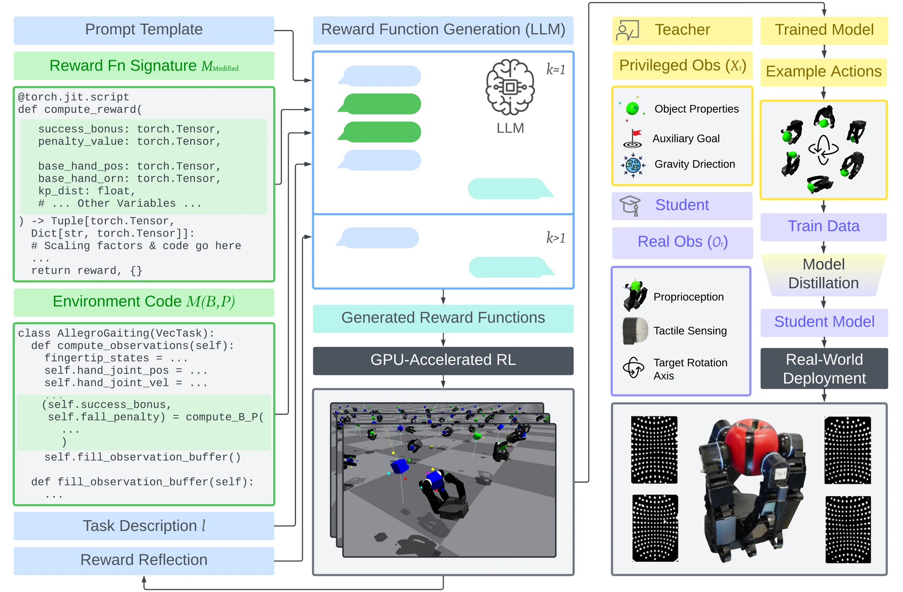

<!-- Generated by scripts/generate.py; edit data/works.json and data/media.json. -->

[← Back to the Awesome index](../../../README.md) · [Interactive website](https://chang-xinhai.github.io/Awesome-RGBDT-Manipulation/?collection=policy&item=text2touch#library)

# Text2Touch

Text2Touch: Tactile In-Hand Manipulation with LLM-Designed Reward Functions

**2025-09-09 · CoRL 2025 · University of Bristol / Bristol Robotics Laboratory**

**[Paper](https://arxiv.org/abs/2509.07445)** · [Project](https://hpfield.github.io/text2touch-website/) · [Code](https://github.com/hpfield/Text2Touch)

LLM-written rewards train tactile in-hand rotation policies through simulation and teacher–student transfer.

*Text2Touch: Tactile In-Hand Manipulation with LLM-Designed Reward Functions authors · [Figure source](https://arxiv.org/abs/2509.07445) · Original rights retained.*

| Field | Reported value and source scope |
| :-- | :-- |
| Record type | policy |
| Policy family | RL [1](https://arxiv.org/abs/2509.07445)  |
| Base model and architecture | Eureka-style iterative reward generation with five LLMs; sim-to-real tactile policy distillation. [1](https://arxiv.org/abs/2509.07445)  |
| Model size and component | Not reported [1](https://arxiv.org/abs/2509.07445)  |
| Deployment inputs | Deployed student: hand joint position/velocity and TacTip tactile observations; no runtime LLM required. [1](https://arxiv.org/abs/2509.07445)  |
| Action outputs and horizon | Dexterous hand joint commands for multi-axis object rotation. [1](https://arxiv.org/abs/2509.07445)  |
| Training method | LLM reward-code generation and selection followed by RL and privileged teacher–student distillation. [1](https://arxiv.org/abs/2509.07445)  |
| Training data | Reward search uses 150 million-step short runs; selected rewards receive 8 billion environment-step training;10 household objects in hardware evaluation. [1](https://arxiv.org/abs/2509.07445)  |
| Training duration | Desktop full 8 B-step policy~12 h; full reward-search experiment~24 h. P100 policy~3 days; search~4.5 days. [1](https://arxiv.org/abs/2509.07445)  |
| Training hardware | Desktop RTX4090or separate HPC single Tesla P100 jobs. [1](https://arxiv.org/abs/2509.07445)  |
| Inference and control rates | 20 Hz deployed hand control. [1](https://arxiv.org/abs/2509.07445)  |
| Evaluation scope | Allegro/TacTip palm-up and palm-down rotation across three axes. [1](https://arxiv.org/abs/2509.07445)  |
| Observations / modalities | Tactile · Proprioception |
| Evaluation domain | Simulation · Real world |
| Embodiment | Dexterous hand |
| Release: code | Available [2](https://hpfield.github.io/text2touch-website/) [3](https://github.com/hpfield/Text2Touch)  |
| Release: weights | Not verified [2](https://hpfield.github.io/text2touch-website/) [3](https://github.com/hpfield/Text2Touch)  |
| Release: data | Not verified [2](https://hpfield.github.io/text2touch-website/) [3](https://github.com/hpfield/Text2Touch)  |
| Release: license | MIT [2](https://hpfield.github.io/text2touch-website/) [3](https://github.com/hpfield/Text2Touch)  |
| Release: notes | Author-linked repository and actual LICENSE inspected; code, checkpoints anddatasets have independent availability. [2](https://hpfield.github.io/text2touch-website/) [3](https://github.com/hpfield/Text2Touch)  |

**Scope and qualifications**

- LLM designs training rewards; the deployed actor is a learned tactile controller, not a language-model action policy.
- Reward-search and final training costs are distinct runs/hardware settings.

**Primary evidence**

1. [Original paper and supplementary implementation details](https://arxiv.org/abs/2509.07445) — Primary full text reviewed; dataset, deployment modalities and training-only privileges are scoped separately.
2. [Official author project](https://hpfield.github.io/text2touch-website/) — Live project artifact links inspected on2026-10-17.
3. [Official released implementation and LICENSE](https://github.com/hpfield/Text2Touch) — Repository metadata,README and actualLICENSE inspected; availability scoped to the listed component.
