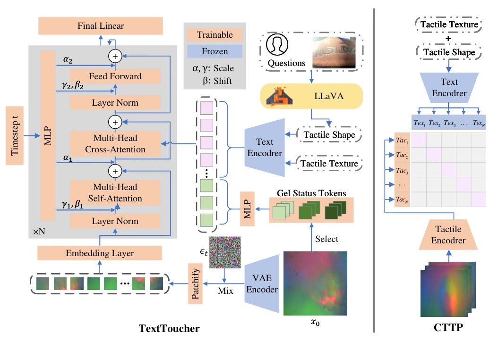

<!-- Generated by scripts/generate.py; edit data/works.json and data/media.json. -->

[← Back to the Awesome index](../../../README.md) · [Interactive website](https://chang-xinhai.github.io/Awesome-RGBDT-Manipulation/?collection=policy&item=texttoucher#library)

# TextToucher

TextToucher: Fine-Grained Text-to-Touch Generation

**2024-09-09 · AAAI 2025 · Zhejiang University; Yale University**

**[Paper](https://arxiv.org/abs/2409.05427)** · [Code](https://github.com/TtuHamg/TextToucher) · [Weights](https://drive.google.com/drive/folders/1207ia6VuSRlrQAVSoH3P5XJFSK7Kk8UK?usp=sharing)

Generates optical tactile images from fine-grained text descriptions of contact texture, shape and gel state.

*texttoucher authors; original paper figure · [Figure source](https://arxiv.org/html/2409.05427#Sx2.F2) · Original rights retained.*

| Field | Reported value and source scope |
| :-- | :-- |
| Record type | model |
| Model role and downstream interface | Reusable representation or perception model; downstream controllers are separate systems [1](https://arxiv.org/abs/2409.05427)  |
| Model family | Generative tactile model [1](https://arxiv.org/abs/2409.05427)  |
| Model architecture | PixArt-α diffusion-transformer backbone with dual-grain textual conditioning and gel-state embeddings [1](https://arxiv.org/abs/2409.05427)  |
| Model size and component | Not reported [1](https://arxiv.org/abs/2409.05427)  |
| Model inputs | Fine-grained language descriptions and tactile sensor/gel-state conditions [1](https://arxiv.org/abs/2409.05427)  |
| Model outputs | Synthetic tactile images [1](https://arxiv.org/abs/2409.05427)  |
| Training method | Text-conditioned diffusion using tactile shape/texture captions and learned gel-status representations [1](https://arxiv.org/abs/2409.05427)  |
| Training data and scale | HCT and SSVTP optical-touch data; LLaVA-v1.6-34B used for annotation, not robot control [1](https://arxiv.org/abs/2409.05427)  |
| Training duration | Generator: 200 epochs; auxiliary ViT-Tiny: 200 epochs. Wall-clock duration not reported. [1](https://arxiv.org/abs/2409.05427)  |
| Training hardware | Generator: 4 NVIDIA RTX 4090 24GB GPUs; auxiliary encoder: 1 RTX 4090 [1](https://arxiv.org/abs/2409.05427)  |
| Inference setting and runtime | 50 sampling steps with DPM-Solver for the reported generation evaluation [1](https://arxiv.org/abs/2409.05427)  |
| Downstream evaluation and scope | Text-to-touch generation fidelity, image/text alignment and tactile-specific image metrics. [1](https://arxiv.org/abs/2409.05427)  |
| Observations / modalities | Language |
| Evaluation domain | Real world |
| Embodiment |  |
| Release: code | Available [2](https://github.com/TtuHamg/TextToucher)  |
| Release: weights | Available — official download link [2](https://github.com/TtuHamg/TextToucher)  |
| Release: data | Not verified [2](https://github.com/TtuHamg/TextToucher)  |
| Release: license | Apache-2.0 repositoryLICENSE; PixArt/annotation/backbone and data terms remain separate [2](https://github.com/TtuHamg/TextToucher) [3](https://github.com/TtuHamg/TextToucher/blob/main/LICENSE)  |
| Release: notes | Code, pretrained encoders and downstream task data are separate artifacts; no policy checkpoint is implied by an encoder release. [2](https://github.com/TtuHamg/TextToucher)  |

**Scope and qualifications**

- Tactile images are generated targets; this model does not measure tactile contact at deployment or produce actions.
- Synthetic tactile imagery is not a validated replacement for measured force dynamics.

**Primary evidence**

1. [Original model paper and first submission](https://arxiv.org/abs/2409.05427) — Method, experiments and implementation sections; specifications retain component and evaluation scope.
2. [Official implementation and current release instructions](https://github.com/TtuHamg/TextToucher) — README and repository files inspected on 2026-10-17.
3. [Repository license file](https://github.com/TtuHamg/TextToucher/blob/main/LICENSE) — Applies to repository scope; model/data/base-model terms can differ.
