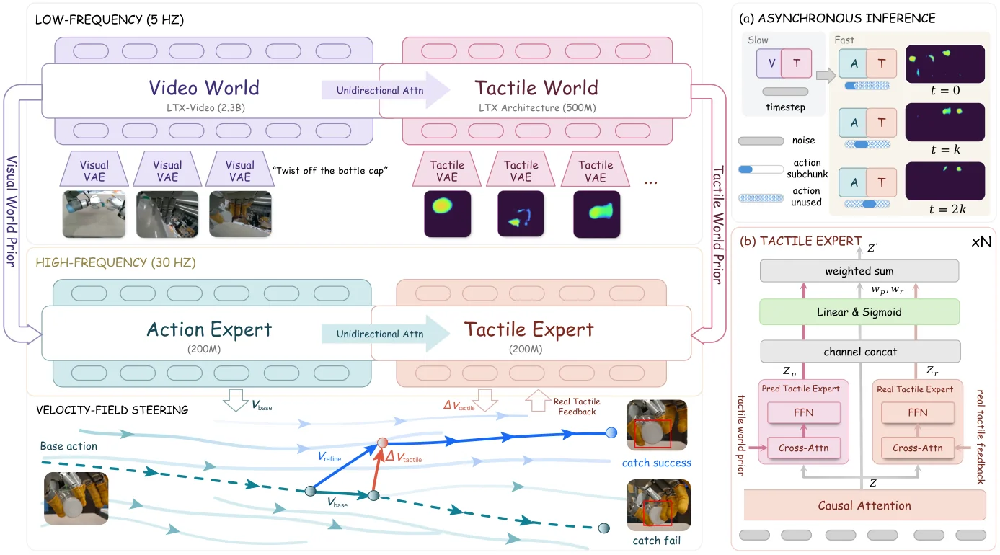

<!-- Generated by scripts/generate.py; edit data/works.json and data/media.json. -->

[← Back to the Awesome index](../../../README.md) · [Interactive website](https://chang-xinhai.github.io/Awesome-RGBDT-Manipulation/?collection=policy&item=tf2-steering#library)

# TF²-Steering

TF²-Steering: Action Refinement with Tactile Forecasts and Feedback via Velocity-Field Steering

**2026-11-01 · Preprint · Zhejiang University; Shanghai Innovation Institute; Westlake University; Fudan University**

**[Paper](https://arxiv.org/abs/2611.01483)** · [Project](https://yiming-cc.github.io/tf2-steering/)

Predicted tactile outcomes and tactile feedback steer a flow-based manipulation policy at inference time.

*TF²-Steering authors · [Figure source](https://arxiv.org/abs/2611.01483) · Original rights retained.*

| Field | Reported value and source scope |
| :-- | :-- |
| Record type | policy |
| Policy family | Visuotactile flow policy [1](https://arxiv.org/html/2611.01483v1)  |
| Base model and architecture | Flow-based expert policy [1](https://arxiv.org/html/2611.01483v1)  |
| Model size and component | Not reported [1](https://arxiv.org/html/2611.01483v1)  |
| Deployment inputs | Visual observations, tactile feedback and robot state [1](https://arxiv.org/html/2611.01483v1)  |
| Action outputs and horizon | Refined manipulation action velocities [1](https://arxiv.org/html/2611.01483v1)  |
| Training method | Tactile forecast and observed feedback steer the pretrained expert velocity field. [1](https://arxiv.org/html/2611.01483v1)  |
| Training data | See original paper for dataset and protocol. [1](https://arxiv.org/html/2611.01483v1)  |
| Training duration | Not reported [1](https://arxiv.org/html/2611.01483v1)  |
| Training hardware | Not reported [1](https://arxiv.org/html/2611.01483v1)  |
| Inference and control rates | Not reported [1](https://arxiv.org/html/2611.01483v1)  |
| Evaluation scope | Six simulated and six physical manipulation tasks. [1](https://arxiv.org/html/2611.01483v1)  |
| Observations / modalities | RGB · Tactile · Proprioception |
| Evaluation domain | Simulation · Real world |
| Embodiment | Not reported |
| Release: code | Not verified |
| Release: weights | Not verified |
| Release: data | Not verified |
| Release: license | Not verified |
| Release: notes | Release status checked against author artifacts on 2026-11-05. |

**Scope and qualifications**

- Tactile forecasting and measured tactile feedback play different roles in the inference procedure.

**Primary evidence**

1. [Original paper: method, inputs and evaluation](https://arxiv.org/html/2611.01483v1) — Results and sensing claims are scoped to the authors’ evaluation and deployment setting.
