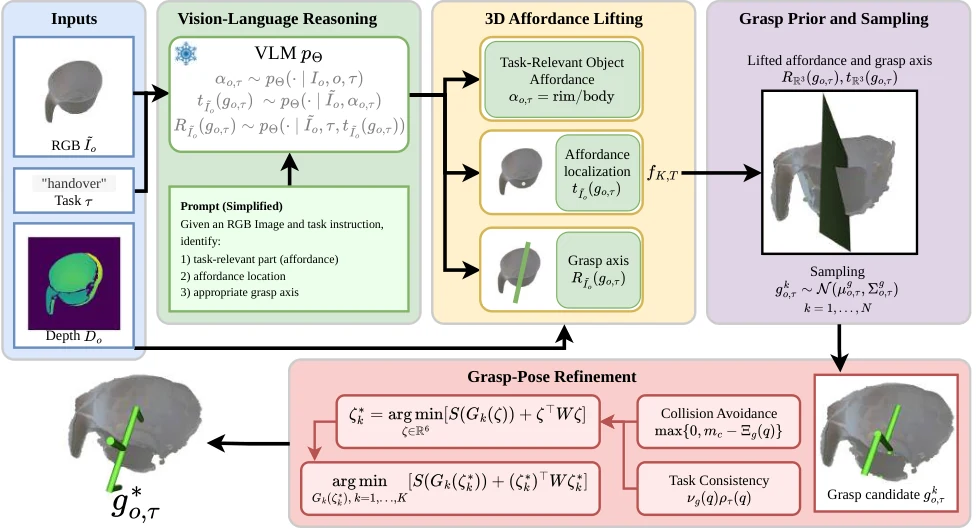

<!-- Generated by scripts/generate.py; edit data/works.json and data/media.json. -->

[← Back to the Awesome index](../../../README.md) · [Interactive website](https://chang-xinhai.github.io/Awesome-RGBDT-Manipulation/?collection=policy&item=tgrasp6d#library)

# TGrasp6D

TGrasp6D: Task-Informed Vision-Language Priors and Pose Refinement enable Zero-Shot Task-Oriented 6DoF Grasping

**2026-10-14 · Preprint · Purdue University**

**[Paper](https://arxiv.org/abs/2610.20901)**

A VLM identifies a task-relevant affordance/grasp axis in RGB, lifts it with depth, then refines six-degree-of-freedom grasps for collision avoidance.

*TGrasp6D authors; original rights retained · [Figure source](https://arxiv.org/abs/2610.20901) · Original rights retained.*

| Field | Reported value and source scope |
| :-- | :-- |
| Record type | model |
| Model role and downstream interface | Task-oriented 6-DoF grasp proposal/refinement model. [1](https://arxiv.org/html/2610.20901)  |
| Model family | Grasp synthesis [1](https://arxiv.org/html/2610.20901)  |
| Model architecture | Pretrained VLM semantic priors plus depth alignment and geometric pose optimization; GPT/Gemini/Qwen ablations separate. [1](https://arxiv.org/html/2610.20901)  |
| Model size and component | Not reported [1](https://arxiv.org/html/2610.20901)  |
| Model inputs | Task language and one RGB-D object observation. [1](https://arxiv.org/html/2610.20901)  |
| Model outputs | Collision-aware 6-DoF task-consistent grasp poses. [1](https://arxiv.org/html/2610.20901)  |
| Training method | No grasp-specific model training: image-space affordance/axis reasoning,3D lifting, proposal sampling and pose optimization. [1](https://arxiv.org/html/2610.20901)  |
| Training data and scale | TaskGrasp object-task pairs for evaluation; baseline retraining is separate from proposed method training. [1](https://arxiv.org/html/2610.20901)  |
| Training duration | Not reported [1](https://arxiv.org/html/2610.20901)  |
| Training hardware | Evaluation workstation RTX 5080 +20-core Intel Core i7; this includes separately retrained baselines. [1](https://arxiv.org/html/2610.20901)  |
| Inference setting and runtime | Not reported [1](https://arxiv.org/html/2610.20901)  |
| Downstream evaluation and scope | TaskGrasp and Franka FR3 real novel-object/task grasps. [1](https://arxiv.org/html/2610.20901)  |
| Observations / modalities | RGB · Depth · Language |
| Evaluation domain | Simulation · Real world |
| Embodiment | Parallel-jaw gripper |
| Release: code | Not verified |
| Release: weights | Not verified |
| Release: data | Not verified |
| Release: license | Not verified |
| Release: notes | The inspected primary sources do not establish a public implementation, model checkpoint or dataset download. Paper figures retain their original rights. |

**Scope and qualifications**

- Grasp synthesis is not itself a long-horizon coding agent or learned closed-loop VLA.
- TaskGrasp 94% success and physical execution are separate evaluation settings; throughput is not servo frequency.

**Primary evidence**

1. [Original full paper, methods and evaluation](https://arxiv.org/html/2610.20901) — Publication date is arXiv v1; implementation and deployment observations are distinguished from training supervision, generated geometry and base-model identity.
