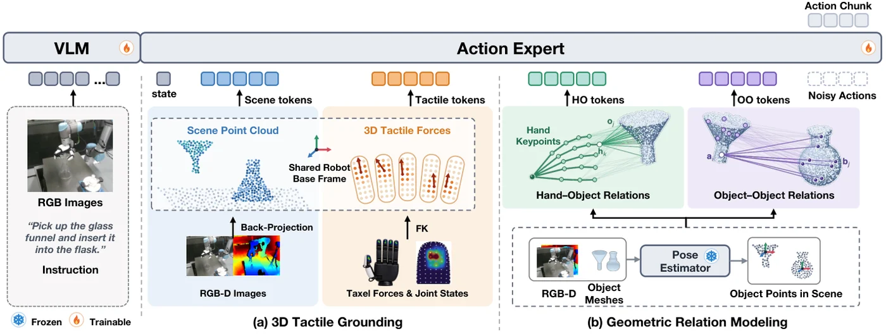

<!-- Generated by scripts/generate.py; edit data/works.json and data/media.json. -->

[← Back to the Awesome index](../../../README.md) · [Interactive website](https://chang-xinhai.github.io/Awesome-RGBDT-Manipulation/?collection=policy&item=three-d-touch#library)

# 3DTouch

3DTouch: A Tactile-aware VLA Model with 3D Geometric Relations for Dexterous Manipulation

**2026-11-18 · Preprint · University of Science and Technology of China**

**[Paper](https://arxiv.org/abs/2611.23961)**

Grounds measured RGB-D scene points and dense fingertip force in one robot-base coordinate frame before VLA action generation.

*3DTouch authors · [Figure source](https://arxiv.org/html/2611.23961v1) · Original rights retained.*

| Field | Reported value and source scope |
| :-- | :-- |
| Record type | policy |
| Policy family | Geometry- and tactile-conditioned VLA [1](https://arxiv.org/html/2611.23961)  |
| Base model and architecture | π0 [1](https://arxiv.org/html/2611.23961)  |
| Model size and component | Not reported [1](https://arxiv.org/html/2611.23961)  |
| Deployment inputs | Front RGB and calibrated metric RGB-D scene points; measured three-axis tactile observations from 600 taxels per XHand, plus robot state and instruction. [1](https://arxiv.org/html/2611.23961)  |
| Action outputs and horizon | 18-dimensional joint actions for arm and hand; executes 16 steps per inference. [1](https://arxiv.org/html/2611.23961)  |
| Training method | Fine-tunes the action model with scene, per-finger tactile and explicit geometric relation tokens. [1](https://arxiv.org/html/2611.23961)  |
| Training data | About 100 physical demonstrations per task on five tasks. [1](https://arxiv.org/html/2611.23961)  |
| Training duration | Not reported [1](https://arxiv.org/html/2611.23961)  |
| Training hardware | Not reported [1](https://arxiv.org/html/2611.23961)  |
| Inference and control rates | Not reported [1](https://arxiv.org/html/2611.23961)  |
| Evaluation scope | Funnel insertion, plug assembly, button press, sponge wiping and pipette press. Authors report +42 percentage points over the paired visual VLA baseline. [1](https://arxiv.org/html/2611.23961)  |
| Observations / modalities | RGB · Depth · Tactile · Force · Proprioception · Language |
| Evaluation domain | Real world |
| Embodiment | UR7e + XHand |
| Release: code | Not verified |
| Release: weights | Not verified |
| Release: data | Not verified |
| Release: license | Not verified |
| Release: notes | Primary paper reports real-robot rollouts and training. Downloadable model, dataset and executable artifact were not verified. |

**Scope and qualifications**

- Calibrated RGB-D is explicitly used at deployment; object surfaces and hand/object relations are computed from observations.
- The XHand reports three-axis force at 600 tactile taxels. The action space and tactile readout are separately sized.
- The shared robot-frame representation receives both depth-derived scene points and actual tactile force vectors for action prediction.

**Primary evidence**

1. [Primary paper and evaluated setting](https://arxiv.org/html/2611.23961)
