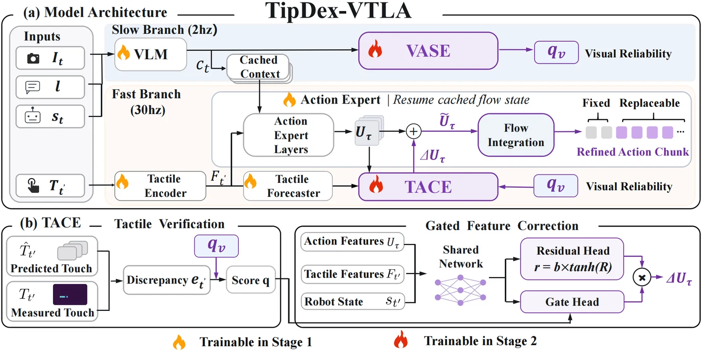

<!-- Generated by scripts/generate.py; edit data/works.json and data/media.json. -->

[← Back to the Awesome index](../../../README.md) · [Interactive website](https://chang-xinhai.github.io/Awesome-RGBDT-Manipulation/?collection=policy&item=tipdex-vtla#library)

# TipDex-VTLA

TipDex-VTLA: Learning When to Refine Actions with Touch for Dexterous Manipulation

**2026-11-19 · Preprint · Wuhan University and Wuhan Huaweike Intelligent Technology**

**[Paper](https://arxiv.org/abs/2611.25683)**

Forecasts touch and estimates action sensitivity to lighting, then gates corrections on unexecuted actions when observed contact disagrees with the forecast.

*Xudi Ge and coauthors · [Figure source](https://arxiv.org/html/2611.25683v1) · Original rights retained.*

| Field | Reported value and source scope |
| :-- | :-- |
| Record type | policy |
| Policy family | Vision–tactile–language–action [1](https://arxiv.org/html/2611.25683v1)  |
| Base model and architecture | Slow/fast action model, VASE reliability head and TACE correction module. [1](https://arxiv.org/html/2611.25683v1)  |
| Model size and component | Not reported [1](https://arxiv.org/html/2611.25683v1)  |
| Deployment inputs | Overhead and wrist RGB, joint feedback, tactile arrays and instruction. Each hand has 364 taxels across eight arrays. [1](https://arxiv.org/html/2611.25683v1)  |
| Action outputs and horizon | Action chunks with bounded feature corrections for unexecuted actions. [1](https://arxiv.org/html/2611.25683v1)  |
| Training method | Train action backbone and tactile forecasting, then freeze those modules and train visual reliability and correction gates on paired lighting perturbations. [1](https://arxiv.org/html/2611.25683v1)  |
| Training data | 300 physical demonstrations, 200 for the backbone and 100 for Stage 2, whose trajectories are paired with perturbed-illumination copies. [1](https://arxiv.org/html/2611.25683v1)  |
| Training duration | Not reported [1](https://arxiv.org/html/2611.25683v1)  |
| Training hardware | Eight NVIDIA A100 GPUs in each training stage. [1](https://arxiv.org/html/2611.25683v1)  |
| Inference and control rates | Tactile sampling at 30 Hz; this is not the action dispatch rate. [1](https://arxiv.org/html/2611.25683v1)  |
| Evaluation scope | Egg transfer, grape picking, tissue and bean manipulation plus UniVTAC simulation. Real trials: mean full-task success 87.5% under normal lighting and 73.8% on the paper’s unseen-light condition. [1](https://arxiv.org/html/2611.25683v1)  |
| Observations / modalities | RGB · Tactile · Proprioception · Language |
| Evaluation domain | Simulation · Real world |
| Embodiment | RealMan RM75 · Inspire RH56F2-E2-T1 |
| Release: code | Announced by authors; official source not verified |
| Release: weights | Not verified |
| Release: data | Announced by authors; downloadable rollout set not verified |
| Release: license | Not verified |
| Release: notes | Code and demonstration availability were announced in the paper. |

**Scope and qualifications**

- RealSense devices supply RGB in the described policy configuration. Their availability does not establish measured depth input.

**Primary evidence**

1. [Original author paper or dataset description](https://arxiv.org/html/2611.25683v1)
