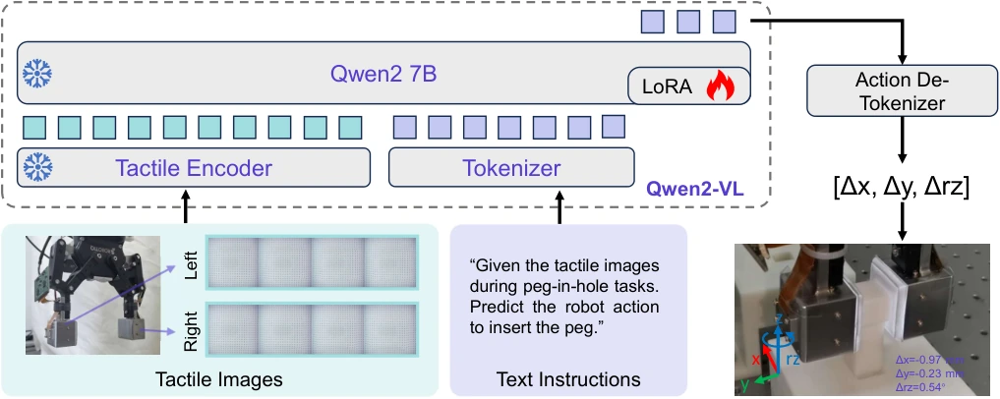

<!-- Generated by scripts/generate.py; edit data/works.json and data/media.json. -->

[← Back to the Awesome index](../../../README.md) · [Interactive website](https://chang-xinhai.github.io/Awesome-RGBDT-Manipulation/?collection=policy&item=tla#library)

# TLA

TLA: Tactile-Language-Action Model for Contact-Rich Manipulation

**2025-03-11 · Robot Learning 2026 · Institute of Automation, Chinese Academy of Sciences / Samsung Research China–Beijing / Beijing Academy of Artificial Intelligence (arXiv); Xiaomi EV replaces BAAI affiliation in journal version.**

**[Paper](https://arxiv.org/abs/2503.08548)** · [Project](https://sites.google.com/view/tactile-language-action/) · [Journal](https://doi.org/10.55092/rl20260001)

Tactile image histories and language condition corrective insertion actions through a Qwen2-VL language model.

*TLA: Tactile-Language-Action Model for Contact-Rich Manipulation authors · [Figure source](https://arxiv.org/abs/2503.08548) · Original rights retained.*

| Field | Reported value and source scope |
| :-- | :-- |
| Record type | policy |
| Policy family | VLA [1](https://arxiv.org/abs/2503.08548)  |
| Base model and architecture | Qwen2-VL / Qwen2-7B, frozen ViT tactile encoder and LoRA language-model adaptation. [1](https://arxiv.org/abs/2503.08548)  |
| Model size and component | 7B backbone; adapter and total trainable parameter counts Not reported. [1](https://arxiv.org/abs/2503.08548)  |
| Deployment inputs | Four frames from each of two GelStereo 2.0 fingertips, arranged into one image, plus a text instruction; no external scene RGB or depth. [1](https://arxiv.org/abs/2503.08548)  |
| Action outputs and horizon | Corrective horizontal translation and yaw: Δx, Δy, Δrz, decoded from numeric text. [1](https://arxiv.org/abs/2503.08548)  |
| Training method | Next-token supervised fine-tuning with frozen tactile encoder and LoRA language-model updates; action labels derived from simulated peg-hole pose errors. [1](https://arxiv.org/abs/2503.08548)  |
| Training data | 24k simulated tactile-action instruction samples at 2.0 mm clearance. Single-peg study uses 6k train / 2k test; multi-peg uses 16k train and a separate 8k test set. These are sample counts, not robot episodes. [1](https://arxiv.org/abs/2503.08548)  |
| Training duration | Journal §5.2: single-peg 10 epochs / 1.6 h; multi-peg 10 epochs / 4.4 h. ArXiv v1 instead gives 20 epochs for single-peg. [1](https://arxiv.org/abs/2503.08548) [3](https://pdf.elspublishing.com/paper/journal/open/RL/2026/rl20260001.pdf)  |
| Training hardware | 8 NVIDIA A6000 GPUs. [1](https://arxiv.org/abs/2503.08548)  |
| Inference and control rates | Attempt-based corrective control; physical policy Hz Not reported; maximum 15 insertion attempts per episode. [1](https://arxiv.org/abs/2503.08548)  |
| Evaluation scope | Isaac Gym / Flex-FEM insertion across shapes and clearances; version Not reported. Journal §5.4 adds UR3 with Robotiq-85 and two GelStereo 2.0 sensors, 20 trials per setting; real square-peg success falls from 80% at 2.0 mm to 55% at 1.0 mm. [1](https://arxiv.org/abs/2503.08548) [3](https://pdf.elspublishing.com/paper/journal/open/RL/2026/rl20260001.pdf)  |
| Observations / modalities | Tactile · Language |
| Evaluation domain | Simulation · Real world |
| Embodiment | Parallel-jaw gripper |
| Release: code | Not verified [2](https://sites.google.com/view/tactile-language-action/)  |
| Release: weights | Not verified [2](https://sites.google.com/view/tactile-language-action/)  |
| Release: data | Not verified [2](https://sites.google.com/view/tactile-language-action/) [3](https://pdf.elspublishing.com/paper/journal/open/RL/2026/rl20260001.pdf)  |
| Release: license | Not verified [2](https://sites.google.com/view/tactile-language-action/)  |
| Release: notes | No retrievable official policy code/checkpoint/data release was verified. [2](https://sites.google.com/view/tactile-language-action/)  |

**Scope and qualifications**

- ArXiv v1 reports simulation and leaves real deployment to future work; the 2026 journal version adds real experiments and revises single-peg training details.
- The journal data availability statement offers data on reasonable request; a downloadable public release was not verified despite the original abstract release claim.
- The gripper already holds the peg near its target; evaluation concerns tactile correction, not autonomous perception and grasp acquisition.

**Primary evidence**

1. [Original paper and reviewed full text](https://arxiv.org/abs/2503.08548) — Full primary text, including available supplementary implementation details; first public date retained separately from reviewed revision.
2. [Official author project](https://sites.google.com/view/tactile-language-action/) — Current project links and release claims checked independently of paper prose.
3. [Published journal extension, §§5.2–5.4 and data availability](https://pdf.elspublishing.com/paper/journal/open/RL/2026/rl20260001.pdf) — Published 2026-01-07; reviewed training resources and new real-world experiments separately from arXiv v1.
