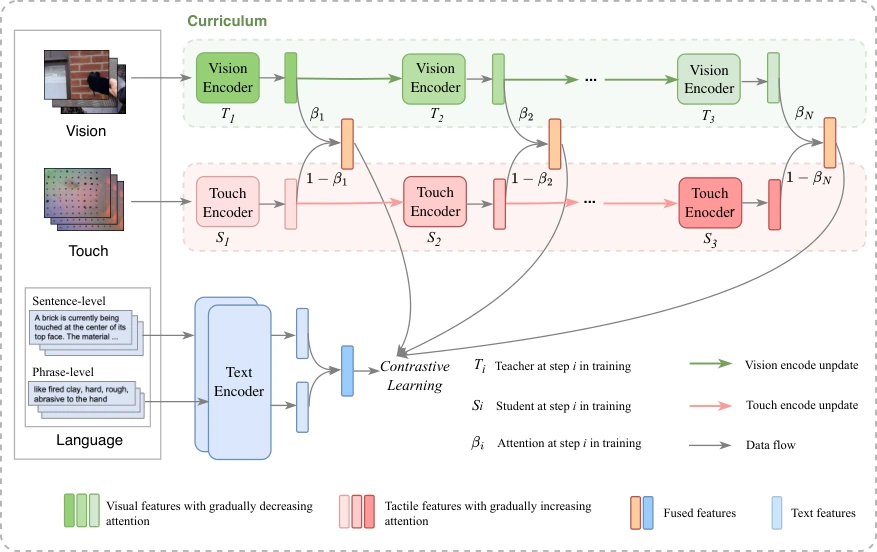

<!-- Generated by scripts/generate.py; edit data/works.json and data/media.json. -->

[← Back to the Awesome index](../../../README.md) · [Interactive website](https://chang-xinhai.github.io/Awesome-RGBDT-Manipulation/?collection=policy&item=tlv-link#library)

# TLV-Link / Touch100k

Touch100k: A Large-Scale Touch-Language-Vision Dataset for Touch-Centric Multimodal Representation

**2024-06-06 · Information Fusion 2025 · Beijing Jiaotong University; WeChat AI, Tencent**

**[Paper](https://arxiv.org/abs/2406.03813)** · [Project](https://cocacola-lab.github.io/Touch100k/) · [Code](https://github.com/cocacola-lab/TLV-Link) · [Data](https://drive.google.com/drive/folders/1QOvbkIZtpJpz4Ry_Zg3ouXX-zLJNqu9m?usp=sharing)

Uses curriculum linking between touch, multigranular language and vision, accompanying the Touch100k tactile description dataset.

*tlv-link authors; original paper figure · [Figure source](https://arxiv.org/html/2406.03813#S3.F2) · Original rights retained.*

| Field | Reported value and source scope |
| :-- | :-- |
| Record type | model |
| Model role and downstream interface | Reusable representation or perception model; downstream controllers are separate systems [1](https://arxiv.org/abs/2406.03813)  |
| Model family | Multimodal representation [1](https://arxiv.org/abs/2406.03813)  |
| Model architecture | CLIP-style image/touch branches and frozen text encoder; sentence- then phrase-level curriculum [1](https://arxiv.org/abs/2406.03813)  |
| Model size and component | Not reported [1](https://arxiv.org/abs/2406.03813)  |
| Model inputs | GelSight tactile image; paired RGB and sentence/phrase tactile descriptions during training [1](https://arxiv.org/abs/2406.03813)  |
| Model outputs | Shared tactile/visual/language embedding for retrieval and property/grasp recognition [1](https://arxiv.org/abs/2406.03813)  |
| Training method | Two-stage curriculum linking from sentence-level semantics to phrase-level tactile detail [1](https://arxiv.org/abs/2406.03813)  |
| Training data and scale | Touch100k: paired touch–language–vision samples at approximately 100K scale, with sentence- and phrase-level annotations. [1](https://arxiv.org/abs/2406.03813)  |
| Training duration | 12 epochs; wall-clock duration not reported [1](https://arxiv.org/abs/2406.03813)  |
| Training hardware | 2 NVIDIA A40 GPUs; batch size 96 [1](https://arxiv.org/abs/2406.03813)  |
| Inference setting and runtime | Not reported [1](https://arxiv.org/abs/2406.03813)  |
| Downstream evaluation and scope | Material/property recognition and grasp-success classification; zero-shot tactile understanding and data-scale ablations. [1](https://arxiv.org/abs/2406.03813)  |
| Observations / modalities | Tactile · RGB · Language |
| Evaluation domain | Real world |
| Embodiment |  |
| Release: code | Available — training, evaluation and model source present in the official repository [2](https://cocacola-lab.github.io/Touch100k/) [3](https://github.com/cocacola-lab/TLV-Link)  |
| Release: weights | Not verified [2](https://cocacola-lab.github.io/Touch100k/) [3](https://github.com/cocacola-lab/TLV-Link)  |
| Release: data | Available — official resource link [2](https://cocacola-lab.github.io/Touch100k/) [3](https://github.com/cocacola-lab/TLV-Link)  |
| Release: license | MIT code LICENSE; the official README states Touch100k CC BY-NC 4.0 and research-only use of models trained on that data. [2](https://cocacola-lab.github.io/Touch100k/) [3](https://github.com/cocacola-lab/TLV-Link) [4](https://github.com/cocacola-lab/TLV-Link/blob/main/LICENSE)  |
| Release: notes | Code, pretrained encoders and downstream task data are separate artifacts; no policy checkpoint is implied by an encoder release. [2](https://cocacola-lab.github.io/Touch100k/) [3](https://github.com/cocacola-lab/TLV-Link)  |

**Scope and qualifications**

- Touch100k counts multimodal samples, rather than 100K independent robot demonstrations.
- Code and dataset terms differ; the official data notice limits downstream models trained on Touch100k to research use.

**Primary evidence**

1. [Original model paper and first submission](https://arxiv.org/abs/2406.03813) — Method, experiments and implementation sections; specifications retain component and evaluation scope.
2. [Official project](https://cocacola-lab.github.io/Touch100k/) — Author project; author-reported release scope is distinguished from an executed reproduction.
3. [Official implementation and current release instructions](https://github.com/cocacola-lab/TLV-Link) — README and repository files inspected on 2026-10-17.
4. [Repository license file](https://github.com/cocacola-lab/TLV-Link/blob/main/LICENSE) — Applies to repository scope; model/data/base-model terms can differ.
