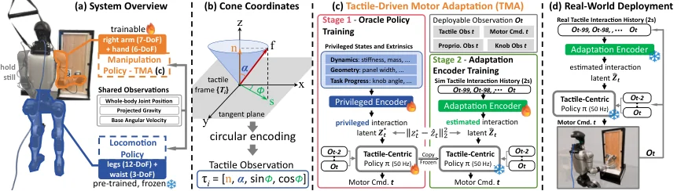

<!-- Generated by scripts/generate.py; edit data/works.json and data/media.json. -->

[← Back to the Awesome index](../../../README.md) · [Interactive website](https://chang-xinhai.github.io/Awesome-RGBDT-Manipulation/?collection=policy&item=tma#library)

# TMA

TMA: Sim-to-Real Forceful Humanoid Manipulation via Tactile-Driven Motor Adaptation

**2026-11-13 · Preprint · Amazon, Rice University and collaborating universities**

**[Paper](https://arxiv.org/abs/2611.18976)** · [Project](https://humanoid-tma.github.io/)

Transfers tactile-driven round-doorknob manipulation from simulation to a humanoid by jointly coordinating hand motion and whole-body stabilization.

*Yiting Chen and coauthors · [Figure source](https://arxiv.org/html/2611.18976v1) · Original rights retained.*

| Field | Reported value and source scope |
| :-- | :-- |
| Record type | policy |
| Policy family | Sim-to-real tactile reinforcement learning [1](https://arxiv.org/html/2611.18976v1)  |
| Base model and architecture | Privileged PPO teacher, tactile-history adaptation encoder and frozen general locomotion controller. [1](https://arxiv.org/html/2611.18976v1)  |
| Model size and component | Not reported [1](https://arxiv.org/html/2611.18976v1)  |
| Deployment inputs | Deployable joint/body observations and multi-finger tactile contact histories. Door properties used by the training teacher are privileged. [1](https://arxiv.org/html/2611.18976v1)  |
| Action outputs and horizon | Upper-body joint targets for arm and hand; separate balance controller stabilizes leg and waist joints. [1](https://arxiv.org/html/2611.18976v1)  |
| Training method | Train a clean-observation oracle, fine-tune with observation noise, then fit a temporal adapter to latent privileged feedback. [1](https://arxiv.org/html/2611.18976v1)  |
| Training data | Procedurally randomized articulated door simulation, with fixed real-world no-fine-tuning evaluation. [1](https://arxiv.org/html/2611.18976v1)  |
| Training duration | Not reported [1](https://arxiv.org/html/2611.18976v1)  |
| Training hardware | Not reported [1](https://arxiv.org/html/2611.18976v1)  |
| Inference and control rates | Simulation physics 200 Hz and policy control 50 Hz; hardware timing follows the paper setup. [1](https://arxiv.org/html/2611.18976v1)  |
| Evaluation scope | Zero-shot real transfer evaluated on four commercial round doorknobs, compared with RMA and reactive tactile baselines. [1](https://arxiv.org/html/2611.18976v1)  |
| Observations / modalities | Tactile · Proprioception |
| Evaluation domain | Simulation · Real world |
| Embodiment | Unitree G1 Edu · BrainCo Revo2 |
| Release: code | Not verified [2](https://humanoid-tma.github.io/)  |
| Release: weights | Not verified [2](https://humanoid-tma.github.io/)  |
| Release: data | Not verified [2](https://humanoid-tma.github.io/)  |
| Release: license | Not verified [2](https://humanoid-tma.github.io/)  |
| Release: notes | Author project shows videos; implementation and weights were not identified. [2](https://humanoid-tma.github.io/)  |

**Scope and qualifications**

- Adaptation is through tactile-conditioned latent inference during operation; the deployed system does not update model weights.

**Primary evidence**

1. [Original author paper or dataset description](https://arxiv.org/html/2611.18976v1)
2. [Author source and artifact entry points](https://humanoid-tma.github.io/)
