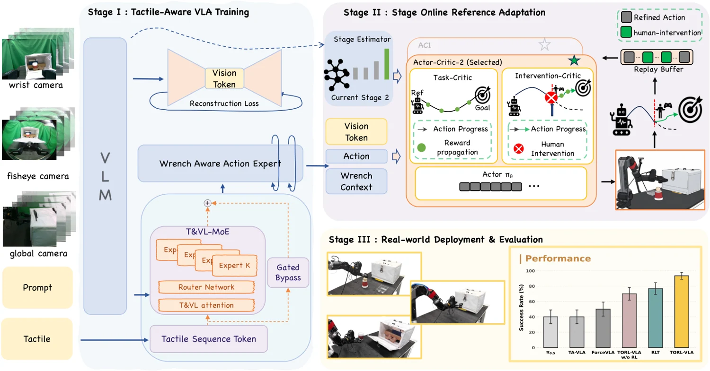

<!-- Generated by scripts/generate.py; edit data/works.json and data/media.json. -->

[← Back to the Awesome index](../../../README.md) · [Interactive website](https://chang-xinhai.github.io/Awesome-RGBDT-Manipulation/?collection=policy&item=torl-vla#library)

# TORL-VLA

TORL-VLA: Tactile Guided Online Reinforcement Learning for Contact-Rich Manipulation

**2026-06-08 · Preprint · Meituan**

**[Paper](https://arxiv.org/abs/2606.09337)** · [Project](https://torl-vla.github.io/)

Refines a frozen tactile-wrench-aware VLA online using stage-wise RL and an intervention-censored critic.

*TORL-VLA authors · [Figure source](https://arxiv.org/html/2606.09337) · Original rights retained.*

| Field | Reported value and source scope |
| :-- | :-- |
| Record type | policy |
| Policy family | Hybrid [1](https://arxiv.org/abs/2606.09337)  |
| Base model and architecture | Wrench-aware VLA plus lightweight online actor–critic [1](https://arxiv.org/abs/2606.09337) [3](https://arxiv.org/html/2606.09337)  |
| Model size and component | Not reported [1](https://arxiv.org/abs/2606.09337) [3](https://arxiv.org/html/2606.09337)  |
| Deployment inputs | Three RGB views, state, instruction and tactile-derived 12D wrench history [1](https://arxiv.org/abs/2606.09337) [3](https://arxiv.org/html/2606.09337)  |
| Action outputs and horizon | 50-step action/wrench references; refines and executes first 10 actions [1](https://arxiv.org/abs/2606.09337) [3](https://arxiv.org/html/2606.09337)  |
| Training method | Supervised action/wrench prediction followed by online RL from autonomous and human-intervention data [1](https://arxiv.org/abs/2606.09337) [3](https://arxiv.org/html/2606.09337)  |
| Training data | Not reported [1](https://arxiv.org/abs/2606.09337) [3](https://arxiv.org/html/2606.09337)  |
| Training duration | Not reported [1](https://arxiv.org/abs/2606.09337) [3](https://arxiv.org/html/2606.09337)  |
| Training hardware | Not reported [1](https://arxiv.org/abs/2606.09337) [3](https://arxiv.org/html/2606.09337)  |
| Inference and control rates | 20 Hz commands; 0.5 s replanning interval; inference timing measured separately on RTX 4090 [1](https://arxiv.org/abs/2606.09337) [3](https://arxiv.org/html/2606.09337)  |
| Evaluation scope | Long-horizon latch manipulation, coffee-cup placement and egg handling [1](https://arxiv.org/abs/2606.09337) [3](https://arxiv.org/html/2606.09337)  |
| Observations / modalities | RGB · Tactile · Force/Torque · Proprioception · Language |
| Evaluation domain | Real world |
| Embodiment | Parallel-jaw gripper |
| Release: code | Not verified [2](https://torl-vla.github.io/)  |
| Release: weights | Not verified [2](https://torl-vla.github.io/)  |
| Release: data | Not verified [2](https://torl-vla.github.io/)  |
| Release: license | Not verified [2](https://torl-vla.github.io/)  |
| Release: notes | No verified public download found in the inspected primary sources. [2](https://torl-vla.github.io/)  |

**Scope and qualifications**

- Deployment uses tactile-derived wrench summaries rather than raw tactile images.
- Human interventions and real interaction are additional training resources.

**Primary evidence**

1. [Author manuscript and submission history](https://arxiv.org/abs/2606.09337) — Policy facts refer to the full manuscript available on the verification date; date is first arXiv submission.
2. [Author project page](https://torl-vla.github.io/) — Release status is checked separately from paper claims; a project page alone does not imply released implementation or weights.
3. [Full paper: method and implementation details](https://arxiv.org/html/2606.09337) — Unreported specifications remain explicitly unknown; hardware/rates are scoped to training, inference or low-level control.
