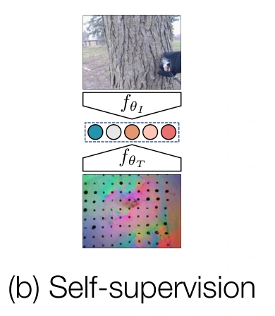

<!-- Generated by scripts/generate.py; edit data/works.json and data/media.json. -->

[← Back to the Awesome index](../../../README.md) · [Interactive website](https://chang-xinhai.github.io/Awesome-RGBDT-Manipulation/?collection=policy&item=touch-and-go#library)

# Touch and Go

Touch and Go: Learning from Human-Collected Vision and Touch

**2022-11-22 · NeurIPS 2022 Datasets and Benchmarks · University of Michigan; Carnegie Mellon University**

**[Paper](https://arxiv.org/abs/2211.12498)** · [Project](https://touch-and-go.github.io/) · [Code](https://github.com/fredfyyang/Touch-and-Go) · [Data](https://drive.google.com/drive/folders/1NDasyshDCL9aaQzxjn_-Q5MBURRT360B)

Human-collected RGB/GelSight data trains cross-modal contrastive encoders evaluated through frozen-feature perception transfer.

*Fengyu Yang, Chenyang Ma, Jiacheng Zhang, Jing Zhu, Wenzhen Yuan and Andrew Owens (CC BY 4.0) · [Figure source](https://arxiv.org/html/2211.12498v2#S0.F1) · Original rights retained.*

| Field | Reported value and source scope |
| :-- | :-- |
| Record type | model |
| Model role and downstream interface | Transferable visual-tactile contrastive encoders with supporting human-touch corpus [1](https://arxiv.org/abs/2211.12498)  |
| Model family | Multimodal representation [1](https://arxiv.org/abs/2211.12498)  |
| Model architecture | Separate ResNet-18/ResNet-50 encoders with Contrastive Multiview Coding (CMC). [1](https://arxiv.org/abs/2211.12498) [3](https://github.com/fredfyyang/Touch-and-Go/blob/main/Visuo-tactile%20contrastive%20learning/README.md)  |
| Model size and component | Not reported; backbone variants are identified without assigning an unreported complete parameter count. [1](https://arxiv.org/abs/2211.12498)  |
| Model inputs | Paired RGB and GelSight images during contrastive pretraining; tactile images for frozen-feature downstream classifiers. [1](https://arxiv.org/abs/2211.12498)  |
| Model outputs | Normalized visual/tactile embeddings; linear heads predict material properties and grasp outcomes. [1](https://arxiv.org/abs/2211.12498)  |
| Training method | Bidirectional paired-versus-mismatched contrastive learning; frozen backbones and 60-epoch linear probes. [1](https://arxiv.org/abs/2211.12498)  |
| Training data and scale | Touch and Go: approximately 246K paired frames, 13.9K touches, 20 materials and an extrapolated 3,971 objects. The representation experiment separates 5,172 unlabeled pretraining touches from labeled evaluation splits. [1](https://arxiv.org/abs/2211.12498) [2](https://touch-and-go.github.io/)  |
| Training duration | 240 pretraining epochs; wall-clock duration not reported. [1](https://arxiv.org/abs/2211.12498)  |
| Training hardware | Four NVIDIA RTX 2080 Ti GPUs in the manuscript; released example scripts select two devices. [1](https://arxiv.org/abs/2211.12498)  |
| Inference setting and runtime | No robot action frequency reported; inference is encoder/classifier evaluation. [1](https://arxiv.org/abs/2211.12498)  |
| Downstream evaluation and scope | Offline transfer to Feeling of Success grasp-outcome prediction and material/hardness/roughness classification; separate stylization and future-touch prediction demonstrations. [1](https://arxiv.org/abs/2211.12498)  |
| Observations / modalities | RGB · Tactile |
| Evaluation domain | Real-world recordings |
| Embodiment |  |
| Release: code | Available [3](https://github.com/fredfyyang/Touch-and-Go/blob/main/Visuo-tactile%20contrastive%20learning/README.md)  |
| Release: weights | Not released [3](https://github.com/fredfyyang/Touch-and-Go/blob/main/Visuo-tactile%20contrastive%20learning/README.md)  |
| Release: data | Available [2](https://touch-and-go.github.io/) [5](https://drive.google.com/drive/folders/1NDasyshDCL9aaQzxjn_-Q5MBURRT360B)  |
| Release: license | BSD-2-Clause-style terms for visuo-tactile CMC code; CC BY 4.0 dataset/project; separate upstream stylization components retain their own licenses [2](https://touch-and-go.github.io/) [4](https://github.com/fredfyyang/Touch-and-Go/blob/main/Visuo-tactile%20contrastive%20learning/LICENSE)  |
| Release: notes | Actual encoder training/linear-probing code exists. Encoder README still marks pretrained models unreleased; no checkpoint files or download found. Public data directory lists dataset/, category_reference.txt, extract_frame.py and label.txt. Future-prediction implementation was not identified in the released tree. |

**Scope and qualifications**

- This record describes a pretrained representation and corpus; it does not introduce an executable robot policy.
- Grasp-outcome accuracy uses held-out recorded grasps, and does not establish closed-loop grasp control.
- Object-instance count is extrapolated from a sample of videos rather than exhaustively annotated.

**Primary evidence**

1. [Original manuscript and submission history](https://arxiv.org/abs/2211.12498) — Sections 4.1/5.1 and Appendix E verify contrastive learning, encoder transfer, splits and compute. Grasp-outcome prediction is offline classification, not action execution.
2. [Official project, corpus interface and licensing](https://touch-and-go.github.io/) — Project links the original public corpus; source datasheet distinguishes frames, touches and extrapolated objects.
3. [Released encoder scope and checkpoint status](https://github.com/fredfyyang/Touch-and-Go/blob/main/Visuo-tactile%20contrastive%20learning/README.md) — Actual CMC training/evaluation files and ResNet-18/50 scripts verified; pretrained-model checkbox remains unchecked.
4. [Encoder implementation license](https://github.com/fredfyyang/Touch-and-Go/blob/main/Visuo-tactile%20contrastive%20learning/LICENSE) — Two redistribution conditions inspected; stylization subdirectory includes multiple upstream licenses.
5. [Actual public data file listing](https://drive.google.com/drive/folders/1NDasyshDCL9aaQzxjn_-Q5MBURRT360B) — Anonymous directory listing inspected, not only a download link or author release claim.
