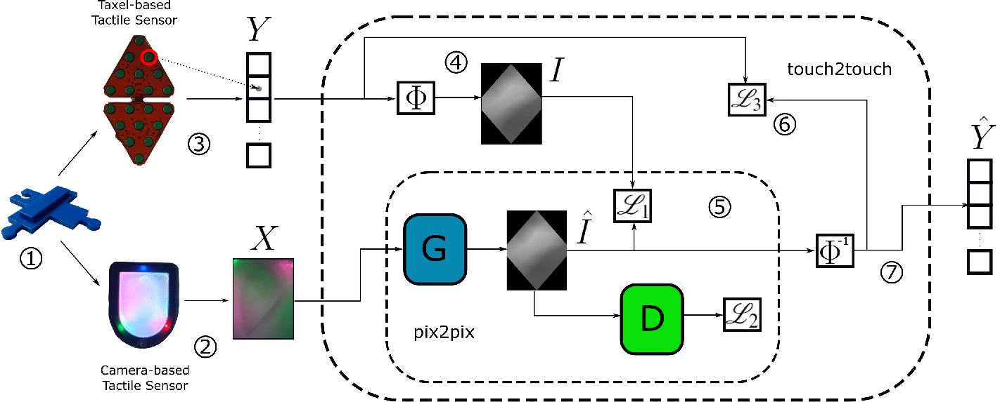

<!-- Generated by scripts/generate.py; edit data/works.json and data/media.json. -->

[← Back to the Awesome index](../../../README.md) · [Interactive website](https://chang-xinhai.github.io/Awesome-RGBDT-Manipulation/?collection=policy&item=touch-to-touch-translation#library)

# Touch-to-Touch Translation / touch2touch

Touch-to-Touch Translation -- Learning the Mapping Between Heterogeneous Tactile Sensing Technologies

**2024-11-04 · Preprint · University of Genoa; Oxford Robotics Institute, University of Oxford**

**[Paper](https://arxiv.org/abs/2411.02187)**

Maps opticalDIGIT observations to capacitiveCySkin responses using paired contacts across sensing technologies.

*touch-to-touch-translation authors; original paper figure · [Figure source](https://arxiv.org/html/2411.02187#S1.F1) · Original rights retained.*

| Field | Reported value and source scope |
| :-- | :-- |
| Record type | model |
| Model role and downstream interface | Reusable representation or perception model; downstream controllers are separate systems [1](https://arxiv.org/abs/2411.02187)  |
| Model family | Generative tactile model [1](https://arxiv.org/abs/2411.02187)  |
| Model architecture | Adapted pix2pix image-to-image model compared with ResNet-18 regression [1](https://arxiv.org/abs/2411.02187)  |
| Model size and component | Not reported [1](https://arxiv.org/abs/2411.02187)  |
| Model inputs | DIGIT optical tactile image [1](https://arxiv.org/abs/2411.02187)  |
| Model outputs | Predicted CySkin capacitive taxel-response vector or map [1](https://arxiv.org/abs/2411.02187)  |
| Training method | Supervised paired-sensor translation with adversarial/reconstruction losses, or direct regression [1](https://arxiv.org/abs/2411.02187)  |
| Training data and scale | Matched physical stimuli across DIGIT and CySkin; trained on local tactile features and tested on previously unseen larger objects. [1](https://arxiv.org/abs/2411.02187)  |
| Training duration | Not reported [1](https://arxiv.org/abs/2411.02187)  |
| Training hardware | Not reported [1](https://arxiv.org/abs/2411.02187)  |
| Inference setting and runtime | Not reported [1](https://arxiv.org/abs/2411.02187)  |
| Downstream evaluation and scope | Cross-technology contact-shape and signal-magnitude translation; no autonomous manipulation-policy evaluation. [1](https://arxiv.org/abs/2411.02187)  |
| Observations / modalities | Tactile |
| Evaluation domain | Real world |
| Embodiment |  |
| Release: code | Not verified |
| Release: weights | Not verified |
| Release: data | Not verified |
| Release: license | Paper retains its stated arXiv rights; official code, model and dataset release terms not verified. |
| Release: notes | Code, pretrained encoders and downstream task data are separate artifacts; no policy checkpoint is implied by an encoder release. |

**Scope and qualifications**

- Distinct from Touch2Touch using GelSlim and Soft Bubble; similar names do not establish the same method.
- The manuscript says initially submitted to IROS 2023. That statement does not establish conference acceptance or an earlier publicly accessible paper.

**Primary evidence**

1. [Original model paper and first submission](https://arxiv.org/abs/2411.02187) — Method, experiments and implementation sections; specifications retain component and evaluation scope.
