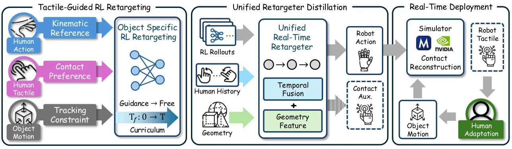

<!-- Generated by scripts/generate.py; edit data/works.json and data/media.json. -->

[← Back to the Awesome index](../../../README.md) · [Interactive website](https://chang-xinhai.github.io/Awesome-RGBDT-Manipulation/?collection=policy&item=touch2robot#library)

# Touch2Robot

Touch2Robot: Robot Touch in the Human Demonstration Loop

**2026-09-21 · Preprint · BIGAI / ShanghaiTech University / Shanghai Jiao Tong University / Bei hang University**

**[Paper](https://arxiv.org/abs/2609.24660)** · [Project](https://Touch2Robot.github.io/)

Human tactile preferences shape simulated robot contacts and live demonstration feedback, improving downstream robot imitation.

*Touch2Robot: Robot Touch in the Human Demonstration Loop authors · [Figure source](https://arxiv.org/abs/2609.24660) · Original rights retained.*

| Field | Reported value and source scope |
| :-- | :-- |
| Record type | policy |
| Policy family | Hybrid [1](https://arxiv.org/abs/2609.24660)  |
| Base model and architecture | Object-specific RL teachers, unified retargeter and downstream Le Robot Diffusion Policy. [1](https://arxiv.org/abs/2609.24660)  |
| Model size and component | Not reported [1](https://arxiv.org/abs/2609.24660)  |
| Deployment inputs | Downstream policy:two RGB views, robot joint states and tactile observations. [1](https://arxiv.org/abs/2609.24660)  |
| Action outputs and horizon | Robot joint-target chunks; live collection retargeter also predicts robot contacts. [1](https://arxiv.org/abs/2609.24660)  |
| Training method | Tactile-preference RL and guided-to-free dynamics curriculum, retargeter distillation, then robot demonstration diffusion imitation. [1](https://arxiv.org/abs/2609.24660)  |
| Training data | Four tasks;30 teacher trajectories/task augmented to 400 training rollouts; separate equal-size collected datasets for downstream policies. [1](https://arxiv.org/abs/2609.24660)  |
| Training duration | Not reported [1](https://arxiv.org/abs/2609.24660)  |
| Training hardware | Not reported [1](https://arxiv.org/abs/2609.24660)  |
| Inference and control rates | Live VR feedback 30 Hz/122 ms; downstream executes 16 actions before replanning. [1](https://arxiv.org/abs/2609.24660)  |
| Evaluation scope | LEAP Hand pick-and-place, rotation, board wiping, drawer opening; real replay and autonomous policy completion. [1](https://arxiv.org/abs/2609.24660)  |
| Observations / modalities | RGB · Tactile · Proprioception |
| Evaluation domain | Simulation · Real world |
| Embodiment | Dexterous hand |
| Release: code | Not verified [2](https://Touch2Robot.github.io/)  |
| Release: weights | Not verified [2](https://Touch2Robot.github.io/)  |
| Release: data | Not verified [2](https://Touch2Robot.github.io/)  |
| Release: license | Not verified [2](https://Touch2Robot.github.io/)  |
| Release: notes | Original paper reviewed; claimed future releases are not treated as currently available. [2](https://Touch2Robot.github.io/)  |

**Scope and qualifications**

- Object-specific teachers use object geometry/references; the unified retargeter is a different deployment stage.
- Predicted contact feedback during human collection is not direct real-robot touch measurement.

**Primary evidence**

1. [Original paper and supplementary implementation details](https://arxiv.org/abs/2609.24660) — Primary full text reviewed; dataset, deployment modalities and training-only privileges are scoped separately.
2. [Official author project](https://Touch2Robot.github.io/) — Live project artifact links inspected on2026-10-17.
