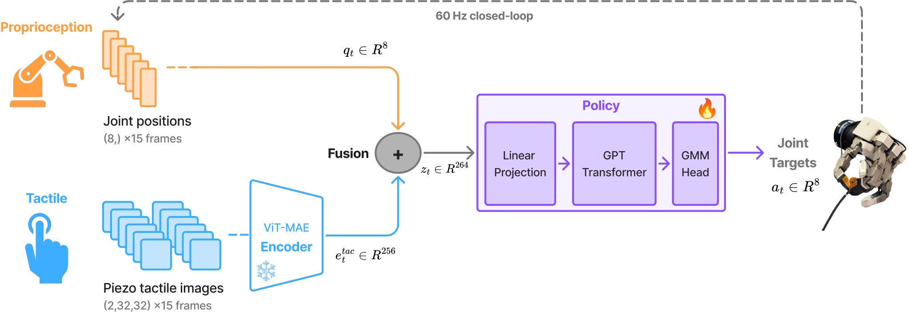

<!-- Generated by scripts/generate.py; edit data/works.json and data/media.json. -->

[← Back to the Awesome index](../../../README.md) · [Interactive website](https://chang-xinhai.github.io/Awesome-RGBDT-Manipulation/?collection=policy&item=touch2trace#library)

# Touch2Trace

Touch2Trace: Tactile-Driven Imitation Learning for Dexterous Cable Tracing

**2026-09-14 · Preprint · Not reported**

**[Paper](https://arxiv.org/abs/2609.15921)**

A tactile-only behavior-cloning transformer performs dexterous cable tracing without explicit cable-state estimation.

*Touch2Trace: Tactile-Driven Imitation Learning for Dexterous Cable Tracing authors · [Figure source](https://arxiv.org/abs/2609.15921) · Original rights retained.*

| Field | Reported value and source scope |
| :-- | :-- |
| Record type | policy |
| Policy family | Transformer [1](https://arxiv.org/abs/2609.15921)  |
| Base model and architecture | Frozen ViT-MAE tactile encoder; three-layer causal transformer with five-component Gaussian-mixture action head. [1](https://arxiv.org/abs/2609.15921)  |
| Model size and component | 4.1 M pipeline parameters:1.6 M frozen tactile encoder+2.5 M policy backbone. [1](https://arxiv.org/abs/2609.15921)  |
| Deployment inputs | Two 32×32 normal-pressure fingertip images and eight controlled joint positions;15-observation history. [1](https://arxiv.org/abs/2609.15921)  |
| Action outputs and horizon | Eight finger-joint position targets. [1](https://arxiv.org/abs/2609.15921)  |
| Training method | Self-supervised tactile-MAE pretraining then frozen-encoder behavior cloning for 50 epochs. [1](https://arxiv.org/abs/2609.15921)  |
| Training data | 16 teleoperated demos/~14 min total, 12 training/10.1 min and 4 validation/~4 min; all policy training uses USB-0 cable in ring routing. [1](https://arxiv.org/abs/2609.15921)  |
| Training duration | Policy 50 epochs; wall-clock Not reported. [1](https://arxiv.org/abs/2609.15921)  |
| Training hardware | Not reported [1](https://arxiv.org/abs/2609.15921)  |
| Inference and control rates | 60 Hz deployed control;3.4 ms end-to-end measured on RTX4500Ada (inference hardware, not training). [1](https://arxiv.org/abs/2609.15921)  |
| Evaluation scope | Tesol lo DG-5 F cable tracing; unseen Ethernet/USB variants and straight/ring routing. [1](https://arxiv.org/abs/2609.15921)  |
| Observations / modalities | Tactile · Proprioception |
| Evaluation domain | Real world |
| Embodiment | Dexterous hand |
| Release: code | Not verified |
| Release: weights | Not verified |
| Release: data | Not verified |
| Release: license | Not verified |
| Release: notes | Original paper reviewed; claimed future releases are not treated as currently available. |

**Scope and qualifications**

- TacV5 measures normal pressure, not direct shear. Shear dynamics are inferred from temporal pressure sequences.
- Acc el ero meter, audio and external video are recorded but unused by the deployed policy.

**Primary evidence**

1. [Original paper and supplementary implementation details](https://arxiv.org/abs/2609.15921) — Primary full text reviewed; dataset, deployment modalities and training-only privileges are scoped separately.
