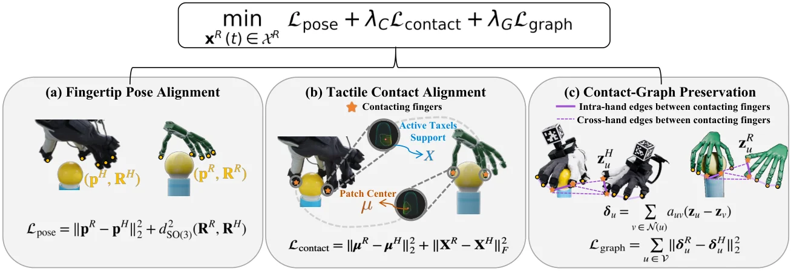

<!-- Generated by scripts/generate.py; edit data/works.json and data/media.json. -->

[← Back to the Awesome index](../../../README.md) · [Interactive website](https://chang-xinhai.github.io/Awesome-RGBDT-Manipulation/?collection=policy&item=touchbridge#library)

# TouchBridge

TouchBridge: Tactile-Conditioned Human-to-Robot Transfer for Dexterous Manipulation

**2026-10-29 · Preprint · Tsinghua University; Zhejiang University**

**[Paper](https://arxiv.org/abs/2610.40349)** · [Project](https://touchbridge2026.github.io/)

Tactile human demonstrations support contact-preserving retargeting and synthetic robot training data.

*TouchBridge authors · [Figure source](https://arxiv.org/abs/2610.40349) · Original rights retained.*

| Field | Reported value and source scope |
| :-- | :-- |
| Record type | policy |
| Policy family | Human-to-robot transfer policy [1](https://arxiv.org/html/2610.40349v1)  |
| Base model and architecture | GR00T N1.7 [1](https://arxiv.org/html/2610.40349v1)  |
| Model size and component | Not reported [1](https://arxiv.org/html/2610.40349v1)  |
| Deployment inputs | Robot RGB and state at deployment; tactile observations condition human demonstration transfer [1](https://arxiv.org/html/2610.40349v1)  |
| Action outputs and horizon | Robot manipulation actions [1](https://arxiv.org/html/2610.40349v1)  |
| Training method | Contact-preserving tactile retargeting and synthetic robot demonstrations for VLA fine-tuning. [1](https://arxiv.org/html/2610.40349v1)  |
| Training data | See original paper for dataset and protocol. [1](https://arxiv.org/html/2610.40349v1)  |
| Training duration | Not reported [1](https://arxiv.org/html/2610.40349v1)  |
| Training hardware | Not reported [1](https://arxiv.org/html/2610.40349v1)  |
| Inference and control rates | Not reported [1](https://arxiv.org/html/2610.40349v1)  |
| Evaluation scope | Four real tasks; authors report 72.5% success for transferred data versus 77.5% for matched teleoperation. [1](https://arxiv.org/html/2610.40349v1)  |
| Observations / modalities | RGB · Proprioception |
| Evaluation domain | Real world |
| Embodiment | Not reported |
| Release: code | Not verified |
| Release: weights | Not verified |
| Release: data | Not verified |
| Release: license | Not verified |
| Release: notes | Release status checked against author artifacts on 2026-11-05. |

**Scope and qualifications**

- Tactile is a demonstration-transfer signal; this alone does not establish tactile input to the deployed robot policy.

**Primary evidence**

1. [Original paper: method, inputs and evaluation](https://arxiv.org/html/2610.40349v1) — Results and sensing claims are scoped to the authors’ evaluation and deployment setting.
