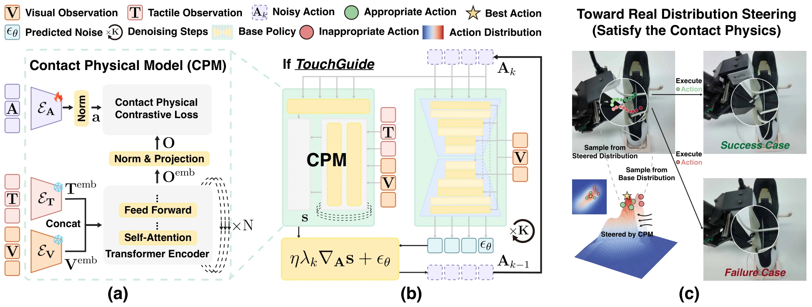

<!-- Generated by scripts/generate.py; edit data/works.json and data/media.json. -->

[← Back to the Awesome index](../../../README.md) · [Interactive website](https://chang-xinhai.github.io/Awesome-RGBDT-Manipulation/?collection=policy&item=touchguide#library)

# TouchGuide

TouchGuide: Inference-Time Steering of Visuomotor Policies via Touch Guidance

**2026-01-28 · RSS 2026 · Shanghai Jiao Tong University / Xense Robotics / Shanghai AI Laboratory and collaborators**

**[Paper](https://arxiv.org/abs/2601.20239)** · [Project](https://martelzhang.github.io/touchguide/) · [Code](https://github.com/martelzhang/TouchGuide)

A task-specific tactile contact model steers frozen diffusion/flow policy sampling in action space at inference.

*TouchGuide: Inference-Time Steering of Visuomotor Policies via Touch Guidance authors · [Figure source](https://arxiv.org/abs/2601.20239) · Original rights retained.*

| Field | Reported value and source scope |
| :-- | :-- |
| Record type | policy |
| Policy family | Hybrid [1](https://arxiv.org/abs/2601.20239)  |
| Base model and architecture | Diffusion Policy or π0.5 base; contrastively trained Contact Physical Model (CPM). [1](https://arxiv.org/abs/2601.20239)  |
| Model size and component | Not reported [1](https://arxiv.org/abs/2601.20239)  |
| Deployment inputs | RGB, tactile images or force feedback and robot state; optional language inherited from the base policy. [1](https://arxiv.org/abs/2601.20239)  |
| Action outputs and horizon | Tactile-guided refinement of candidate action chunks. [1](https://arxiv.org/abs/2601.20239)  |
| Training method | Train CPM on synchronized positive and temporally mismatched negative observation-action pairs; base policy is not retrained for touch guidance. [1](https://arxiv.org/abs/2601.20239)  |
| Training data | Limited task-specific demonstrations; Lock Opening uses 20 demos; five-task evaluation with Tac UMI collection. [1](https://arxiv.org/abs/2601.20239)  |
| Training duration | Not reported [1](https://arxiv.org/abs/2601.20239)  |
| Training hardware | Not reported [1](https://arxiv.org/abs/2601.20239)  |
| Inference and control rates | Tac UMI RGB/tactile recording 30 Hz; deployment rate depends on base policy. [1](https://arxiv.org/abs/2601.20239)  |
| Evaluation scope | Five contact-rich tasks including Shoe Lacing, Chip Handover and Lock Opening; cross-policy/robot/tactile-modality studies. [1](https://arxiv.org/abs/2601.20239)  |
| Observations / modalities | RGB · Tactile · Proprioception |
| Evaluation domain | Real world |
| Embodiment | Parallel-jaw gripper |
| Release: code | Partial [2](https://martelzhang.github.io/touchguide/) [3](https://github.com/martelzhang/TouchGuide)  |
| Release: weights | Not verified [2](https://martelzhang.github.io/touchguide/) [3](https://github.com/martelzhang/TouchGuide)  |
| Release: data | Not verified [2](https://martelzhang.github.io/touchguide/) [3](https://github.com/martelzhang/TouchGuide)  |
| Release: license | MIT [2](https://martelzhang.github.io/touchguide/) [3](https://github.com/martelzhang/TouchGuide)  |
| Release: notes | Official project labels repository Data Collection Code. Policy guidance/training release is not inferred from the sensor-interface release. [2](https://martelzhang.github.io/touchguide/) [3](https://github.com/martelzhang/TouchGuide)  |

**Scope and qualifications**

- Inference-time gradient steering is not an online policy weight update.
- A task-specific CPM must be learned; this is not training-free tactile understanding.

**Primary evidence**

1. [Original paper and supplementary implementation details](https://arxiv.org/abs/2601.20239) — Primary full text reviewed; dataset, deployment modalities and training-only privileges are scoped separately.
2. [Official author project](https://martelzhang.github.io/touchguide/) — Live artifact status reviewed separately from paper claims.
3. [Official released implementation and LICENSE](https://github.com/martelzhang/TouchGuide) — Repository metadata,README and actualLICENSE inspected; availability scoped to the listed component.
