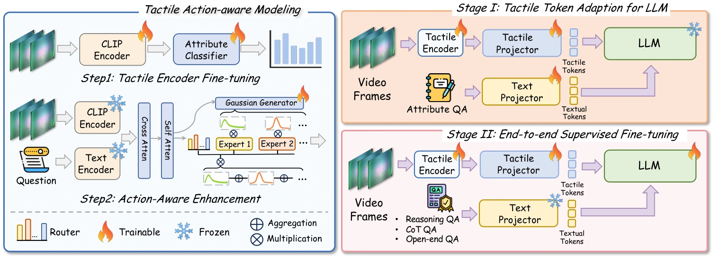

<!-- Generated by scripts/generate.py; edit data/works.json and data/media.json. -->

[← Back to the Awesome index](../../../README.md) · [Interactive website](https://chang-xinhai.github.io/Awesome-RGBDT-Manipulation/?collection=policy&item=touchthinker#library)

# TouchThinker / TouchThinker-1M

TouchThinker: Scaling Tactile Commonsense Reasoning to the Open World with Large-scale Data and Action-aware Representation

**2026-06-10 · Preprint · National University of Singapore; Zhongguancun Academy; Xiamen University; CAS Institute of Automation; Xi’an Jiaotong University; Nanyang Technological University; Nanjing University**

**[Paper](https://arxiv.org/abs/2606.11637)** · [Code](https://github.com/lvkailin0118/TouchThinker) · [Data](https://huggingface.co/datasets/ckjs/TouchThinker)

Scales tactile commonsense question answering through sensor-diverse data and action-aware tactile representations, with held-out sensor/object evaluation.

*touchthinker authors; original paper figure · [Figure source](https://arxiv.org/html/2606.11637#S4.F3) · Original rights retained.*

| Field | Reported value and source scope |
| :-- | :-- |
| Record type | model |
| Model role and downstream interface | Tactile-language reasoning and representation model; no executable robot action interface [1](https://arxiv.org/abs/2606.11637)  |
| Model family | Tactile-language model [1](https://arxiv.org/abs/2606.11637)  |
| Model architecture | Action-aware tactile encoder and tactile-language adapter with Qwen2.5 7B/14B and LoRA [1](https://arxiv.org/abs/2606.11637)  |
| Model size and component | Qwen2.5 7B and 14B language backbones; tactile encoder/adapter additional [1](https://arxiv.org/abs/2606.11637)  |
| Model inputs | Tactile video, question text and action-aware tactile context [1](https://arxiv.org/abs/2606.11637)  |
| Model outputs | Tactile-property descriptions, comparison answers and physical commonsense reasoning text [1](https://arxiv.org/abs/2606.11637)  |
| Training method | Action-aware tactile representation and two-stage tactile-text alignment / end-to-end supervised fine-tuning with LLM LoRA [1](https://arxiv.org/abs/2606.11637)  |
| Training data and scale | TouchThinker-1M: 1,001,344 tactile frames aggregated from nine sources, seven sensor types, 415 deduplicated objects and eight reasoning scenarios; paired QA data is not the same count as frames. [1](https://arxiv.org/abs/2606.11637)  |
| Training duration | Two stages, one epoch each in Appendix Table 5; wall-clock duration not reported [1](https://arxiv.org/abs/2606.11637)  |
| Training hardware | 4 NVIDIA A100 80GB GPUs; Appendix Table 5 states batch 16 per GPU [1](https://arxiv.org/abs/2606.11637)  |
| Inference setting and runtime | Not reported — language generation and tactile encoding costs depend on variant [1](https://arxiv.org/abs/2606.11637)  |
| Downstream evaluation and scope | VTV150K, TouchThinker-Bench and held-out sensor/object tactile QA. Action-aware representation refers to data acquisition dynamics, not robot motor command generation. [1](https://arxiv.org/abs/2606.11637)  |
| Observations / modalities | Tactile · Language |
| Evaluation domain | Real world |
| Embodiment |  |
| Release: code | Not released — current official repository contains README and assets only [2](https://github.com/lvkailin0118/TouchThinker)  |
| Release: weights | Not verified — no official complete model checkpoint identified [2](https://github.com/lvkailin0118/TouchThinker)  |
| Release: data | Available — official dataset repository [2](https://github.com/lvkailin0118/TouchThinker)  |
| Release: license | No standalone code LICENSE identified; dataset and upstream Qwen/checkpoint terms require separate inspection [2](https://github.com/lvkailin0118/TouchThinker)  |
| Release: notes | Official dataset archives are public; the inspected code repository currently contains documentation and figures, without model training source or released weights. [2](https://github.com/lvkailin0118/TouchThinker)  |

**Scope and qualifications**

- TouchThinker-Bench tests perceptual reasoning, rather than robot-control task success.
- One million refers to tactile source frames, not one million physical robot demonstrations.
- Paper methods/counts follow the current revision; an unchanged arXiv identifier does not guarantee v1 specifications.

**Primary evidence**

1. [Original model paper and first submission](https://arxiv.org/abs/2606.11637) — Current full-text v4 methods and Appendix A.3/Table 5; first-public date retained.
2. [Official repository and data release](https://github.com/lvkailin0118/TouchThinker) — README and actual repository tree inspected; no independently confirmed model weights.
