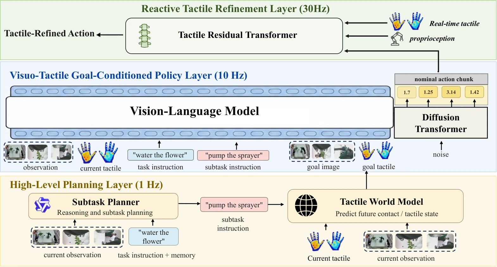

<!-- Generated by scripts/generate.py; edit data/works.json and data/media.json. -->

[← Back to the Awesome index](../../../README.md) · [Interactive website](https://chang-xinhai.github.io/Awesome-RGBDT-Manipulation/?collection=policy&item=touchworld#library)

# TouchWorld

TouchWorld: A Predictive and Reactive Tactile Foundation Model for Dexterous Manipulation

**2026-07-08 · Preprint · Harbin Institute of Technology, Shenzhen / PHANES AI**

**[Paper](https://arxiv.org/abs/2607.07287)** · [Project](https://phanes-lab.github.io/TouchWorld-website/)

Hierarchical planning and tactile goal prediction combine with a fast tactile residual controller for dexterous manipulation.

*TouchWorld: A Predictive and Reactive Tactile Foundation Model for Dexterous Manipulation authors · [Figure source](https://arxiv.org/abs/2607.07287) · Original rights retained.*

| Field | Reported value and source scope |
| :-- | :-- |
| Record type | policy |
| Policy family | World-action model [1](https://arxiv.org/abs/2607.07287)  |
| Base model and architecture | Qwen 3-VL-4 B subtask planner; Wan 2.2-TI2 V-5 B tactile world model; nominal visuo-tactile policy and 8-layer tactile residual transformer. [1](https://arxiv.org/abs/2607.07287)  |
| Model size and component | 4 B planner+5 B world model; total policy parameters Not reported. [1](https://arxiv.org/abs/2607.07287)  |
| Deployment inputs | RGB, language, current tactile observations, proprioception and compact subtask memory; fast branch sees recent tactile/state history. [1](https://arxiv.org/abs/2607.07287)  |
| Action outputs and horizon | 120D nominal actions with 58D tactile-sensitive residual corrections; generated visual/tactile subgoals. [1](https://arxiv.org/abs/2607.07287)  |
| Training method | Planner 20 epochs Lo RA; world model 50 epochs Lo RA; nominal policy learning then frozen-policy residual imitation. [1](https://arxiv.org/abs/2607.07287)  |
| Training data | Six real tasks with 200 teleoperated training trajectories/task; planner 128,866 SFT records; world model human interaction pretraining plus 10 h robot data. [1](https://arxiv.org/abs/2607.07287)  |
| Training duration | Not reported [1](https://arxiv.org/abs/2607.07287)  |
| Training hardware | Not reported [1](https://arxiv.org/abs/2607.07287)  |
| Inference and control rates | Figure 2 depicts 1 Hz high-level planning, 10 Hz nominal policy and 30 Hz tactile refinement; appendix scheduling specifies 32-step nominal chunks, 16-step residual windows and 4-step commits, with realized rate dependent on hardware. [1](https://arxiv.org/abs/2607.07287)  |
| Evaluation scope | Humanoid with Wuji hands/JQ tactile gloves:Water Flower, Tabletop Clearing, Cup Insertion, Power Plug Insertion, Pot Wiping, Tissue Pulling; clean/human perturbation cohorts. [1](https://arxiv.org/abs/2607.07287)  |
| Observations / modalities | RGB · Tactile · Proprioception |
| Evaluation domain | Real world |
| Embodiment | Dexterous hand · Bimanual |
| Release: code | Not verified [2](https://phanes-lab.github.io/TouchWorld-website/)  |
| Release: weights | Not verified [2](https://phanes-lab.github.io/TouchWorld-website/)  |
| Release: data | Not verified [2](https://phanes-lab.github.io/TouchWorld-website/)  |
| Release: license | Not verified [2](https://phanes-lab.github.io/TouchWorld-website/)  |
| Release: notes | Original paper reviewed; claimed future releases are not treated as currently available. [2](https://phanes-lab.github.io/TouchWorld-website/)  |

**Scope and qualifications**

- A high-frequency residual module is described but no universal fixed Hz is inferred from chunk length.
- Planner/world model/nominal policy are different computation stages; parameter counts must not be summed as reported total.

**Primary evidence**

1. [Original paper and supplementary implementation details](https://arxiv.org/abs/2607.07287) — Primary full text reviewed; dataset, deployment modalities and training-only privileges are scoped separately.
2. [Official author project](https://phanes-lab.github.io/TouchWorld-website/) — Live artifact status reviewed separately from paper claims.
