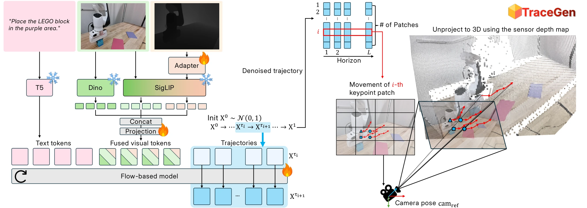

<!-- Generated by scripts/generate.py; edit data/works.json and data/media.json. -->

[← Back to the Awesome index](../../../README.md) · [Interactive website](https://chang-xinhai.github.io/Awesome-RGBDT-Manipulation/?collection=policy&item=tracegen#library)

# TraceGen

TraceGen: World Modeling in 3D Trace Space Enables Learning from Cross-Embodiment Videos

**2025-11-26 · CVPR 2026 · University of Maryland, College Park; New York University**

**[Paper](https://arxiv.org/abs/2511.21690)** · [Project](https://tracegen.github.io/) · [Code](https://github.com/jayLEE0301/TraceGen) · [Data](https://huggingface.co/collections/furonghuang-lab/tracegen)

A compact 3D trace world model learns motion from cross-embodiment videos and drives real manipulation with few-shot adaptation.

*TraceGen authors · [Figure source](https://arxiv.org/html/2511.21690) · Original rights retained.*

| Field | Reported value and source scope |
| :-- | :-- |
| Record type | policy |
| Policy family | World-action model [1](https://arxiv.org/abs/2511.21690)  |
| Base model and architecture | T5 language encoder, RGB-D conditioning and flow-based 3D trace generator; execution maps traces to robot motion. [1](https://arxiv.org/abs/2511.21690)  |
| Model size and component | Not reported in the inspected primary-source sections [1](https://arxiv.org/abs/2511.21690)  |
| Deployment inputs | RGB-D observation, language and query scene points. [1](https://arxiv.org/abs/2511.21690)  |
| Action outputs and horizon | Scene-level 3D motion traces used for robot execution. [1](https://arxiv.org/abs/2511.21690)  |
| Training method | Trace-space world-model pretraining and five-/fifteen-video adaptation. [1](https://arxiv.org/abs/2511.21690)  |
| Training data | TraceForge-123K: 123K videos and 1.8M observation–trace–language triplets. [1](https://arxiv.org/abs/2511.21690)  |
| Training duration | Not reported in the inspected primary-source sections [1](https://arxiv.org/abs/2511.21690)  |
| Training hardware | Not reported in the inspected primary-source sections [1](https://arxiv.org/abs/2511.21690)  |
| Inference and control rates | Not reported in the inspected primary-source sections [1](https://arxiv.org/abs/2511.21690)  |
| Evaluation scope | Four real Franka tasks; five target-robot or five handheld human video adaptation. [1](https://arxiv.org/abs/2511.21690)  |
| Observations / modalities | RGB · Depth · Point cloud · Proprioception |
| Evaluation domain | Simulation · Real world |
| Embodiment | Parallel-jaw gripper |
| Release: code | Available [2](https://tracegen.github.io/) [3](https://github.com/jayLEE0301/TraceGen) [5](https://github.com/jayLEE0301/TraceGen/tree/main)  |
| Release: weights | Not verified [2](https://tracegen.github.io/) [3](https://github.com/jayLEE0301/TraceGen)  |
| Release: data | Not verified [2](https://tracegen.github.io/) [3](https://github.com/jayLEE0301/TraceGen) [6](https://huggingface.co/collections/furonghuang-lab/tracegen)  |
| Release: license | Apache-2.0 for repository code; pretrained models, data and figure rights remain separate [2](https://tracegen.github.io/) [3](https://github.com/jayLEE0301/TraceGen) [4](https://github.com/jayLEE0301/TraceGen/blob/main/LICENSE)  |
| Release: notes | Code, data and weights are checked independently; an upstream pretrained model is not a released task policy. [2](https://tracegen.github.io/) [3](https://github.com/jayLEE0301/TraceGen)  |

**Scope and qualifications**

- Human-video transfer uses task adaptation; it is not an unadapted universal action policy.

**Primary evidence**

1. [Original manuscript and first submission history](https://arxiv.org/abs/2511.21690) — Full author HTML method/evaluation/appendix inspected; depth observations, pseudo-labels and generated outputs retain distinct roles.
2. [Official author project](https://tracegen.github.io/) — Public author-linked project; figure and downstream scope verified separately.
3. [Official implementation and release scope](https://github.com/jayLEE0301/TraceGen) — Availability of research implementation does not establish public task-policy checkpoints.
4. [Actual license file in released source](https://github.com/jayLEE0301/TraceGen/blob/main/LICENSE) — Only source code covered by this file; not a blanket license for paper figures or upstream weights.
5. [Actual repository content inventory](https://github.com/jayLEE0301/TraceGen/tree/main) — 44 tracked paths inspected; code release is distinguished from a README/project/figure-only repository.
6. [Official data release destination](https://huggingface.co/collections/furonghuang-lab/tracegen) — Destination linked by the official project/repository; component release scope is retained in release notes.
