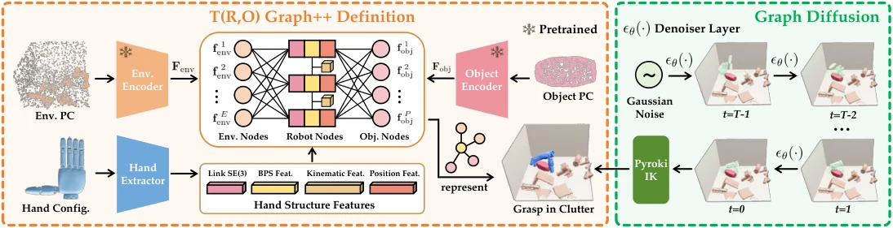

<!-- Generated by scripts/generate.py; edit data/works.json and data/media.json. -->

[← Back to the Awesome index](../../../README.md) · [Interactive website](https://chang-xinhai.github.io/Awesome-RGBDT-Manipulation/?collection=policy&item=trograsp2#library)

# T(R,O) Grasp++

T(R,O) Grasp++: Cross-Embodiment Dexterous Grasping in Cluttered Environments at Scale

**2026-10-18 · CoRL 2026 · National University of Singapore**

**[Paper](https://arxiv.org/abs/2610.25410)** · [Project](https://nus-lins-lab.github.io/TROGrasp2Web/) · [Code](https://github.com/Barrybarry-Smith/TROGraspV2) · [Data](https://huggingface.co/datasets/Barrybarry-Smith/TROV2Dataset) · [Weights](https://drive.google.com/file/d/1mLTmTMilaS5hLyWo5OskxEn9P96CAVko/view?usp=sharing)

Graph diffusion synthesizes cross-hand cluttered-scene grasps from object, environment and robot geometry, paired with a large annotated grasp resource.

*T(R,O) Grasp++ authors; original rights retained · [Figure source](https://arxiv.org/abs/2610.25410) · Original rights retained.*

| Field | Reported value and source scope |
| :-- | :-- |
| Record type | model |
| Model role and downstream interface | Cross-embodiment grasp synthesizer and geometric representation. [1](https://arxiv.org/html/2610.25410)  |
| Model family | Grasp synthesis [1](https://arxiv.org/html/2610.25410)  |
| Model architecture | Separate PointNet++ VQ-VAE object/environment encoders and robot-object-environment graph diffusion. [1](https://arxiv.org/html/2610.25410)  |
| Model size and component | Not reported [1](https://arxiv.org/html/2610.25410)  |
| Model inputs | Target-object and surrounding-environment point clouds, hand geometry/link features and robot configuration. [1](https://arxiv.org/html/2610.25410)  |
| Model outputs | Hand poses/joint configurations for task-agnostic cluttered-scene grasping. [1](https://arxiv.org/html/2610.25410)  |
| Training method | Geometric encoder pretraining followed by graph diffusion and grasp validation. [1](https://arxiv.org/html/2610.25410)  |
| Training data and scale | Around 0.5B annotated grasps across 8 hands/~50K objects; released training shards and validation/object packages. [1](https://arxiv.org/html/2610.25410)  |
| Training duration | Not reported [1](https://arxiv.org/html/2610.25410)  |
| Training hardware | Not reported [1](https://arxiv.org/html/2610.25410)  |
| Inference setting and runtime | Reported≈0.3s grasp synthesis latency; not robot servo frequency. [1](https://arxiv.org/html/2610.25410)  |
| Downstream evaluation and scope | Paper 88% average simulated grasp success across 8 hands; real XHand/LEAP demonstrations. [1](https://arxiv.org/html/2610.25410)  |
| Observations / modalities | Point cloud · Proprioception |
| Evaluation domain | Simulation · Real world |
| Embodiment | Dexterous hand |
| Release: code | Available [2](https://github.com/Barrybarry-Smith/TROGraspV2) [3](https://huggingface.co/datasets/Barrybarry-Smith/TROV2Dataset)  |
| Release: weights | Not verified — author-linked Drive checkpoint; no bundled method checkpoint in the inspected repository [2](https://github.com/Barrybarry-Smith/TROGraspV2) [3](https://huggingface.co/datasets/Barrybarry-Smith/TROV2Dataset)  |
| Release: data | Available — actual train shards, validation and object assets [2](https://github.com/Barrybarry-Smith/TROGraspV2) [3](https://huggingface.co/datasets/Barrybarry-Smith/TROV2Dataset)  |
| Release: license | Repository-wide source/checkpoint/data license not verified; third-party and original figure rights remain separate. [2](https://github.com/Barrybarry-Smith/TROGraspV2) [3](https://huggingface.co/datasets/Barrybarry-Smith/TROV2Dataset)  |
| Release: notes | Training, inference and validation source is public. Actual default-branch tree has no ckpt/ directory despite README claims of bundled Wuji/test files; feature .pt files under robot assets are not method checkpoints. The separate author Drive checkpoint requires independent content verification. HF contains actual training/validation tar shards; no root LICENSE was found. [2](https://github.com/Barrybarry-Smith/TROGraspV2) [3](https://huggingface.co/datasets/Barrybarry-Smith/TROV2Dataset)  |

**Scope and qualifications**

- Static grasp generation and lift/collision evaluation are not a long-horizon closed-loop action policy.
- Approximately 0.5B annotations/50K objects/eight paper hands describe dataset scale, not independent executed robot trials.
- The extra Wuji checkpoint is a release extension; preserve the paper’s eight-hand protocol.

**Primary evidence**

1. [Original full paper, methods and evaluation](https://arxiv.org/html/2610.25410) — Publication date is arXiv v1; implementation and deployment observations are distinguished from training supervision, generated geometry and base-model identity.
2. [Official artifact: actual source files, inventory and license](https://github.com/Barrybarry-Smith/TROGraspV2) — Actual train.py, test.py and validation implementation plus HF tar inventories inspected. The current tree has no ckpt/ method files despite the README text; robot-feature tensors are not model checkpoints. A root source/data license is not established.
3. [Official artifact inventory / model or dataset card](https://huggingface.co/datasets/Barrybarry-Smith/TROV2Dataset) — Actual file inventory and artifact-specific terms checked independently; upstream checkpoints and equivalent dataset layouts are not double-counted.
