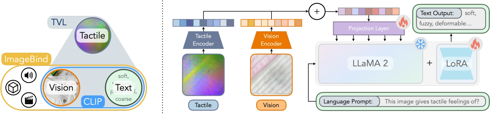

<!-- Generated by scripts/generate.py; edit data/works.json and data/media.json. -->

[← Back to the Awesome index](../../../README.md) · [Interactive website](https://chang-xinhai.github.io/Awesome-RGBDT-Manipulation/?collection=policy&item=tvl#library)

# TVL / TVL-LLaMA

A Touch, Vision, and Language Dataset for Multimodal Alignment

**2024-02-20 · ICML 2024 · UC Berkeley; FAIR at Meta; TU Dresden**

**[Paper](https://arxiv.org/abs/2402.13232)** · [Project](https://tactile-vlm.github.io/) · [Code](https://github.com/Max-Fu/tvl) · [Data](https://huggingface.co/datasets/mlfu7/Touch-Vision-Language-Dataset) · [Weights](https://huggingface.co/mlfu7/Touch-Vision-Language-Models)

Aligns tactile, visual and language observations, releasing an optical-touch encoder, tactile-conditioned language model and paired tactile descriptions.

*tvl authors; original paper figure · [Figure source](https://arxiv.org/html/2402.13232#S3.F4) · Original rights retained.*

| Field | Reported value and source scope |
| :-- | :-- |
| Record type | model |
| Model role and downstream interface | Reusable representation or perception model; downstream controllers are separate systems [1](https://arxiv.org/abs/2402.13232) [5](https://huggingface.co/mlfu7/Touch-Vision-Language-Models)  |
| Model family | Tactile-language model [1](https://arxiv.org/abs/2402.13232) [5](https://huggingface.co/mlfu7/Touch-Vision-Language-Models)  |
| Model architecture | Random-initialized tactile ViT aligned with CLIP vision/text; ImageBind-LLM-style adapter on LLaMA-2 7B [1](https://arxiv.org/abs/2402.13232) [5](https://huggingface.co/mlfu7/Touch-Vision-Language-Models)  |
| Model size and component | Tactile ViT-Tiny 5.7M / Small 22M / Base 86M; LLaMA-2 7B for language generation [1](https://arxiv.org/abs/2402.13232) [5](https://huggingface.co/mlfu7/Touch-Vision-Language-Models)  |
| Model inputs | Optical tactile image, paired RGB observation and textual prompt; encoder supports touch-only embeddings [1](https://arxiv.org/abs/2402.13232) [5](https://huggingface.co/mlfu7/Touch-Vision-Language-Models)  |
| Model outputs | Open-vocabulary touch embeddings and generated tactile descriptions [1](https://arxiv.org/abs/2402.13232) [5](https://huggingface.co/mlfu7/Touch-Vision-Language-Models)  |
| Training method | Pairwise tactile–vision–language contrastive alignment, then tactile-adapter pretraining and language-model fine-tuning [1](https://arxiv.org/abs/2402.13232) [5](https://huggingface.co/mlfu7/Touch-Vision-Language-Models)  |
| Training data and scale | 43,741 in-contact pairs (44K rounded): HCT 39,154 plus SSVTP 4,587; 10% human text labels and 90% GPT-4V pseudo-labels [1](https://arxiv.org/abs/2402.13232) [5](https://huggingface.co/mlfu7/Touch-Vision-Language-Models)  |
| Training duration | Encoder: 200 epochs; language-stage wall-clock duration not reported [1](https://arxiv.org/abs/2402.13232) [5](https://huggingface.co/mlfu7/Touch-Vision-Language-Models)  |
| Training hardware | Encoder experiments: 1 NVIDIA A100; TVL-LLaMA: 4 NVIDIA A100 with gradient accumulation 2 [1](https://arxiv.org/abs/2402.13232) [5](https://huggingface.co/mlfu7/Touch-Vision-Language-Models)  |
| Inference setting and runtime | Not reported [1](https://arxiv.org/abs/2402.13232) [5](https://huggingface.co/mlfu7/Touch-Vision-Language-Models)  |
| Downstream evaluation and scope | Open-vocabulary tactile classification/retrieval and the TVL description benchmark; human and model-assisted text-rating protocols. [1](https://arxiv.org/abs/2402.13232) [5](https://huggingface.co/mlfu7/Touch-Vision-Language-Models)  |
| Observations / modalities | Tactile · RGB · Language |
| Evaluation domain | Real world |
| Embodiment |  |
| Release: code | Available [2](https://tactile-vlm.github.io/) [3](https://github.com/Max-Fu/tvl) [5](https://huggingface.co/mlfu7/Touch-Vision-Language-Models)  |
| Release: weights | Available — official download link [2](https://tactile-vlm.github.io/) [3](https://github.com/Max-Fu/tvl) [5](https://huggingface.co/mlfu7/Touch-Vision-Language-Models)  |
| Release: data | Available — official resource link [2](https://tactile-vlm.github.io/) [3](https://github.com/Max-Fu/tvl) [5](https://huggingface.co/mlfu7/Touch-Vision-Language-Models)  |
| Release: license | Apache-2.0 code LICENSE.txt; pretrained LLaMA-2 base and datasets retain separate terms [2](https://tactile-vlm.github.io/) [3](https://github.com/Max-Fu/tvl) [4](https://github.com/Max-Fu/tvl/blob/main/LICENSE.txt)  |
| Release: notes | Code, pretrained encoders and downstream task data are separate artifacts; no policy checkpoint is implied by an encoder release. [2](https://tactile-vlm.github.io/) [3](https://github.com/Max-Fu/tvl) [5](https://huggingface.co/mlfu7/Touch-Vision-Language-Models)  |

**Scope and qualifications**

- No robot action head or autonomous manipulation policy is provided by TVL-LLaMA.
- Language generation uses a LLaMA-2 base whose access/terms remain separate from the released tactile adapter.

**Primary evidence**

1. [Original model paper and first submission](https://arxiv.org/abs/2402.13232) — Method, experiments and implementation sections; specifications retain component and evaluation scope.
2. [Official project](https://tactile-vlm.github.io/) — Author project; author-reported release scope is distinguished from an executed reproduction.
3. [Official implementation and current release instructions](https://github.com/Max-Fu/tvl) — README and repository files inspected on 2026-10-17.
4. [Repository license file](https://github.com/Max-Fu/tvl/blob/main/LICENSE.txt) — Applies to repository scope; model/data/base-model terms can differ.
5. [Official released encoder and adapter files](https://huggingface.co/mlfu7/Touch-Vision-Language-Models) — Official artifact metadata inspected separately from code.
