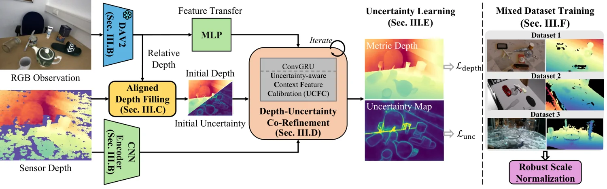

<!-- Generated by scripts/generate.py; edit data/works.json and data/media.json. -->

[← Back to the Awesome index](../../../README.md) · [Interactive website](https://chang-xinhai.github.io/Awesome-RGBDT-Manipulation/?collection=policy&item=ua-depth#library)

# UA-Depth

UA-Depth: Uncertainty-Aware Depth Restoration for Material-Agnostic Object Manipulation

**2026-11-01 · Preprint · The Chinese University of Hong Kong**

**[Paper](https://arxiv.org/abs/2611.01645)**

Uncertainty-aware RGB-D restoration refines noisy metric depth for difficult object materials.

*UA-Depth authors · [Figure source](https://arxiv.org/abs/2611.01645) · Original rights retained.*

| Field | Reported value and source scope |
| :-- | :-- |
| Record type | model |
| Model role and downstream interface | Depth and geometry perception reference [1](https://arxiv.org/html/2611.01645v1)  |
| Model family | Depth estimation [1](https://arxiv.org/html/2611.01645v1)  |
| Model architecture | See original paper [1](https://arxiv.org/html/2611.01645v1)  |
| Model size and component | Not reported [1](https://arxiv.org/html/2611.01645v1)  |
| Model inputs | RGB and noisy or incomplete sensor depth; a frozen monocular depth prior. [1](https://arxiv.org/html/2611.01645v1)  |
| Model outputs | Restored metric depth and pixel-wise uncertainty. [1](https://arxiv.org/html/2611.01645v1)  |
| Training method | Iterative depth/uncertainty co-refinement using aligned foundation-model priors. [1](https://arxiv.org/html/2611.01645v1)  |
| Training data and scale | See original paper for dataset scope [1](https://arxiv.org/html/2611.01645v1)  |
| Training duration | Not reported [1](https://arxiv.org/html/2611.01645v1)  |
| Training hardware | Not reported [1](https://arxiv.org/html/2611.01645v1)  |
| Inference setting and runtime | See original paper and official implementation [1](https://arxiv.org/html/2611.01645v1)  |
| Downstream evaluation and scope | Eight-dataset zero-shot depth evaluation, 6D object pose and grasp synthesis. [1](https://arxiv.org/html/2611.01645v1)  |
| Observations / modalities | RGB · Depth |
| Evaluation domain |  |
| Embodiment |  |
| Release: code | Not verified |
| Release: weights | Not verified |
| Release: data | Not verified |
| Release: license | Not verified; paper states code, models and data will be released upon publication. |
| Release: notes | An estimated uncertainty map is not itself a tactile signal or a grasping policy. |

**Scope and qualifications**

- An estimated uncertainty map is not itself a tactile signal or a grasping policy.

**Primary evidence**

1. [Author paper and first submission](https://arxiv.org/html/2611.01645v1)
