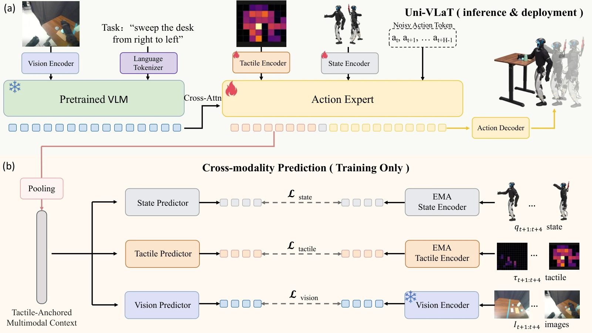

<!-- Generated by scripts/generate.py; edit data/works.json and data/media.json. -->

[← Back to the Awesome index](../../../README.md) · [Interactive website](https://chang-xinhai.github.io/Awesome-RGBDT-Manipulation/?collection=policy&item=uni-vlat#library)

# Uni-VLaT

Uni-VLaT: Whole-Body Tactile Adaptation of VLA Policies for Humanoid Loco-Manipulation

**2026-09-28 · Preprint · Tsinghua University / Bei hang University / Communication University of China / University of Hong Kong**

**[Paper](https://arxiv.org/abs/2609.35450)** · [Project](https://ggkiller-air.github.io/Uni-VLaT/) · [Data](https://huggingface.co/datasets/landauros/Uni-VLaT)

Distributed whole-body skin conditions humanoid VLA adaptation for sustained-contact loco-manipulation.

*Uni-VLaT: Whole-Body Tactile Adaptation of VLA Policies for Humanoid Loco-Manipulation authors · [Figure source](https://arxiv.org/abs/2609.35450) · Original rights retained.*

| Field | Reported value and source scope |
| :-- | :-- |
| Record type | policy |
| Policy family | VLA [1](https://arxiv.org/abs/2609.35450)  |
| Base model and architecture | Isaac-GR00T andπ0.5 variants with region-temporal tactile encoders; SONIC low-level whole-body controller. [1](https://arxiv.org/abs/2609.35450)  |
| Model size and component | Not reported [1](https://arxiv.org/abs/2609.35450)  |
| Deployment inputs | Stereo RGB, language, proprioception and 624 effective torso/arm tactile channels with four-frame causal history. [1](https://arxiv.org/abs/2609.35450)  |
| Action outputs and horizon | 40-step chunks of 64D SONIC motion tokens; separate pretrained controller produces joint targets. [1](https://arxiv.org/abs/2609.35450)  |
| Training method | 50 k-step imitation adaptation with auxiliary future sensory prediction; predictive heads removed at inference. [1](https://arxiv.org/abs/2609.35450)  |
| Training data | Nominal~50 demos/task; cleaned datasets 52–63 episodes/task across five real tasks; all retained episodes used in training split. [1](https://arxiv.org/abs/2609.35450)  |
| Training duration | 50k steps; wall-clock Not reported. [1](https://arxiv.org/abs/2609.35450)  |
| Training hardware | Isaac-GR00T4H100;π0.5 variant 8 H100. [1](https://arxiv.org/abs/2609.35450)  |
| Inference and control rates | Motion tokens 50 Hz; nominal policy request 2.5 Hz with latency compensation; low-level motor loop 500 Hz. [1](https://arxiv.org/abs/2609.35450)  |
| Evaluation scope | Unitree G1: five sustained-contact tasks including hugging, box handling and composed cleanup; real rollout SR and cleanup stage score. [1](https://arxiv.org/abs/2609.35450)  |
| Observations / modalities | RGB · Tactile · Proprioception · Language |
| Evaluation domain | Real world |
| Embodiment | Humanoid · Bimanual |
| Release: code | Not verified [2](https://ggkiller-air.github.io/Uni-VLaT/) [3](https://huggingface.co/datasets/landauros/Uni-VLaT)  |
| Release: weights | Not verified [2](https://ggkiller-air.github.io/Uni-VLaT/) [3](https://huggingface.co/datasets/landauros/Uni-VLaT)  |
| Release: data | Available [2](https://ggkiller-air.github.io/Uni-VLaT/) [3](https://huggingface.co/datasets/landauros/Uni-VLaT)  |
| Release: license | Not verified [2](https://ggkiller-air.github.io/Uni-VLaT/) [3](https://huggingface.co/datasets/landauros/Uni-VLaT)  |
| Release: notes | Original paper reviewed; claimed future releases are not treated as currently available. [2](https://ggkiller-air.github.io/Uni-VLaT/) [3](https://huggingface.co/datasets/landauros/Uni-VLaT)  |

**Scope and qualifications**

- Stereo RGB cameras are not evidence of a measured depth input.
- This is whole-body contact manipulation, not dexterous fingertip insertion.
- DP baseline failed pre-execution validity checks and isN/A, not 0% physical success.

**Primary evidence**

1. [Original paper and supplementary implementation details](https://arxiv.org/abs/2609.35450) — Primary full text reviewed; dataset, deployment modalities and training-only privileges are scoped separately.
2. [Official author project](https://ggkiller-air.github.io/Uni-VLaT/) — Live project artifact links inspected on2026-10-17.
3. [Author-linked released dataset](https://huggingface.co/datasets/landauros/Uni-VLaT) — Public repository file inventory inspected; component/data scope follows model/dataset card.
