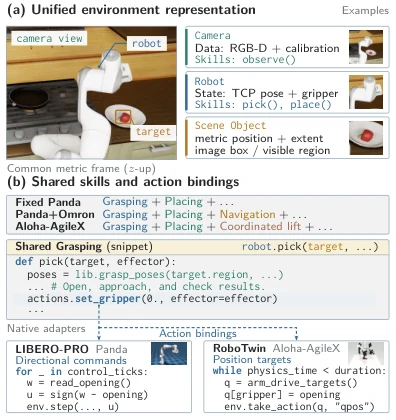

<!-- Generated by scripts/generate.py; edit data/works.json and data/media.json. -->

[← Back to the Awesome index](../../../README.md) · [Interactive website](https://chang-xinhai.github.io/Awesome-RGBDT-Manipulation/?collection=policy&item=unicraft-robot-use#library)

# UniCraft

Alignment Drives Reuse: Learning Generalizable Robot-Use Agents from Heterogeneous Experience

**2026-11-19 · Preprint · The University of Sydney and collaborators**

**[Paper](https://arxiv.org/abs/2611.26376)**

An RGB-D robot-use agent aligns geometric frames, control interfaces and task descriptions to reuse skills across simulation benchmarks.

*UniCraft authors · [Figure source](https://arxiv.org/html/2611.26376v1) · Original rights retained.*

| Field | Reported value and source scope |
| :-- | :-- |
| Record type | policy |
| Policy family | Reusable code/skill and orchestration refinement [1](https://arxiv.org/html/2611.26376v1)  |
| Base model and architecture | Fixed frontier VLMs with execution history and shared robot-control adapters. [1](https://arxiv.org/html/2611.26376v1)  |
| Model size and component | Not reported [1](https://arxiv.org/html/2611.26376v1)  |
| Deployment inputs | Calibrated simulator RGB-D and robot state, with aligned geometry and simulator-specific sensing adapters. [1](https://arxiv.org/html/2611.26376v1)  |
| Action outputs and horizon | Executable robot skills and their orchestration through available control APIs. [1](https://arxiv.org/html/2611.26376v1)  |
| Training method | Interleave tasks across three benchmarks; use rollout feedback to edit and retain reusable skill code and selection rules without updating model weights. [1](https://arxiv.org/html/2611.26376v1)  |
| Training data | 2,700 learning rollouts per agent model from LIBERO-PRO, RoboTwin 2.0 and RoboCasa365 with six embodiments. [1](https://arxiv.org/html/2611.26376v1)  |
| Training duration | Not reported [1](https://arxiv.org/html/2611.26376v1)  |
| Training hardware | Not reported [1](https://arxiv.org/html/2611.26376v1)  |
| Inference and control rates | Not reported [1](https://arxiv.org/html/2611.26376v1)  |
| Evaluation scope | Zero-shot test across robosuite and RoboDojo after freezing learned skills. The paper reports 210 RoboDojo trials across 42 tasks, a paper protocol rather than an official leaderboard entry. [1](https://arxiv.org/html/2611.26376v1)  |
| Observations / modalities | RGB · Depth · Proprioception |
| Evaluation domain | Simulation |
| Embodiment |  |
| Release: code | Not verified |
| Release: weights | Not verified |
| Release: data | Not verified |
| Release: license | Not verified |
| Release: notes | Paper discloses training and transfer settings; reusable skill files, checkpoints and a runtime release were not verified. |

**Scope and qualifications**

- All reported experiments are simulated. RoboDojo is transfer testing, separate from the learning pools. Nothing in the paper changes the official RoboDojo roster.

**Primary evidence**

1. [Original author paper or dataset description](https://arxiv.org/html/2611.26376v1)
