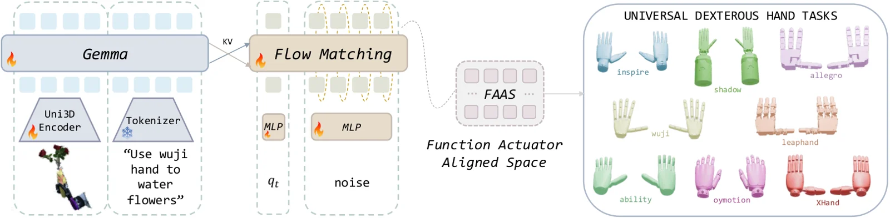

<!-- Generated by scripts/generate.py; edit data/works.json and data/media.json. -->

[← Back to the Awesome index](../../../README.md) · [Interactive website](https://chang-xinhai.github.io/Awesome-RGBDT-Manipulation/?collection=policy&item=unidex#library)

# UniDex

UniDex: A Robot Foundation Suite for Universal Dexterous Hand Control from Egocentric Human Videos

**2026-03-23 · arXiv preprint · Tsinghua University**

**[Paper](https://arxiv.org/abs/2603.22264)** · [Project](https://unidex-ai.github.io/) · [Code](https://github.com/unidex-ai/UniDex) · [Weights](https://huggingface.co/UniDex-ai/UniDex)

Unifies multiple dexterous-hand embodiments through an egocentric RGB-D point-cloud VLA and human-to-robot retargeting.

*UniDex authors · [Figure source](https://arxiv.org/html/2603.22264v1) · Original rights retained.*

| Field | Reported value and source scope |
| :-- | :-- |
| Record type | policy |
| Policy family | 3D vision-language-action [1](https://arxiv.org/html/2603.22264v1)  |
| Base model and architecture | Not reported [1](https://arxiv.org/html/2603.22264v1)  |
| Model size and component | Not reported [1](https://arxiv.org/html/2603.22264v1)  |
| Deployment inputs | RGB-D point cloud from Intel RealSense L515, language and proprioception. [1](https://arxiv.org/html/2603.22264v1)  |
| Action outputs and horizon | Wrist and dexterous-hand actions in a shared function-actuator-aligned space. [1](https://arxiv.org/html/2603.22264v1)  |
| Training method | Flow-matching VLA pretrained on retargeted human data and post-trained with task demonstrations. [1](https://arxiv.org/html/2603.22264v1)  |
| Training data | 52K trajectories across eight hand embodiments; UniDex-Cap records aligned Vision Pro poses and RGB-D. [1](https://arxiv.org/html/2603.22264v1)  |
| Training duration | Not reported [1](https://arxiv.org/html/2603.22264v1)  |
| Training hardware | Not reported [1](https://arxiv.org/html/2603.22264v1)  |
| Inference and control rates | Not reported [1](https://arxiv.org/html/2603.22264v1)  |
| Evaluation scope | Real tool-use experiments across Inspire and Oymotion hands; separate cross-hand transfer and object generalization. [1](https://arxiv.org/html/2603.22264v1)  |
| Observations / modalities | RGB · Depth · Language |
| Evaluation domain | Simulation · Real world |
| Embodiment | Dexterous hand |
| Release: code | Available — source and retargeting tools [2](https://unidex-ai.github.io/) [3](https://github.com/unidex-ai/UniDex) [4](https://huggingface.co/UniDex-ai/UniDex)  |
| Release: weights | Available — 3- and 32-epoch checkpoints [2](https://unidex-ai.github.io/) [3](https://github.com/unidex-ai/UniDex) [4](https://huggingface.co/UniDex-ai/UniDex)  |
| Release: data | Partial — annotation archives; full dataset access not independently verified [2](https://unidex-ai.github.io/) [3](https://github.com/unidex-ai/UniDex) [4](https://huggingface.co/UniDex-ai/UniDex)  |
| Release: license | No root code license or model-card license verified [2](https://unidex-ai.github.io/) [3](https://github.com/unidex-ai/UniDex) [4](https://huggingface.co/UniDex-ai/UniDex)  |
| Release: notes | 60 source files; checkpoint 3-epochs.ckpt Range HTTP 206; upstream model/assets retain separate terms. [2](https://unidex-ai.github.io/) [3](https://github.com/unidex-ai/UniDex) [4](https://huggingface.co/UniDex-ai/UniDex)  |

**Scope and qualifications**

- Human egocentric data and actual robot training/deployment observations are separate stages.

**Primary evidence**

1. [Author manuscript and initial submission](https://arxiv.org/html/2603.22264v1) — Original manuscript distinguishes human capture, training labels and deployment observations.
2. [Official project and release evidence](https://unidex-ai.github.io/) — Current repository contents and access are assessed independently of paper claims.
3. [Official code and release evidence](https://github.com/unidex-ai/UniDex) — Current repository contents and access are assessed independently of paper claims.
4. [Official weights and release evidence](https://huggingface.co/UniDex-ai/UniDex) — Current repository contents and access are assessed independently of paper claims.
