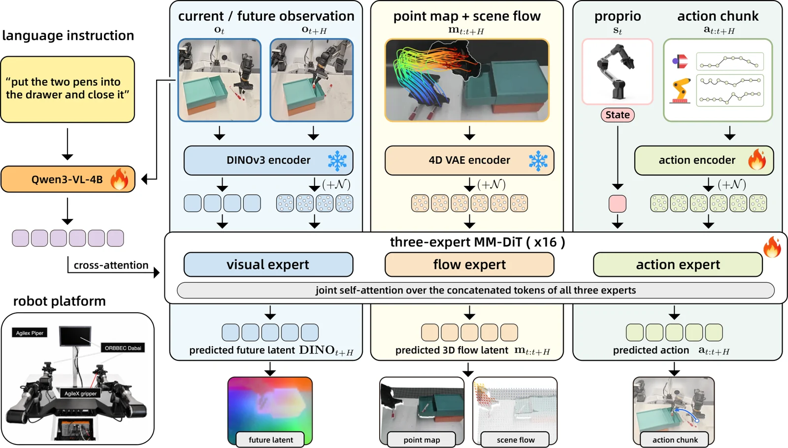

<!-- Generated by scripts/generate.py; edit data/works.json and data/media.json. -->

[← Back to the Awesome index](../../../README.md) · [Interactive website](https://chang-xinhai.github.io/Awesome-RGBDT-Manipulation/?collection=policy&item=uniflowwam#library)

# UniFlowWAM

UniFlowWAM: A Unified World-Action Model with Visual Semantics and 4D Geometry

**2026-10-22 · Preprint · Shanghai Jiao Tong University**

**[Paper](https://arxiv.org/abs/2610.30991)** · [Project](https://kksham111.github.io/UniFlowWAM_ProjectPage/)

Joint visual, action and scene-flow experts use geometric training supervision while deploying as a direct policy without flow input.

*UniFlowWAM authors · [Figure source](https://arxiv.org/abs/2610.30991) · Original rights retained.*

| Field | Reported value and source scope |
| :-- | :-- |
| Record type | policy |
| Policy family | Diffusion [1](https://arxiv.org/abs/2610.30991)  |
| Base model and architecture | Qwen3-VL-4B visual conditioning and a three-expert diffusion transformer. [1](https://arxiv.org/abs/2610.30991)  |
| Model size and component | Not reported [1](https://arxiv.org/abs/2610.30991)  |
| Deployment inputs | Current RGB, language and robot state at policy deployment; 3D flow derived from training RGB videos with Track4World. [1](https://arxiv.org/abs/2610.30991)  |
| Action outputs and horizon | Direct action chunks; joint model can also predict future visual features or scene flow under other role assignments. [1](https://arxiv.org/abs/2610.30991)  |
| Training method | Mid-training followed by benchmark fine-tuning under ten modality-role objectives. [1](https://arxiv.org/abs/2610.30991)  |
| Training data | 214,443 mid-training episodes across 10 embodiments; 50 real demonstrations/task in four-task suite. [1](https://arxiv.org/abs/2610.30991)  |
| Training duration | Not reported [1](https://arxiv.org/abs/2610.30991)  |
| Training hardware | Not reported [1](https://arxiv.org/abs/2610.30991)  |
| Inference and control rates | Not reported [1](https://arxiv.org/abs/2610.30991)  |
| Evaluation scope | RoboCasa-GR1 mean 56.4% over 11 seeds versus 52.1% base; LIBERO-Plus 87.7%; four real bimanual tasks87.0% versus 68.5% π0.5. [1](https://arxiv.org/abs/2610.30991)  |
| Observations / modalities | RGB · Proprioception · Language |
| Evaluation domain | Simulation · Real world |
| Embodiment | Bimanual · Parallel-jaw gripper · Humanoid |
| Release: code | Not released [2](https://kksham111.github.io/UniFlowWAM_ProjectPage/)  |
| Release: weights | Not verified [2](https://kksham111.github.io/UniFlowWAM_ProjectPage/)  |
| Release: data | Not verified [2](https://kksham111.github.io/UniFlowWAM_ProjectPage/)  |
| Release: license | Not verified [2](https://kksham111.github.io/UniFlowWAM_ProjectPage/)  |
| Release: notes | Official project still marks code coming soon; no method checkpoint/data inventory is linked. [2](https://kksham111.github.io/UniFlowWAM_ProjectPage/)  |

**Scope and qualifications**

- Derived 3D flow is training supervision; there is no measured-depth/flow requirement for the deployed policy.
- RoboCasa best-seed58.9% and eleven-seed mean 56.4% are different statistics.

**Primary evidence**

1. [Primary manuscript and first-submission history](https://arxiv.org/abs/2610.30991) — Current primary manuscript reviewed; first-public date uses arXiv v1. Observations, training privileges and deployed interfaces retain their separate scopes.
2. [Official project source and actual artifact inventory](https://kksham111.github.io/UniFlowWAM_ProjectPage/) — Reviewed 26 October 2026. Availability and licensing apply only to the described released component, independently of paper results.
