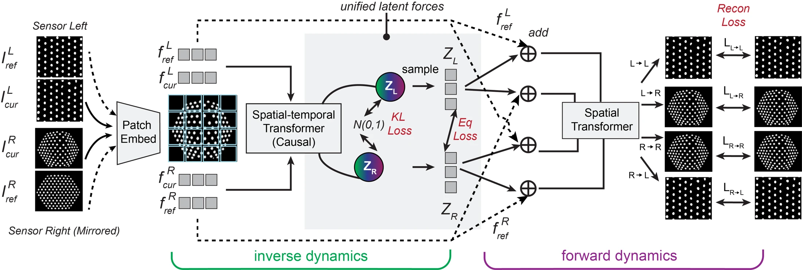

<!-- Generated by scripts/generate.py; edit data/works.json and data/media.json. -->

[← Back to the Awesome index](../../../README.md) · [Interactive website](https://chang-xinhai.github.io/Awesome-RGBDT-Manipulation/?collection=policy&item=uniforce#library)

# UniForce

UniForce: A Unified Latent Force Model for Robot Manipulation with Diverse Tactile Sensors

**2026-02-01 · arXiv preprint 2026 · King’s College London; Imperial College London; University College London; University of Bristol**

**[Paper](https://arxiv.org/abs/2602.01153)**

A shared force-grounded tactile latent aligns heterogeneous sensors through quasi-static equilibrium, with downstream force prediction and VLA wiping transfer.

*UniForce authors · [Figure source](https://arxiv.org/abs/2602.01153) · Original rights retained.*

| Field | Reported value and source scope |
| :-- | :-- |
| Record type | model |
| Model role and downstream interface | Cross-sensor force-grounded tactile representation [1](https://arxiv.org/abs/2602.01153)  |
| Model family | Tactile encoder [1](https://arxiv.org/abs/2602.01153)  |
| Model architecture | Conditional VAE with a causal spatiotemporal Transformer; inverse/forward dynamics share a patch-wise latent. Downstream frozen encoder is integrated into π0.5. [1](https://arxiv.org/abs/2602.01153)  |
| Model size and component | Not reported in the inspected primary manuscript [1](https://arxiv.org/abs/2602.01153)  |
| Model inputs | Reference/current tactile marker images; optical GelSight/TacTip and magnetic uSkin signals are canonicalized to a common image representation. [1](https://arxiv.org/abs/2602.01153)  |
| Model outputs | 196 spatial patches with six latent force coordinates each, reconstructed tactile observations and optional trained force predictions. Latent coordinates are not directly measured force units. [1](https://arxiv.org/abs/2602.01153)  |
| Training method | Self/cross reconstruction, variational regularization and paired force-equilibrium constraints; no external F/T labels required for representation learning. [1](https://arxiv.org/abs/2602.01153)  |
| Training data and scale | UniForce-pair: approximately 8K frames per GelSight–TacTip and uSkin–TacTip pair. Separate GenForce-Hetero data supports force probes; downstream wiping uses 50 task trajectories. [1](https://arxiv.org/abs/2602.01153)  |
| Training duration | Not reported in the inspected primary manuscript [1](https://arxiv.org/abs/2602.01153)  |
| Training hardware | Not reported in the inspected primary manuscript [1](https://arxiv.org/abs/2602.01153)  |
| Inference setting and runtime | Signal-to-marker preprocessing reported above 29.6 Hz; full encoder/VLA inference rate not reported. [1](https://arxiv.org/abs/2602.01153)  |
| Downstream evaluation and scope | Cross-sensor force estimation and reconstruction; frozen-encoder π0.5 wiping evaluated with single and bilateral sensor combinations, 20 rollouts per setting. [1](https://arxiv.org/abs/2602.01153)  |
| Observations / modalities | Tactile |
| Evaluation domain | Real robot |
| Embodiment |  |
| Release: code | Not released [2](https://zhuochenn.github.io/#chen2026uniforce)  |
| Release: weights | Not verified [2](https://zhuochenn.github.io/#chen2026uniforce)  |
| Release: data | Not verified [2](https://zhuochenn.github.io/#chen2026uniforce)  |
| Release: license | Not verified [2](https://zhuochenn.github.io/#chen2026uniforce)  |
| Release: notes | Primary paper says code/data will be released; the inspected author publication page links only the manuscript. No actual release destination was verified. [2](https://zhuochenn.github.io/#chen2026uniforce)  |

**Scope and qualifications**

- Primary role is a reusable tactile encoder; π0.5 provides the downstream action policy. No separate action-policy release is inferred.
- Equilibrium supervision assumes slow bilateral contact; shear directions and transfers from low-resolution sensors have uneven performance.

**Primary evidence**

1. [Original manuscript and first public submission history](https://arxiv.org/abs/2602.01153) — Full author method, evaluation and appendix reviewed; downstream controller probes are distinguished from the reusable model.
2. [Lead-author publication listing](https://zhuochenn.github.io/#chen2026uniforce) — Lists the work as a preprint under review and exposes the manuscript link; no code or checkpoint destination appears for this entry.
