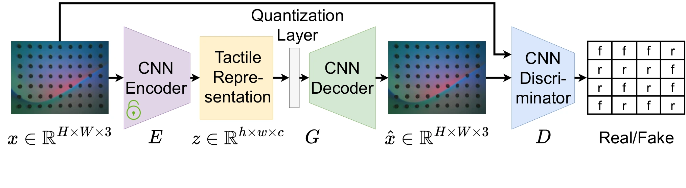

<!-- Generated by scripts/generate.py; edit data/works.json and data/media.json. -->

[← Back to the Awesome index](../../../README.md) · [Interactive website](https://chang-xinhai.github.io/Awesome-RGBDT-Manipulation/?collection=policy&item=unit#library)

# UniT

UniT: Data Efficient Tactile Representation with Generalization to Unseen Objects

**2024-08-12 · IEEE Robotics and Automation Letters 2025 · Purdue University; University of Arkansas**

**[Paper](https://arxiv.org/abs/2408.06481)** · [Project](https://zhengtongxu.github.io/unit-website/) · [Code](https://github.com/ZhengtongXu/UniT) · [Data](https://drive.google.com/drive/folders/1CkPqgNFCE6B1mr2pxYdNdSR-xAkSnxQc?usp=sharing)

Uses a VQGAN tactile autoencoder trained with a single simple object, transferring compact tactile features to unseen objects and downstream manipulation.

*unit authors; original paper figure · [Figure source](https://arxiv.org/html/2408.06481#S2.F1) · Original rights retained.*

| Field | Reported value and source scope |
| :-- | :-- |
| Record type | model |
| Model role and downstream interface | Reusable representation or perception model; downstream controllers are separate systems [1](https://arxiv.org/abs/2408.06481)  |
| Model family | Tactile encoder [1](https://arxiv.org/abs/2408.06481)  |
| Model architecture | VQGAN encoder, quantized codebook and adversarial/reconstruction decoder; downstream frozen encoder heads [1](https://arxiv.org/abs/2408.06481)  |
| Model size and component | 79.81M for the reported 16×20 representation configuration; includes autoencoder scope [1](https://arxiv.org/abs/2408.06481)  |
| Model inputs | GelSight Mini tactile image [1](https://arxiv.org/abs/2408.06481)  |
| Model outputs | Quantized tactile latent map; downstream pose, material or policy features [1](https://arxiv.org/abs/2408.06481)  |
| Training method | Unsupervised VQGAN reconstruction using contacts with a simple object; separate supervised decoders or Diffusion Policy downstream [1](https://arxiv.org/abs/2408.06481)  |
| Training data and scale | Representation data from one simple object per training setup; downstream demonstrations: chicken-leg hanging 200, chip grasping 180, Allen-key insertion 170 [1](https://arxiv.org/abs/2408.06481)  |
| Training duration | Not reported [1](https://arxiv.org/abs/2408.06481)  |
| Training hardware | Not reported [1](https://arxiv.org/abs/2408.06481)  |
| Inference setting and runtime | Not reported [1](https://arxiv.org/abs/2408.06481)  |
| Downstream evaluation and scope | Unseen-object reconstruction; in-hand 3D/6D pose and classification; three physical policy tasks, plus paper simulated policy comparisons. [1](https://arxiv.org/abs/2408.06481)  |
| Observations / modalities | Tactile |
| Evaluation domain | Simulation · Real world |
| Embodiment | Robot arm with parallel-jaw tactile gripper |
| Release: code | Available [2](https://zhengtongxu.github.io/unit-website/) [3](https://github.com/ZhengtongXu/UniT)  |
| Release: weights | Not verified — no separately confirmed pretrained model file [2](https://zhengtongxu.github.io/unit-website/) [3](https://github.com/ZhengtongXu/UniT)  |
| Release: data | Available — official resource link [2](https://zhengtongxu.github.io/unit-website/) [3](https://github.com/ZhengtongXu/UniT)  |
| Release: license | MIT code LICENSE; linked data/checkpoints require their own artifact terms [2](https://zhengtongxu.github.io/unit-website/) [3](https://github.com/ZhengtongXu/UniT) [4](https://github.com/ZhengtongXu/UniT/blob/main/LICENSE)  |
| Release: notes | Code, pretrained encoders and downstream task data are separate artifacts; no policy checkpoint is implied by an encoder release. [2](https://zhengtongxu.github.io/unit-website/) [3](https://github.com/ZhengtongXu/UniT)  |

**Scope and qualifications**

- Earlier lists call this “Unified Tactile Representation for Robot Learning”; current paper title is Data Efficient Tactile Representation with Generalization to Unseen Objects.
- Single-object training is representation pretraining, not zero-demonstration training of the downstream robot controller.

**Primary evidence**

1. [Original model paper and first submission](https://arxiv.org/abs/2408.06481) — Method, experiments and implementation sections; specifications retain component and evaluation scope.
2. [Official project](https://zhengtongxu.github.io/unit-website/) — Author project; author-reported release scope is distinguished from an executed reproduction.
3. [Official implementation and current release instructions](https://github.com/ZhengtongXu/UniT) — README and repository files inspected on 2026-10-17.
4. [Repository license file](https://github.com/ZhengtongXu/UniT/blob/main/LICENSE) — Applies to repository scope; model/data/base-model terms can differ.
