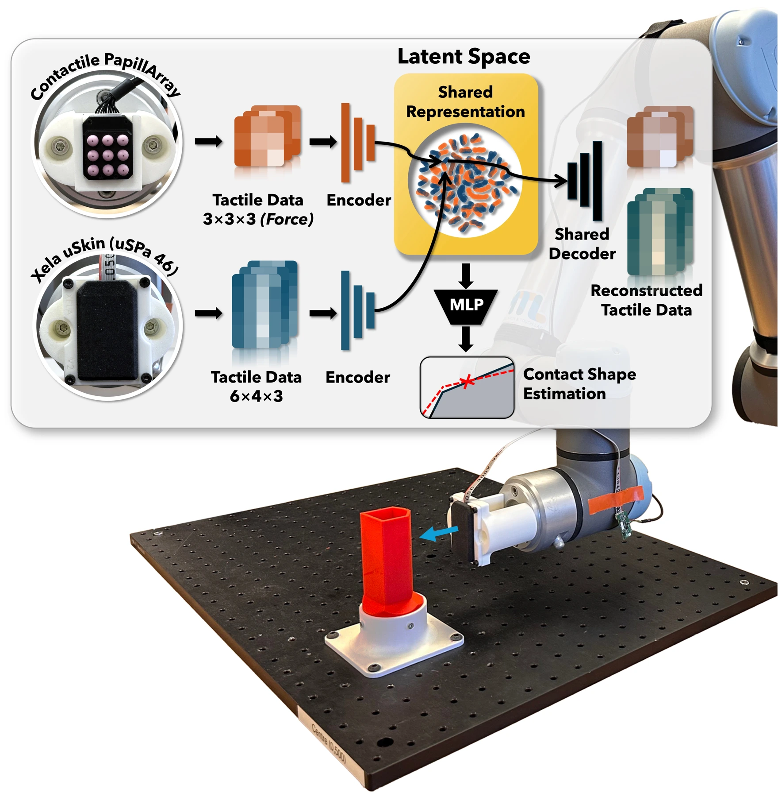

<!-- Generated by scripts/generate.py; edit data/works.json and data/media.json. -->

[← Back to the Awesome index](../../../README.md) · [Interactive website](https://chang-xinhai.github.io/Awesome-RGBDT-Manipulation/?collection=policy&item=unitac-nv#library)

# UniTac-NV

UniTac-NV: A Unified Tactile Representation For Non-Vision-Based Tactile Sensors

**2025-06-24 · Preprint · Manipulation and Touch Lab, Imperial College London**

**[Paper](https://arxiv.org/abs/2506.19699)**

Aligns magnetic and non-optical tactile arrays using matched contacts and an autoencoder, enabling sensor transfer and contact-geometry estimation.

*unitac-nv authors; original paper figure · [Figure source](https://arxiv.org/html/2506.19699#S1.F1) · Original rights retained.*

| Field | Reported value and source scope |
| :-- | :-- |
| Record type | model |
| Model role and downstream interface | Reusable representation or perception model; downstream controllers are separate systems [1](https://arxiv.org/abs/2506.19699)  |
| Model family | Tactile encoder [1](https://arxiv.org/abs/2506.19699)  |
| Model architecture | Sensor-specific MLP encoders with a shared latent space and decoder [1](https://arxiv.org/abs/2506.19699)  |
| Model size and component | Not reported [1](https://arxiv.org/abs/2506.19699)  |
| Model inputs | Xela uSkin uSPa 46 or Contactile PapillArray non-optical tactile readings [1](https://arxiv.org/abs/2506.19699)  |
| Model outputs | Sensor-agnostic latent vector, self/cross-sensor reconstruction, optional 11-dimensional contact-geometry prediction [1](https://arxiv.org/abs/2506.19699)  |
| Training method | Joint autoencoder training on matched interactions; separately trained contact-geometry head [1](https://arxiv.org/abs/2506.19699)  |
| Training data and scale | UR5e force-controlled pressing over six seen shape/material objects (three shapes × PLA/TPU), with an additional irregular unseen object; angle-stratified 90/10 seen split [1](https://arxiv.org/abs/2506.19699)  |
| Training duration | Autoencoder 1,000 epochs; contact-geometry head 80 epochs; wall-clock not reported [1](https://arxiv.org/abs/2506.19699)  |
| Training hardware | Not reported [1](https://arxiv.org/abs/2506.19699)  |
| Inference setting and runtime | Not reported [1](https://arxiv.org/abs/2506.19699)  |
| Downstream evaluation and scope | Self and cross-sensor reconstruction and contact-geometry regression on held-out approach angles/unseen object; no autonomous manipulation evaluation. [1](https://arxiv.org/abs/2506.19699)  |
| Observations / modalities | Tactile |
| Evaluation domain | Real world |
| Embodiment | UR5e robot arm |
| Release: code | Not verified |
| Release: weights | Not verified |
| Release: data | Not verified |
| Release: license | Paper CC BY 4.0; code/model/data release license not verified |
| Release: notes | Code, pretrained encoders and downstream task data are separate artifacts; no policy checkpoint is implied by an encoder release. |

**Scope and qualifications**

- The Xela/Contactile signals are skin tactile arrays, not an optical image or wrist F/T sensor.
- Matched pressing actions collect data; the learned model estimates contact geometry and does not output control actions.

**Primary evidence**

1. [Original model paper and first submission](https://arxiv.org/abs/2506.19699) — Method, experiments and implementation sections; specifications retain component and evaluation scope.
