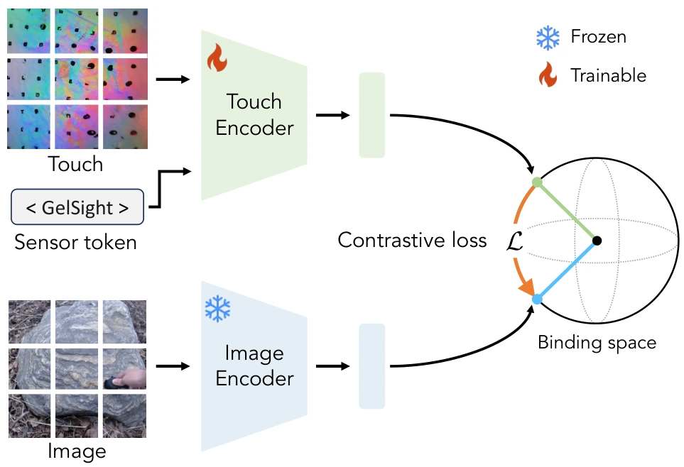

<!-- Generated by scripts/generate.py; edit data/works.json and data/media.json. -->

[← Back to the Awesome index](../../../README.md) · [Interactive website](https://chang-xinhai.github.io/Awesome-RGBDT-Manipulation/?collection=policy&item=unitouch#library)

# UniTouch / Touch-LLM

Binding Touch to Everything: Learning Unified Multimodal Tactile Representations

**2024-01-31 · CVPR 2024 · Yale University; University of Michigan**

**[Paper](https://arxiv.org/abs/2401.18084)** · [Project](https://cfeng16.github.io/UniTouch/) · [Code](https://github.com/cfeng16/UniTouch) · [Weights](https://huggingface.co/chfeng/Touch-LLM)

Binds optical touch to an existing multimodal embedding space through image alignment and sensor-specific tokens, with zero-shot tactile understanding and Touch-LLM demonstrations.

*unitouch authors; original paper figure · [Figure source](https://arxiv.org/html/2401.18084#S3.F3) · Original rights retained.*

| Field | Reported value and source scope |
| :-- | :-- |
| Record type | model |
| Model role and downstream interface | Reusable representation or perception model; downstream controllers are separate systems [1](https://arxiv.org/abs/2401.18084)  |
| Model family | Multimodal representation [1](https://arxiv.org/abs/2401.18084)  |
| Model architecture | ViT tactile encoder aligned to frozen ImageBind image embeddings; sensor-specific tokens; LLaMA-based Touch-LLM extension [1](https://arxiv.org/abs/2401.18084)  |
| Model size and component | 24-layer tactile ViT; feature width 1024; total trainable parameter count not reported [1](https://arxiv.org/abs/2401.18084)  |
| Model inputs | Optical tactile image plus sensor identity; paired scene image for alignment; language/audio queries through the frozen shared space [1](https://arxiv.org/abs/2401.18084)  |
| Model outputs | Shared embeddings, zero-shot property/grasp predictions and retrieval; optional tactile-conditioned text or image generation [1](https://arxiv.org/abs/2401.18084)  |
| Training method | Touch–image contrastive alignment against a frozen multimodal anchor with sensor-specific sampling and tokens [1](https://arxiv.org/abs/2401.18084)  |
| Training data and scale | Paired visual–tactile datasets from heterogeneous optical sensors; paper uses Touch and Go, Feeling of Success, YCB-Slide and ObjectFolder sources [1](https://arxiv.org/abs/2401.18084)  |
| Training duration | 150 epochs for touch embedding alignment; wall-clock duration not reported [1](https://arxiv.org/abs/2401.18084)  |
| Training hardware | 4 NVIDIA A40 GPUs, batch size 48 per GPU for alignment [1](https://arxiv.org/abs/2401.18084)  |
| Inference setting and runtime | Not reported [1](https://arxiv.org/abs/2401.18084)  |
| Downstream evaluation and scope | Zero-shot material and grasp-success prediction, cross-modal retrieval, Touch-LLM question answering and tactile-conditioned image synthesis; no closed-loop manipulation benchmark. [1](https://arxiv.org/abs/2401.18084)  |
| Observations / modalities | Tactile · RGB · Language · Audio |
| Evaluation domain | Real world |
| Embodiment |  |
| Release: code | Available [2](https://cfeng16.github.io/UniTouch/) [3](https://github.com/cfeng16/UniTouch)  |
| Release: weights | Available — official download link [2](https://cfeng16.github.io/UniTouch/) [3](https://github.com/cfeng16/UniTouch)  |
| Release: data | Not verified [2](https://cfeng16.github.io/UniTouch/) [3](https://github.com/cfeng16/UniTouch)  |
| Release: license | No standalone repository LICENSE identified; ImageBind, language and generative backbones retain separate terms [2](https://cfeng16.github.io/UniTouch/) [3](https://github.com/cfeng16/UniTouch)  |
| Release: notes | Code, pretrained encoders and downstream task data are separate artifacts; no policy checkpoint is implied by an encoder release. [2](https://cfeng16.github.io/UniTouch/) [3](https://github.com/cfeng16/UniTouch)  |

**Scope and qualifications**

- Language and audio can query the shared embedding space; they are not additional physical sensor streams required by the tactile encoder.
- Zero-shot grasp prediction and language answers do not constitute an executable manipulation policy.

**Primary evidence**

1. [Original model paper and first submission](https://arxiv.org/abs/2401.18084) — Method, experiments and implementation sections; specifications retain component and evaluation scope.
2. [Official project](https://cfeng16.github.io/UniTouch/) — Author project; author-reported release scope is distinguished from an executed reproduction.
3. [Official implementation and current release instructions](https://github.com/cfeng16/UniTouch) — README and repository files inspected on 2026-10-17.
