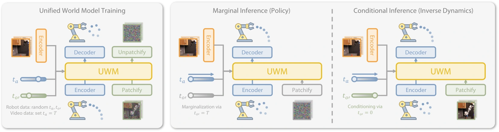

<!-- Generated by scripts/generate.py; edit data/works.json and data/media.json. -->

[← Back to the Awesome index](../../../README.md) · [Interactive website](https://chang-xinhai.github.io/Awesome-RGBDT-Manipulation/?collection=policy&item=uwm#library)

# Unified World Models (UWM)

Unified World Models: Coupling Video and Action Diffusion for Pretraining on Large Robotic Datasets

**2025-04-03 · RSS 2025 · University of Washington / Toyota Research Institute**

**[Paper](https://arxiv.org/abs/2504.02792)** · [Project](https://weirdlabuw.github.io/uwm/) · [Code](https://github.com/WEIRDLabUW/unified-world-model)

Unifies policy, forward dynamics, inverse dynamics and video prediction by independently controlling action and video diffusion times.

*Unified World Models (UWM) authors · [Figure source](https://arxiv.org/html/2504.02792) · Original rights retained.*

| Field | Reported value and source scope |
| :-- | :-- |
| Record type | policy |
| Policy family | World-action model [1](https://arxiv.org/abs/2504.02792)  |
| Base model and architecture | Multimodal diffusion Transformer with observation/action streams and independent modality timesteps. [1](https://arxiv.org/abs/2504.02792)  |
| Model size and component | Complete policy count not reported. [1](https://arxiv.org/abs/2504.02792)  |
| Deployment inputs | RGB cameras; proprioception where configured, with language conditioning for LIBERO. [1](https://arxiv.org/abs/2504.02792)  |
| Action outputs and horizon | Actions or visual futures depending on query mode; physical seven-dimensional end-effector delta/gripper actions. [1](https://arxiv.org/abs/2504.02792)  |
| Training method | Coupled video/action diffusion with independent noise levels; missing action labels masked on action-free videos. [1](https://arxiv.org/abs/2504.02792)  |
| Training data | DROID robot trajectories, physical target-task data, LIBERO/robomimic and action-free video co-training. [1](https://arxiv.org/abs/2504.02792)  |
| Training duration | DROID pretraining: 100k steps in approximately 24 hours. Target-task fine-tuning is separate. [1](https://arxiv.org/abs/2504.02792)  |
| Training hardware | Four A100 GPUs for DROID pretraining. [1](https://arxiv.org/abs/2504.02792)  |
| Inference and control rates | Physical Franka control at 10 Hz; not a measured common model-query throughput. [1](https://arxiv.org/abs/2504.02792)  |
| Evaluation scope | Physical Franka/DROID tasks, LIBERO and robomimic; ID/OOD distractors and learning-from-scratch comparisons. [1](https://arxiv.org/abs/2504.02792)  |
| Observations / modalities | RGB · Proprioception · Language |
| Evaluation domain | Simulation · Real world |
| Embodiment | Parallel-jaw gripper · Bimanual |
| Release: code | Available [2](https://github.com/WEIRDLabUW/unified-world-model) [3](https://weirdlabuw.github.io/uwm/)  |
| Release: weights | Not verified [2](https://github.com/WEIRDLabUW/unified-world-model) [3](https://weirdlabuw.github.io/uwm/)  |
| Release: data | Partial [2](https://github.com/WEIRDLabUW/unified-world-model) [3](https://weirdlabuw.github.io/uwm/)  |
| Release: license | Not verified; pretrained backbones and data retain separate terms [2](https://github.com/WEIRDLabUW/unified-world-model) [3](https://weirdlabuw.github.io/uwm/)  |
| Release: notes | Availability concerns author-linked artifacts; no training or installation reproduced. [2](https://github.com/WEIRDLabUW/unified-world-model) [3](https://weirdlabuw.github.io/uwm/)  |

**Scope and qualifications**

- The model exposes an executable policy mode, in addition to video simulation.
- Observation/action context varies across benchmarks.

**Primary evidence**

1. [Author manuscript and submission history](https://arxiv.org/abs/2504.02792) — Read full manuscript; first arXiv submission retained separately from current revision. Numeric costs and observations have setting-specific scope.
2. [Official implementation](https://github.com/WEIRDLabUW/unified-world-model) — Author-linked code and artifact instructions; current release may differ from the original manuscript.
3. [Official project](https://weirdlabuw.github.io/uwm/) — Author project and links; scientific figure keeps original rights.
