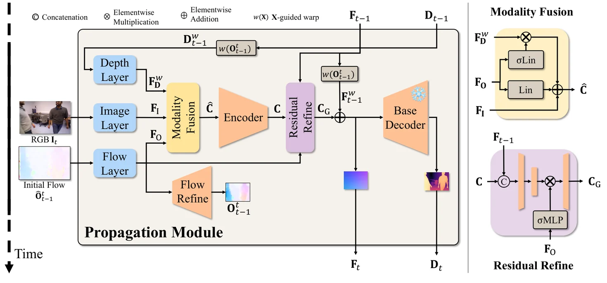

<!-- Generated by scripts/generate.py; edit data/works.json and data/media.json. -->

[← Back to the Awesome index](../../../README.md) · [Interactive website](https://chang-xinhai.github.io/Awesome-RGBDT-Manipulation/?collection=policy&item=velodepth#library)

# VeloDepth

Video Depth Propagation

**2025-12-11 · 3DV 2026 · ETH Zürich and Toyota Motor Europe**

**[Paper](https://arxiv.org/abs/2512.10725)** · [Project](https://lpiccinelli-eth.github.io/pub/velodepth/) · [Code](https://github.com/lpiccinelli-eth/velodepth) · [Weights](https://huggingface.co/lpiccinelli/velodepth)

An online propagation model reuses earlier metric-depth features, avoiding repeated heavy inference on every video frame.

*Luigi Piccinelli and coauthors · [Figure source](https://arxiv.org/html/2512.10725v1) · Original rights retained.*

| Field | Reported value and source scope |
| :-- | :-- |
| Record type | model |
| Model role and downstream interface | Geometry perception model [1](https://arxiv.org/html/2512.10725v1)  |
| Model family | Causal monocular video depth [1](https://arxiv.org/html/2512.10725v1)  |
| Model architecture | UniK3D keyframe estimator with recurrent flow-based learned propagation. [1](https://arxiv.org/html/2512.10725v1) [3](https://github.com/lpiccinelli-eth/velodepth)  |
| Model size and component | Not reported [1](https://arxiv.org/html/2512.10725v1)  |
| Model inputs | Online sequence of RGB frames and persistent previous depth/features. [1](https://arxiv.org/html/2512.10725v1)  |
| Model outputs | Dense depth per frame and propagated hidden features. [1](https://arxiv.org/html/2512.10725v1)  |
| Training method | Pretrain depth from the base model; learn spatiotemporal residuals and feature propagation from video supervision. [1](https://arxiv.org/html/2512.10725v1)  |
| Training data and scale | Paper describes training clips and public benchmark splits in training details. [1](https://arxiv.org/html/2512.10725v1)  |
| Training duration | Not reported [1](https://arxiv.org/html/2512.10725v1)  |
| Training hardware | Not reported [1](https://arxiv.org/html/2512.10725v1)  |
| Inference setting and runtime | Keyframe inference is separate from the faster update path; reported FPS depends on the keyframe schedule and GPU. [1](https://arxiv.org/html/2512.10725v1)  |
| Downstream evaluation and scope | Zero-shot tested across real and synthetic video depth domains with depth error and temporal consistency. [1](https://arxiv.org/html/2512.10725v1)  |
| Observations / modalities | RGB |
| Evaluation domain | Simulation · Real world |
| Embodiment |  |
| Release: code | Available — PyTorch inference implementation. [2](https://lpiccinelli-eth.github.io/pub/velodepth/) [3](https://github.com/lpiccinelli-eth/velodepth)  |
| Release: weights | Available — author release with UniK3D keyframe model. [2](https://lpiccinelli-eth.github.io/pub/velodepth/) [5](https://huggingface.co/lpiccinelli/velodepth)  |
| Release: data | Paper lists training and evaluation sets; no bundled complete training corpus verified. [2](https://lpiccinelli-eth.github.io/pub/velodepth/)  |
| Release: license | CC BY-NC-SA 4.0 in the author source LICENSE; check checkpoint and base model terms separately. [2](https://lpiccinelli-eth.github.io/pub/velodepth/) [4](https://github.com/lpiccinelli-eth/velodepth/blob/main/LICENSE)  |
| Release: notes | Current published release propagates UniK3D estimates. [2](https://lpiccinelli-eth.github.io/pub/velodepth/)  |

**Scope and qualifications**

- The depth scale follows the learned keyframe estimator.

**Primary evidence**

1. [Original author paper or dataset description](https://arxiv.org/html/2512.10725v1)
2. [Author source and artifact entry points](https://lpiccinelli-eth.github.io/pub/velodepth/)
3. [Official implementation and released base model choice](https://github.com/lpiccinelli-eth/velodepth)
4. [Source license](https://github.com/lpiccinelli-eth/velodepth/blob/main/LICENSE)
5. [Official checkpoint repository](https://huggingface.co/lpiccinelli/velodepth)
