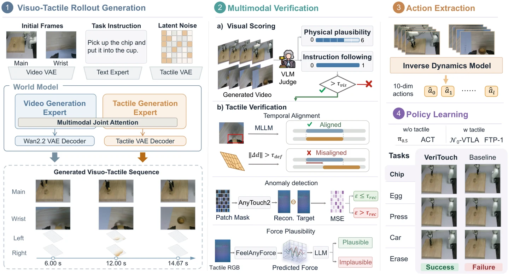

<!-- Generated by scripts/generate.py; edit data/works.json and data/media.json. -->

[← Back to the Awesome index](../../../README.md) · [Interactive website](https://chang-xinhai.github.io/Awesome-RGBDT-Manipulation/?collection=policy&item=veritouch#library)

# VeriTouch

VeriTouch: Verified Visuo-Tactile World Models that Improve Robot Policy Learning

**2026-11-23 · Preprint · Zhejiang University and collaborators**

**[Paper](https://arxiv.org/abs/2611.30572)** · [Project](https://zjuscl.github.io/veritouch/)

Generates and checks joint RGB and tactile trajectories, then assigns actions to create demonstrations for downstream policy training.

*Shuxun Wang and coauthors · [Figure source](https://arxiv.org/html/2611.30572v1) · Original rights retained.*

| Field | Reported value and source scope |
| :-- | :-- |
| Record type | model |
| Model role and downstream interface | Training-data generator, verifier and inverse-dynamics labeler for visuo-tactile action learning [1](https://arxiv.org/html/2611.30572v1)  |
| Model family | VeriTouch [1](https://arxiv.org/html/2611.30572v1)  |
| Model architecture | Pretrained video generator with separate tactile generation expert and a multimodal verifier. [1](https://arxiv.org/html/2611.30572v1)  |
| Model size and component | Not reported [1](https://arxiv.org/html/2611.30572v1)  |
| Model inputs | Initial main/wrist RGB and task instruction for generation. Verification receives generated videos/contact sequences; inverse dynamics labels filtered trajectories. [1](https://arxiv.org/html/2611.30572v1)  |
| Model outputs | Paired synthetic RGB and tactile trajectories with estimated robot commands; the pipeline itself does not execute a closed-loop manipulation policy. [1](https://arxiv.org/html/2611.30572v1)  |
| Training method | Joint RGB/tactile generation, plausibility and consistency filtering, then inverse-dynamics action extraction. [1](https://arxiv.org/html/2611.30572v1)  |
| Training data and scale | Mixed real and simulated trajectories across training stages, including target-task physical examples. VeriIDM reports 355 real and 540 simulation trajectories. [1](https://arxiv.org/html/2611.30572v1)  |
| Training duration | Not reported [1](https://arxiv.org/html/2611.30572v1)  |
| Training hardware | Not reported [1](https://arxiv.org/html/2611.30572v1)  |
| Inference setting and runtime | Not reported [1](https://arxiv.org/html/2611.30572v1)  |
| Downstream evaluation and scope | Downstream gains evaluated on five physical manipulation tasks across four policy variants; separate 25-episode generation comparison with three rollouts per episode. [1](https://arxiv.org/html/2611.30572v1)  |
| Observations / modalities | RGB · Language |
| Evaluation domain | Simulation · Real world |
| Embodiment | Parallel-jaw gripper |
| Release: code | Not verified |
| Release: weights | Not verified |
| Release: data | Not verified |
| Release: license | Not verified |
| Release: notes | Public paper verified. Code, task weights and data are tracked separately. |

**Scope and qualifications**

- Downstream visual/tactile policies provide the closed-loop control evidence. The core resource generates labeled training data.
- Tactile is generated by the training-data model. The input modality label describes this generator, not the downstream policy.

**Primary evidence**

1. [Original author paper with methods, evaluation and scope](https://arxiv.org/html/2611.30572v1)
2. [Public author project with method and evaluation examples](https://zjuscl.github.io/veritouch/)
