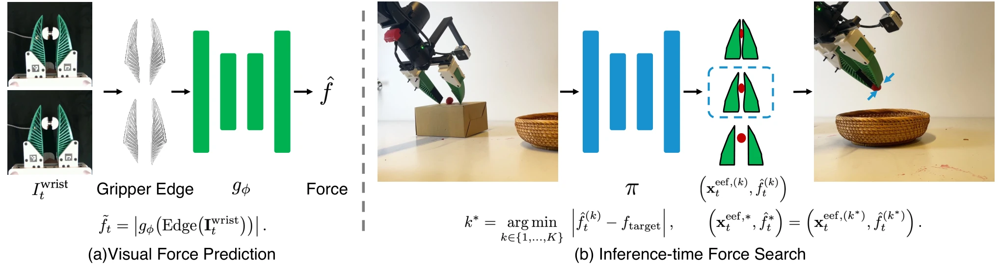

<!-- Generated by scripts/generate.py; edit data/works.json and data/media.json. -->

[← Back to the Awesome index](../../../README.md) · [Interactive website](https://chang-xinhai.github.io/Awesome-RGBDT-Manipulation/?collection=policy&item=visual-predicted-force#library)

# Visual Predicted Force

Robot Learning with Visual Predicted Force

**2026-10-03 · Preprint · Not reported**

**[Paper](https://arxiv.org/abs/2610.04741)**

A diffusion policy jointly proposes actions and forces, then selects actions matching a task-specific target without a deployment force sensor.

*Robot Learning with Visual Predicted Force authors · [Figure source](https://arxiv.org/abs/2610.04741) · Original rights retained.*

| Field | Reported value and source scope |
| :-- | :-- |
| Record type | policy |
| Policy family | Diffusion [1](https://arxiv.org/abs/2610.04741)  |
| Base model and architecture | Visual Fin Ray-force estimator for demonstration labeling; Diffusion Policy action–force proposal model. [1](https://arxiv.org/abs/2610.04741)  |
| Model size and component | Not reported [1](https://arxiv.org/abs/2610.04741)  |
| Deployment inputs | RGB and robot state; force estimator used to label training demos, not to rank test time candidate actions. [1](https://arxiv.org/abs/2610.04741)  |
| Action outputs and horizon | Candidate end-effector actions and force values; execute candidate closest to demonstration target force. [1](https://arxiv.org/abs/2610.04741)  |
| Training method | Calibration force regression, frozen-label annotation and joint action–force diffusion imitation. [1](https://arxiv.org/abs/2610.04741)  |
| Training data | Calibration 117 episodes/47.5 min;40 robot demonstrations per each of four tasks. [1](https://arxiv.org/abs/2610.04741)  |
| Training duration | Not reported [1](https://arxiv.org/abs/2610.04741)  |
| Training hardware | Single NVIDIA GeForce RTX5090for policy training and execution. [1](https://arxiv.org/abs/2610.04741)  |
| Inference and control rates | Not reported [1](https://arxiv.org/abs/2610.04741)  |
| Evaluation scope | ARX arm/Fin Ray gripper:berry picking, empty-can grasping, in-hand reorientation, plug insertion. [1](https://arxiv.org/abs/2610.04741)  |
| Observations / modalities | RGB · Proprioception |
| Evaluation domain | Real world |
| Embodiment | Parallel-jaw gripper |
| Release: code | Not verified |
| Release: weights | Not verified |
| Release: data | Not verified |
| Release: license | Not verified |
| Release: notes | Original paper reviewed; claimed future releases are not treated as currently available. |

**Scope and qualifications**

- Runtime force values are policy-generated predictions, not sensor readings.
- Only normal grasping force is modeled; the visual force estimator does not provide online correction of sampled actions.

**Primary evidence**

1. [Original paper and supplementary implementation details](https://arxiv.org/abs/2610.04741) — Primary full text reviewed; dataset, deployment modalities and training-only privileges are scoped separately.
