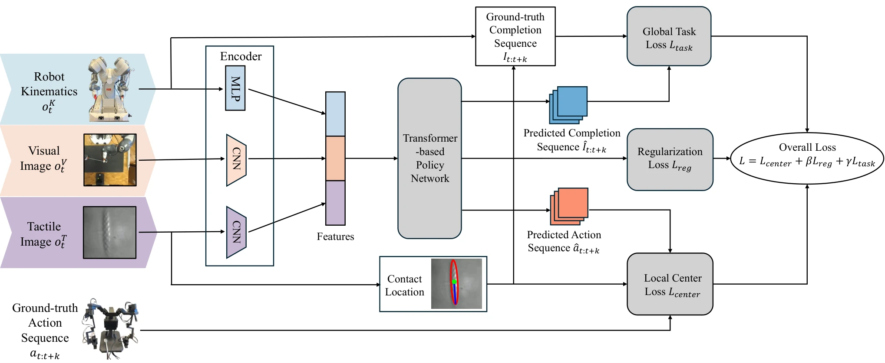

<!-- Generated by scripts/generate.py; edit data/works.json and data/media.json. -->

[← Back to the Awesome index](../../../README.md) · [Interactive website](https://chang-xinhai.github.io/Awesome-RGBDT-Manipulation/?collection=policy&item=vitac-tracing#library)

# ViTac-Tracing

ViTac-Tracing: Visual-Tactile Imitation Learning of Deformable Object Tracing

**2026-03-19 · Preprint · King's College London / Imperial College London**

**[Paper](https://arxiv.org/abs/2603.18784)**

A unified visual-tactile imitation policy traces both linear and planar deformable objects.

*ViTac-Tracing: Visual-Tactile Imitation Learning of Deformable Object Tracing authors · [Figure source](https://arxiv.org/abs/2603.18784) · Original rights retained.*

| Field | Reported value and source scope |
| :-- | :-- |
| Record type | policy |
| Policy family | ACT [1](https://arxiv.org/abs/2603.18784)  |
| Base model and architecture | Action-chunking policy with separate ResNet 18 vision/tactile encoders, local center loss and global task-progress loss. [1](https://arxiv.org/abs/2603.18784)  |
| Model size and component | Not reported [1](https://arxiv.org/abs/2603.18784)  |
| Deployment inputs | RGB, tactile images and robot kinematic/gripper states. [1](https://arxiv.org/abs/2603.18784)  |
| Action outputs and horizon | 60-step joint-space or Cartesian end-effector action chunks. [1](https://arxiv.org/abs/2603.18784)  |
| Training method | Behavior cloning with contact-center, KL and task-progress losses; checkpoint chosen by validation loss. [1](https://arxiv.org/abs/2603.18784)  |
| Training data | 100 demos:25 each for flat shoelace, braided cable, face towel and microfiber cloth. [1](https://arxiv.org/abs/2603.18784)  |
| Training duration | 15,000 epochs; wall-clock Not reported. [1](https://arxiv.org/abs/2603.18784)  |
| Training hardware | NVIDIA RTX4090workstation for training. [1](https://arxiv.org/abs/2603.18784)  |
| Inference and control rates | 30 Hz data recording; inference frequency Not reported. [1](https://arxiv.org/abs/2603.18784)  |
| Evaluation scope | Real tracing across four training objects and two unseen objects. [1](https://arxiv.org/abs/2603.18784)  |
| Observations / modalities | RGB · Tactile · Proprioception |
| Evaluation domain | Real world |
| Embodiment | Parallel-jaw gripper |
| Release: code | Not verified |
| Release: weights | Not verified |
| Release: data | Not verified |
| Release: license | Not verified |
| Release: notes | Original paper reviewed; claimed future releases are not treated as currently available. |

**Scope and qualifications**

- Do not conflate this gripper tracing method with tactile-only dexterous Touch 2 Trace.

**Primary evidence**

1. [Original paper and supplementary implementation details](https://arxiv.org/abs/2603.18784) — Primary full text reviewed; dataset, deployment modalities and training-only privileges are scoped separately.
