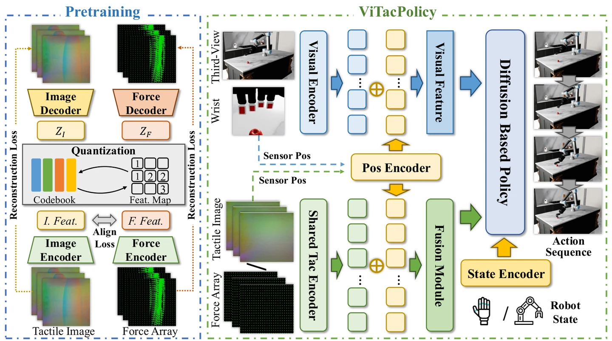

<!-- Generated by scripts/generate.py; edit data/works.json and data/media.json. -->

[← Back to the Awesome index](../../../README.md) · [Interactive website](https://chang-xinhai.github.io/Awesome-RGBDT-Manipulation/?collection=policy&item=vitaclab#library)

# ViTacLab

ViTacLab: Physically Consistent Visuo-Tactile Simulation, Benchmarking, and Representation Learning for Robotic Manipulation

**2026-11-24 · Preprint · University of Hong Kong; Ant Group and collaborators**

**[Paper](https://arxiv.org/abs/2611.32476)** · [Project](https://youlj109.github.io/ViTacLab/) · [Code](https://github.com/youlj109/ViTacLab) · [Data](https://huggingface.co/datasets/Yanlj/ViTacLab-assets)

Simulates multiple tactile formats and learns pose-conditioned visual–tactile policy features across grippers and single- or dual-hand robots.

*Linjing You and coauthors · [Figure source](https://arxiv.org/html/2611.32476v1) · Original rights retained.*

| Field | Reported value and source scope |
| :-- | :-- |
| Record type | policy |
| Policy family | ViTacLab [1](https://arxiv.org/html/2611.32476v1)  |
| Base model and architecture | Not reported [1](https://arxiv.org/html/2611.32476v1)  |
| Model size and component | Not reported [1](https://arxiv.org/html/2611.32476v1)  |
| Deployment inputs | RGB views, proprioception and a variable number of spatially registered tactile images or force-array inputs. [1](https://arxiv.org/html/2611.32476v1)  |
| Action outputs and horizon | Diffusion action chunk conditioned on fused multi-sensor features. [1](https://arxiv.org/html/2611.32476v1)  |
| Training method | Pose-conditioned Transformer over heterogeneous tactile observations and two-stream VQ-VAE alignment using a shared codebook. [1](https://arxiv.org/html/2611.32476v1)  |
| Training data | Benchmark-specific simulated demonstration corpora; physically calibrated contact fields and tactile renderings. [1](https://arxiv.org/html/2611.32476v1)  |
| Training duration | Not reported [1](https://arxiv.org/html/2611.32476v1)  |
| Training hardware | Not reported [1](https://arxiv.org/html/2611.32476v1)  |
| Inference and control rates | Not reported [1](https://arxiv.org/html/2611.32476v1)  |
| Evaluation scope | Fifteen tasks across three embodiments and sensing regimes; real-sensor measurements validate tactile simulation separately. [1](https://arxiv.org/html/2611.32476v1)  |
| Observations / modalities | RGB · Tactile · Proprioception |
| Evaluation domain | Simulation |
| Embodiment | Parallel-jaw gripper · Dexterous hand · Bimanual |
| Release: code | Partial — simulator, environments and downstream policy code; pretraining source and some required assets are missing [3](https://github.com/youlj109/ViTacLab#readme)  |
| Release: weights | Not verified — pretrained-backbone hooks are distinct from model release [3](https://github.com/youlj109/ViTacLab#readme)  |
| Release: data | Partial — public external asset bundle and examples; full paper-scale assets not packaged [3](https://github.com/youlj109/ViTacLab#readme) [4](https://huggingface.co/datasets/Yanlj/ViTacLab-assets)  |
| Release: license | Apache-2.0 source; external environments and assets have separate terms. [3](https://github.com/youlj109/ViTacLab#readme)  |
| Release: notes | Public paper verified. Code, task weights and data are tracked separately. [3](https://github.com/youlj109/ViTacLab#readme)  |

**Scope and qualifications**

- Real-sensor touching and sliding experiments validate simulation. Policy results in ViTacBench are simulated.

**Primary evidence**

1. [Original author paper with methods, evaluation and scope](https://arxiv.org/html/2611.32476v1)
2. [Public author project with method and evaluation examples](https://youlj109.github.io/ViTacLab/)
3. [Public checkout and release table](https://github.com/youlj109/ViTacLab#readme)
4. [External asset bundle](https://huggingface.co/datasets/Yanlj/ViTacLab-assets)
