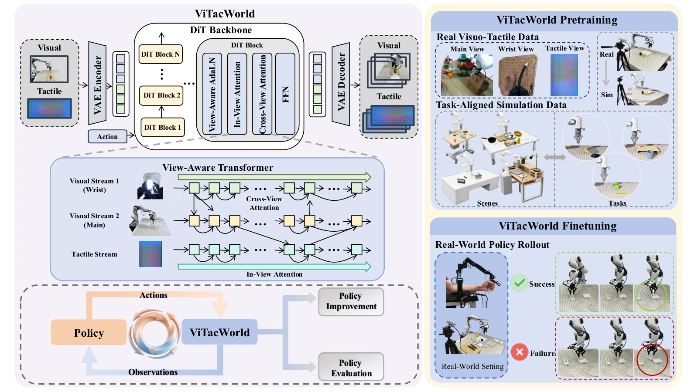

<!-- Generated by scripts/generate.py; edit data/works.json and data/media.json. -->

[← Back to the Awesome index](../../../README.md) · [Interactive website](https://chang-xinhai.github.io/Awesome-RGBDT-Manipulation/?collection=policy&item=vitacworld#library)

# ViTacWorld

ViTacWorld: Scaling Visuo-Tactile World Models for Contact-Rich Robot Manipulation

**2026-07-24 · Preprint · ShanghaiTech University / InstAdapt**

**[Paper](https://arxiv.org/abs/2607.22530)** · [Project](https://vitacworld.github.io/)

An action-conditioned world model generates aligned RGB and tactile rollouts for policy training and imagined evaluation.

*ViTacWorld: Scaling Visuo-Tactile World Models for Contact-Rich Robot Manipulation authors · [Figure source](https://arxiv.org/abs/2607.22530) · Original rights retained.*

| Field | Reported value and source scope |
| :-- | :-- |
| Record type | model |
| Model role and downstream interface | Action-conditioned visuo-tactile rollout generator for downstream policy augmentation and evaluation. [1](https://arxiv.org/abs/2607.22530)  |
| Model family | Diffusion world model [1](https://arxiv.org/abs/2607.22530)  |
| Model architecture | Pretrained action-conditioned robot video world-model prior; exact checkpoint Not reported. [1](https://arxiv.org/abs/2607.22530)  |
| Model size and component | Not reported. [1](https://arxiv.org/abs/2607.22530)  |
| Model inputs | Current external/wrist RGB and image-like tactile views, view-presence mask and a provided sequence of relative end-effector motions with gripper commands. [1](https://arxiv.org/abs/2607.22530)  |
| Model outputs | Temporally aligned future RGB and tactile observations; does not generate robot actions itself. [1](https://arxiv.org/abs/2607.22530)  |
| Training method | Latent denoising with view-aware modulation and cross-view attention; real/simulation pretraining followed by target-domain expert and policy-rollout fine-tuning. [1](https://arxiv.org/abs/2607.22530)  |
| Training data and scale | &gt;16k public real trajectories and &gt;5k task-aligned Isaac Sim trajectories, sampled about 2:1. Target adaptation uses 300 expert demonstrations total across four tasks (120+50+62+68), plus 50 real policy rollouts per task. Synthetic augmentation selects 200 successful trajectories/round, yielding 500 then 700 downstream training trajectories. [1](https://arxiv.org/abs/2607.22530)  |
| Training duration | 30k pretraining and 7k fine-tuning steps; wall-clock time Not reported. [1](https://arxiv.org/abs/2607.22530)  |
| Training hardware | Not reported. [1](https://arxiv.org/abs/2607.22530)  |
| Inference setting and runtime | 13-frame windows sampled at 15 Hz during training; generator throughput Not reported. Isaac Sim version Not reported. [1](https://arxiv.org/abs/2607.22530)  |
| Downstream evaluation and scope | Franka Panda / Robotiq 2F-85 with Xense tactile: Charger Plugging, Cucumber Peeling, U-Block Insertion, Cuboid Insertion. Three downstream policies/stages use 50 real trials/task. Imagined evaluation compares 600 matched real/imagined pairs aggregated into 12 success-rate points. [1](https://arxiv.org/abs/2607.22530)  |
| Observations / modalities | RGB · Tactile |
| Evaluation domain | Simulation · Real world |
| Embodiment | Parallel-jaw gripper |
| Release: code | Not released [2](https://vitacworld.github.io/)  |
| Release: weights | Not verified [2](https://vitacworld.github.io/)  |
| Release: data | Not verified [2](https://vitacworld.github.io/)  |
| Release: license | Not verified [2](https://vitacworld.github.io/)  |
| Release: notes | Official project explicitly labels code coming soon. No downloadable model or dataset release verified. [2](https://vitacworld.github.io/)  |

**Scope and qualifications**

- Supporting predictive model, not an executable action policy; π0.5 and ACT supply actions for rollouts and are trained separately.
- World-model prediction uses RGB/tactile views and provided action sequences; downstream policy proprioception and language are not automatically model observation channels.
- Imagined evaluation uses human task/plausibility judgment; aggregate correlation does not prove trial-level agreement or exact success calibration.

**Primary evidence**

1. [Original paper and reviewed full text](https://arxiv.org/abs/2607.22530) — Full primary text, including available supplementary implementation details; first public date retained separately from reviewed revision.
2. [Official author project](https://vitacworld.github.io/) — Current project links and release claims checked independently of paper prose.
