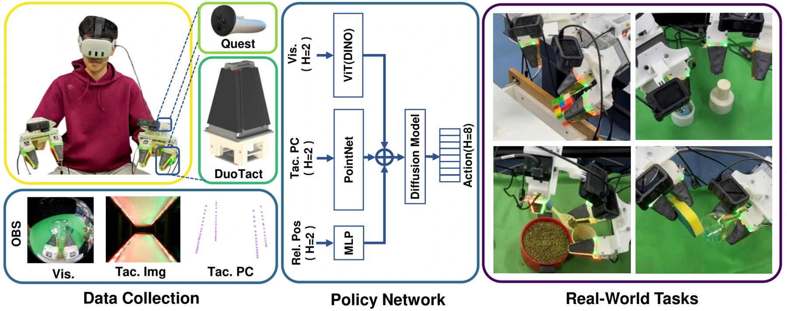

<!-- Generated by scripts/generate.py; edit data/works.json and data/media.json. -->

[← Back to the Awesome index](../../../README.md) · [Interactive website](https://chang-xinhai.github.io/Awesome-RGBDT-Manipulation/?collection=policy&item=vitamin-b#library)

# ViTaMIn-B

ViTaMIn-B: A Reliable and Efficient Visuo-Tactile Bimanual Manipulation Interface

**2025-11-08 · Preprint · Tsinghua University / University of California, Berkeley / JD Explore Academy / Hong Kong Polytechnic University**

**[Paper](https://arxiv.org/abs/2511.05858)** · [Project](https://chuanyune.github.io/ViTaMIn-B_page/) · [Code](https://github.com/chuanyune/ViTaMIn-B_code) · [Data](https://huggingface.co/datasets/chuanyune/ViTaMIn-B_data_and_ckpt) · [Weights](https://huggingface.co/datasets/chuanyune/ViTaMIn-B_data_and_ckpt)

Bimanual handheld demonstrations and tactile deformation point clouds improve cross-sensor policy transfer.

*Chuanyu Li et al., ViTaMIn-B, Figure 1 (arXiv v2). Original rights retained. · [Figure source](https://arxiv.org/abs/2511.05858) · Original rights retained.*

| Field | Reported value and source scope |
| :-- | :-- |
| Record type | policy |
| Policy family | Diffusion [1](https://arxiv.org/abs/2511.05858)  |
| Base model and architecture | DINO ViT-B/16 RGB encoder, shared Point Net tactile encoder and diffusion policy. [1](https://arxiv.org/abs/2511.05858)  |
| Model size and component | Not reported [1](https://arxiv.org/abs/2511.05858)  |
| Deployment inputs | RGB, 256-point local tactile deformation point clouds and proprioception. [1](https://arxiv.org/abs/2511.05858)  |
| Action outputs and horizon | Bimanual end-effector/gripper action sequences. [1](https://arxiv.org/abs/2511.05858)  |
| Training method | Diffusion imitation on synchronized Meta Quest-tracked human demonstrations; compare tactile image/pointcloud representations. [1](https://arxiv.org/abs/2511.05858)  |
| Training data | Four bimanual manipulation task datasets; exact retained demonstrations Not reported in inspected text. [1](https://arxiv.org/abs/2511.05858)  |
| Training duration | Not reported [1](https://arxiv.org/abs/2511.05858)  |
| Training hardware | Not reported [1](https://arxiv.org/abs/2511.05858)  |
| Inference and control rates | Not reported [1](https://arxiv.org/abs/2511.05858)  |
| Evaluation scope | Four real bimanual tasks including weight placement; switched sensor installation tests. [1](https://arxiv.org/abs/2511.05858)  |
| Observations / modalities | RGB · Tactile · Proprioception |
| Evaluation domain | Real world |
| Embodiment | Parallel-jaw gripper · Bimanual |
| Release: code | Available [2](https://chuanyune.github.io/ViTaMIn-B_page/) [3](https://github.com/chuanyune/ViTaMIn-B_code) [4](https://huggingface.co/datasets/chuanyune/ViTaMIn-B_data_and_ckpt)  |
| Release: weights | Available [2](https://chuanyune.github.io/ViTaMIn-B_page/) [3](https://github.com/chuanyune/ViTaMIn-B_code) [4](https://huggingface.co/datasets/chuanyune/ViTaMIn-B_data_and_ckpt)  |
| Release: data | Available [2](https://chuanyune.github.io/ViTaMIn-B_page/) [3](https://github.com/chuanyune/ViTaMIn-B_code) [4](https://huggingface.co/datasets/chuanyune/ViTaMIn-B_data_and_ckpt)  |
| Release: license | MIT for released datasets and four task policy checkpoints, verified actual HF LICENSE; original GitHub code license remains Not verified because no root code LICENSE is present. [2](https://chuanyune.github.io/ViTaMIn-B_page/) [3](https://github.com/chuanyune/ViTaMIn-B_code) [4](https://huggingface.co/datasets/chuanyune/ViTaMIn-B_data_and_ckpt)  |
| Release: notes | Official HF inventory includes four task-specific.ckpt files, four processed task archives and rawdata.zip. The newly published HF LICENSE explicitly applies MIT to these released data/weights; it does not silently license the separate unlicensed code repository. [2](https://chuanyune.github.io/ViTaMIn-B_page/) [3](https://github.com/chuanyune/ViTaMIn-B_code) [4](https://huggingface.co/datasets/chuanyune/ViTaMIn-B_data_and_ckpt)  |

**Scope and qualifications**

- Tactile deformation point clouds describe sensor surface geometry, not an external RGB-D stream.

**Primary evidence**

1. [Original paper and supplementary implementation details](https://arxiv.org/abs/2511.05858) — Primary full text reviewed; dataset, deployment modalities and training-only privileges are scoped separately.
2. [Official author project](https://chuanyune.github.io/ViTaMIn-B_page/) — Live artifact status reviewed separately from paper claims.
3. [Official released implementation and LICENSE](https://github.com/chuanyune/ViTaMIn-B_code) — Substantive implementation is public, but no original root code LICENSE was verified. The HF data/checkpoint LICENSE has separate scope.
4. [Author-linked released dataset](https://huggingface.co/datasets/chuanyune/ViTaMIn-B_data_and_ckpt) — Public repository file inventory inspected; component/data scope follows model/dataset card.
5. [Official current source / actual release —26October2026](https://huggingface.co/datasets/chuanyune/ViTaMIn-B_data_and_ckpt/blob/main/LICENSE) — Actual MIT text newly verified for the HF artifacts; no inference about separate original-code redistribution permission.
