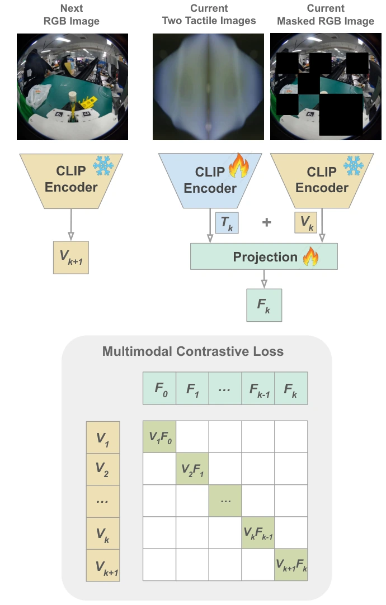

<!-- Generated by scripts/generate.py; edit data/works.json and data/media.json. -->

[← Back to the Awesome index](../../../README.md) · [Interactive website](https://chang-xinhai.github.io/Awesome-RGBDT-Manipulation/?collection=policy&item=vitamin#library)

# ViTaMIn

ViTaMIn: Learning Contact-Rich Tasks Through Robot-Free Visuo-Tactile Manipulation Interface

**2025-04-08 · Preprint · Tsinghua University / University of California, Berkeley**

**[Paper](https://arxiv.org/abs/2504.06156)** · [Project](https://chuanyune.github.io/ViTaMIn_page/)

A compliant handheld visual-tactile interface and multimodal pretraining support contact-rich robot imitation.

*ViTaMIn: Learning Contact-Rich Tasks Through Robot-Free Visuo-Tactile Manipulation Interface authors · [Figure source](https://arxiv.org/abs/2504.06156) · Original rights retained.*

| Field | Reported value and source scope |
| :-- | :-- |
| Record type | policy |
| Policy family | Diffusion [1](https://arxiv.org/abs/2504.06156)  |
| Base model and architecture | UMI-style diffusion policy with masked/contrastive tactile pretraining. [1](https://arxiv.org/abs/2504.06156)  |
| Model size and component | Not reported [1](https://arxiv.org/abs/2504.06156)  |
| Deployment inputs | RGB, tactile images and gripper/pose observations. [1](https://arxiv.org/abs/2504.06156)  |
| Action outputs and horizon | End-effector/gripper action sequences. [1](https://arxiv.org/abs/2504.06156)  |
| Training method | Action-free multimodal tactile pretraining then demonstration-based policy learning. [1](https://arxiv.org/abs/2504.06156)  |
| Training data | Raw demonstration counts 87–172 per single-arm task, with approximately 80%SLAM tracking success; retained training demonstrations differ from raw collection. [1](https://arxiv.org/abs/2504.06156)  |
| Training duration | Not reported [1](https://arxiv.org/abs/2504.06156)  |
| Training hardware | Not reported [1](https://arxiv.org/abs/2504.06156)  |
| Inference and control rates | 10 Hz robot control. [1](https://arxiv.org/abs/2504.06156)  |
| Evaluation scope | Main latest text evaluates five real contact-rich tasks including test-tube reorientation and dual-arm knife pulling. [1](https://arxiv.org/abs/2504.06156)  |
| Observations / modalities | RGB · Tactile · Proprioception |
| Evaluation domain | Real world |
| Embodiment | Parallel-jaw gripper |
| Release: code | Not verified [2](https://chuanyune.github.io/ViTaMIn_page/)  |
| Release: weights | Not verified [2](https://chuanyune.github.io/ViTaMIn_page/)  |
| Release: data | Not verified [2](https://chuanyune.github.io/ViTaMIn_page/)  |
| Release: license | Not verified [2](https://chuanyune.github.io/ViTaMIn_page/)  |
| Release: notes | Original paper reviewed; claimed future releases are not treated as currently available. [2](https://chuanyune.github.io/ViTaMIn_page/)  |

**Scope and qualifications**

- Discovery-list/abstract seven-task claim differs from latest main-text five-task evaluation; do not silently aggregate them.
- SLAM success filters demonstrations; action-free sensor pretraining can use trajectories rejected for pose learning.

**Primary evidence**

1. [Original paper and supplementary implementation details](https://arxiv.org/abs/2504.06156) — Primary full text reviewed; dataset, deployment modalities and training-only privileges are scoped separately.
2. [Official author project](https://chuanyune.github.io/ViTaMIn_page/) — Live artifact status reviewed separately from paper claims.
