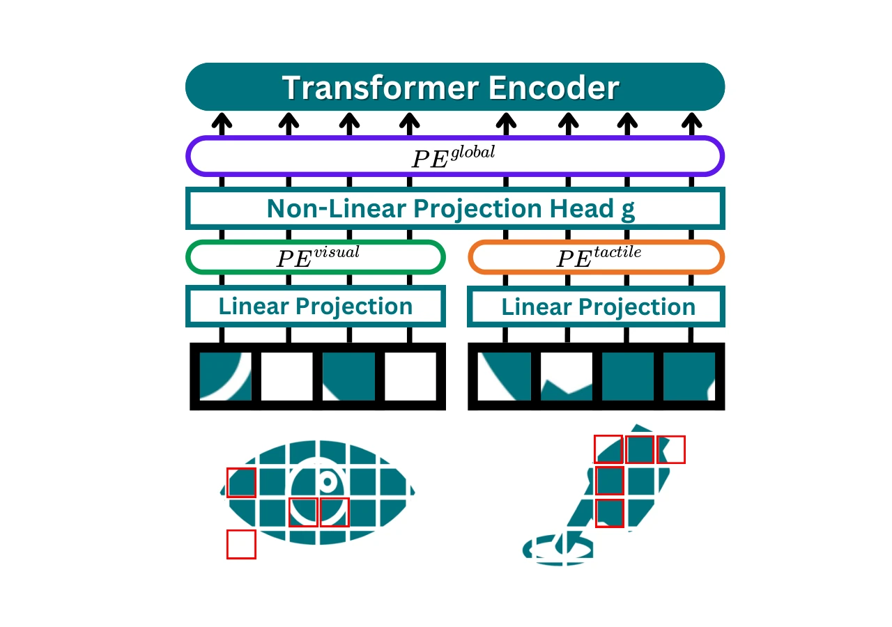

<!-- Generated by scripts/generate.py; edit data/works.json and data/media.json. -->

[← Back to the Awesome index](../../../README.md) · [Interactive website](https://chang-xinhai.github.io/Awesome-RGBDT-Manipulation/?collection=policy&item=vitapes#library)

# ViTaPEs

ViTaPEs: Visuotactile Position Encodings for Cross-Modal Alignment in Multimodal Transformers

**2025-05-26 · Transactions on Machine Learning Research 2026 · Technical University of Leoben; Graz University of Technology**

**[Paper](https://arxiv.org/abs/2505.20032)** · [Project](https://sites.google.com/view/vitapes) · [Publication](https://openreview.net/forum?id=mxzzO66Zbu)

Two-stage positional encodings improve visual/tactile feature fusion and transfer, including offline prediction of robot grasp outcomes.

*ViTaPEs authors · [Figure source](https://arxiv.org/abs/2505.20032) · Original rights retained.*

| Field | Reported value and source scope |
| :-- | :-- |
| Record type | model |
| Model role and downstream interface | Vision-tactile representation and outcome prediction [1](https://arxiv.org/abs/2505.20032)  |
| Model family | Multimodal representation [1](https://arxiv.org/abs/2505.20032)  |
| Model architecture | ViT fusion with modality-specific local position encodings, a shared nonlinear projection and global position encodings; supervised and MAE-pretrained variants. [1](https://arxiv.org/abs/2505.20032)  |
| Model size and component | Supervised main model: 12.7M; SSL Balanced model: 30.6M. Scaling study spans 6.7M to 90.7M parameters. [1](https://arxiv.org/abs/2505.20032) [3](https://arxiv.org/html/2505.20032v3#A4)  |
| Model inputs | RGB and optical tactile images; paired modalities need not share a calibrated pixel coordinate frame. [1](https://arxiv.org/abs/2505.20032)  |
| Model outputs | Fused descriptors, recognition labels or a predicted grasp-success score; no action commands. [1](https://arxiv.org/abs/2505.20032)  |
| Training method | Supervised recognition or 75%-masked MAE pretraining with independently augmented modalities; linear probing and zero-shot transfer evaluated separately. [1](https://arxiv.org/abs/2505.20032)  |
| Training data and scale | Touch-and-Go pretraining; ObjectFolder Real, YCB-Slide and Grasp datasets support task-specific/transfer evaluation. Grasp prediction uses mid-grasp observations; split units are stated in the appendix. [1](https://arxiv.org/abs/2505.20032)  |
| Training duration | ViTaPEs pretraining budget: 62.5 GPU-hours under the reported comparison setting. [1](https://arxiv.org/abs/2505.20032) [3](https://arxiv.org/html/2505.20032v3#A4)  |
| Training hardware | NVIDIA A100 40GB for training-cost comparison. [1](https://arxiv.org/abs/2505.20032) [3](https://arxiv.org/html/2505.20032v3#A4)  |
| Inference setting and runtime | 10 ms per fused visual–tactile pair on RTX 4090; model throughput, not a robot-control frequency. [1](https://arxiv.org/abs/2505.20032) [3](https://arxiv.org/html/2505.20032v3#A4)  |
| Downstream evaluation and scope | Material/object recognition, cross-dataset/cross-sensor transfer and grasp-success prediction under SSL, linear-probe and zero-shot protocols. [1](https://arxiv.org/abs/2505.20032)  |
| Observations / modalities | RGB · Tactile |
| Evaluation domain | Real robot |
| Embodiment |  |
| Release: code | Not released [2](https://sites.google.com/view/vitapes)  |
| Release: weights | Not released [2](https://sites.google.com/view/vitapes)  |
| Release: data | Not verified [2](https://sites.google.com/view/vitapes)  |
| Release: license | Not verified [2](https://sites.google.com/view/vitapes)  |
| Release: notes | Official project explicitly says code/models will be available soon; Code/Models buttons point to blank placeholders. Existing evaluation datasets are separate from a new model release. [2](https://sites.google.com/view/vitapes)  |

**Scope and qualifications**

- Grasp-success classification is an offline perception task; it is not closed-loop grasp control.
- Performance and cost numbers belong to specified model scales/protocols. Local/global position embeddings do not establish calibrated scene depth.

**Primary evidence**

1. [Original manuscript and first public submission history](https://arxiv.org/abs/2505.20032) — Full author method, evaluation and appendix reviewed; downstream controller probes are distinguished from the reusable model.
2. [Official author project and current artifact destinations](https://sites.google.com/view/vitapes) — A project button or advertised artifact does not establish a downloadable release; paper-version differences are retained.
3. [Original training/inference cost appendix](https://arxiv.org/html/2505.20032v3#A4) — Cost is measured for the reported model/protocol; inference throughput is not an action-control rate.
