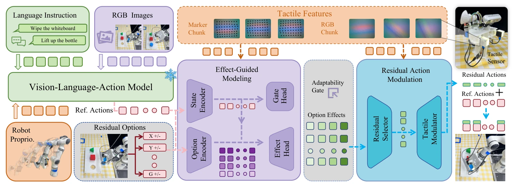

<!-- Generated by scripts/generate.py; edit data/works.json and data/media.json. -->

[← Back to the Awesome index](../../../README.md) · [Interactive website](https://chang-xinhai.github.io/Awesome-RGBDT-Manipulation/?collection=policy&item=vitar#library)

# ViTaR

ViTaR: Visuo-Tactile Residual Adaptation for Foundation VLA Manipulation

**2026-08-16 · Preprint · Not reported**

**[Paper](https://arxiv.org/abs/2608.15816)**

Bounded tactile residual adaptation modulates a frozen VLA using offline branch-outcome preferences.

*ViTaR: Visuo-Tactile Residual Adaptation for Foundation VLA Manipulation authors · [Figure source](https://arxiv.org/abs/2608.15816) · Original rights retained.*

| Field | Reported value and source scope |
| :-- | :-- |
| Record type | policy |
| Policy family | Hybrid [1](https://arxiv.org/abs/2608.15816)  |
| Base model and architecture | Frozen OpenVLA-OFT; Effect-Guided Modeling (EGM) and Residual Action Modulation (RAM). [1](https://arxiv.org/abs/2608.15816)  |
| Model size and component | Not reported [1](https://arxiv.org/abs/2608.15816)  |
| Deployment inputs | Scene/wrist RGB, language, proprioception, marker-derived contact descriptors and bilateral tactile summaries. [1](https://arxiv.org/abs/2608.15816)  |
| Action outputs and horizon | Base VLA action plus a selected bounded residual direction and learned continuous scale. [1](https://arxiv.org/abs/2608.15816)  |
| Training method | Offline EGM ranking/adaptability training, then frozen-EGM RAM selection/magnitude training, each 120 epochs; no online base-policy weight update. [1](https://arxiv.org/abs/2608.15816)  |
| Training data | 50 OFT demonstrations per UniVTAC task; additional 20 restored decision groups/task ×5 short branches =100 branch rollouts, reused in 160 preference pairs; not 100 independent demonstrations. [1](https://arxiv.org/abs/2608.15816)  |
| Training duration | EGM120 epochs; RAM120 epochs; wall-clock Not reported. [1](https://arxiv.org/abs/2608.15816)  |
| Training hardware | 8 NVIDIA RTX4090 GPUs for foundation fine-tuning, EGM/RAM and offline branch processing. [1](https://arxiv.org/abs/2608.15816)  |
| Inference and control rates | Real controller 10 Hz; camera/tactile collection 30 Hz. [1](https://arxiv.org/abs/2608.15816)  |
| Evaluation scope | Seven UniVTAC simulation tasks,100 episodes/method/task; real insertion, sliding and grasping, 20 trials/task. [1](https://arxiv.org/abs/2608.15816)  |
| Observations / modalities | RGB · Tactile · Proprioception |
| Evaluation domain | Simulation · Real world |
| Embodiment | Parallel-jaw gripper |
| Release: code | Not verified |
| Release: weights | Not verified |
| Release: data | Not verified |
| Release: license | Not verified |
| Release: notes | Original paper reviewed; claimed future releases are not treated as currently available. |

**Scope and qualifications**

- Branch rollouts and preference pairs are separate supervision units and are not added to expert-demo totals.
- Tactile summaries modulate residual magnitude; offline outcome labels are unavailable at runtime.

**Primary evidence**

1. [Original paper and supplementary implementation details](https://arxiv.org/abs/2608.15816) — Primary full text reviewed; dataset, deployment modalities and training-only privileges are scoped separately.
