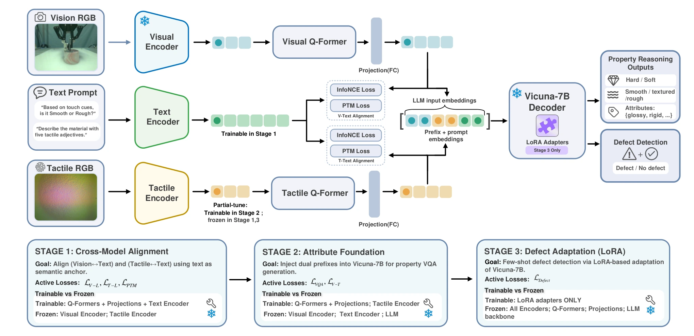

<!-- Generated by scripts/generate.py; edit data/works.json and data/media.json. -->

[← Back to the Awesome index](../../../README.md) · [Interactive website](https://chang-xinhai.github.io/Awesome-RGBDT-Manipulation/?collection=policy&item=vitatouch#library)

# VitaTouch / VitaSet

VitaTouch: Property-Aware Vision-Tactile-Language Model for Robotic Quality Inspection in Manufacturing

**2026-04-02 · Preprint · Beijing University of Posts and Telecommunications; Beijing Institute of Technology; Zhongguancun Academy**

**[Paper](https://arxiv.org/abs/2604.03322)** · [Project](https://vitatouch.github.io/) · [Data](https://huggingface.co/datasets/Bupt-Joy/VitaSet)

Combines visual and tactile prefix tokens for material-property reasoning and defect recognition, integrated into an industrial inspection/sorting demonstration.

*vitatouch authors; original paper figure · [Figure source](https://arxiv.org/html/2604.03322#S4.F3) · Original rights retained.*

| Field | Reported value and source scope |
| :-- | :-- |
| Record type | model |
| Model role and downstream interface | Reusable representation or perception model; downstream controllers are separate systems [1](https://arxiv.org/abs/2604.03322)  |
| Model family | Tactile-language model [1](https://arxiv.org/abs/2604.03322)  |
| Model architecture | Modality-specific encoders and dual Q-Formers with frozen Vicuna 7B; LoRA for defect adaptation [1](https://arxiv.org/abs/2604.03322)  |
| Model size and component | Vicuna 7B language base; encoders and Q-Formers are additional [1](https://arxiv.org/abs/2604.03322)  |
| Model inputs | RGB view, GelSight tactile observation and language prompt [1](https://arxiv.org/abs/2604.03322)  |
| Model outputs | Material/hardness/roughness descriptions and defect labels; separate robot workflow uses the recognition result [1](https://arxiv.org/abs/2604.03322)  |
| Training method | Cross-modal contrastive and pair-matching alignment, property-reasoning training, then LoRA adaptation with few-shot defect labels [1](https://arxiv.org/abs/2604.03322)  |
| Training data and scale | VitaSet: 186 objects, 52K images and 5.1K human-verified instruction–answer pairs. The TVL comparison follows the original TVL split. [1](https://arxiv.org/abs/2604.03322)  |
| Training duration | Stage 1: approximately 2 hours; stage 2: approximately 10 hours; stage 3: within one hour [1](https://arxiv.org/abs/2604.03322)  |
| Training hardware | Stages 1/2: 8 NVIDIA A800 GPUs; stage 3: 1 NVIDIA RTX 5090 [1](https://arxiv.org/abs/2604.03322)  |
| Inference setting and runtime | Not reported [1](https://arxiv.org/abs/2604.03322)  |
| Downstream evaluation and scope | TVL/HCT/SSVTP description benchmark, property classification, defect recognition and 100 laboratory robotic sorting trials. [1](https://arxiv.org/abs/2604.03322)  |
| Observations / modalities | Tactile · RGB · Language |
| Evaluation domain | Real world |
| Embodiment |  |
| Release: code | Not verified — no official implementation link found on inspected project [2](https://vitatouch.github.io/)  |
| Release: weights | Not verified — no official model checkpoint linked on inspected project [2](https://vitatouch.github.io/)  |
| Release: data | Available — official resource link [2](https://vitatouch.github.io/)  |
| Release: license | VitaSet dataset LICENSE is MIT; code/model weights are not verified and Vicuna/base-model terms apply separately. [2](https://vitatouch.github.io/) [3](https://huggingface.co/datasets/Bupt-Joy/VitaSet/resolve/main/LICENSE)  |
| Release: notes | Code, pretrained encoders and downstream task data are separate artifacts; no policy checkpoint is implied by an encoder release. [2](https://vitatouch.github.io/)  |

**Scope and qualifications**

- The model produces descriptions and defect decisions. The 100 physical trials evaluate an integrated sorting workflow, rather than a learned continuous-action policy.
- VitaSet image and QA totals differ; 52K images are not 52K independent robot demonstrations.

**Primary evidence**

1. [Original model paper and first submission](https://arxiv.org/abs/2604.03322) — Method, experiments and implementation sections; specifications retain component and evaluation scope.
2. [Official project](https://vitatouch.github.io/) — Author project; author-reported release scope is distinguished from an executed reproduction.
3. [Actual VitaSet dataset MIT license](https://huggingface.co/datasets/Bupt-Joy/VitaSet/resolve/main/LICENSE) — Dataset license checked independently of code and model status.
