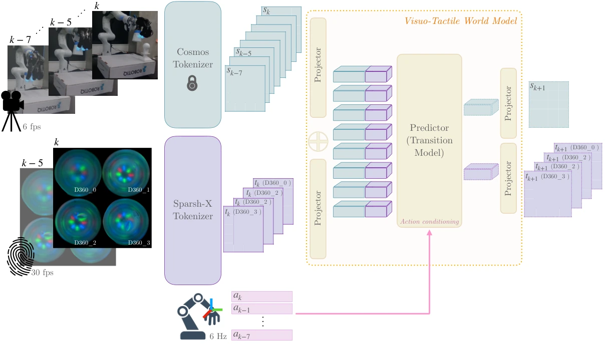

<!-- Generated by scripts/generate.py; edit data/works.json and data/media.json. -->

[← Back to the Awesome index](../../../README.md) · [Interactive website](https://chang-xinhai.github.io/Awesome-RGBDT-Manipulation/?collection=policy&item=vt-wm#library)

# VT-WM

Visuo-Tactile World Models

**2026-02-05 · Preprint · FAIR, Meta / University of Washington**

**[Paper](https://arxiv.org/abs/2602.06001)**

Action-conditioned visual/tactile world models provide contact-aware imagined rollouts and evaluate real robot plan transfer.

*Visuo-Tactile World Models authors · [Figure source](https://arxiv.org/abs/2602.06001) · Original rights retained.*

| Field | Reported value and source scope |
| :-- | :-- |
| Record type | policy |
| Policy family | Model-based planning [1](https://arxiv.org/abs/2602.06001)  |
| Base model and architecture | Cosmos visual tokenizer, Sparsh-X tactile encoder and autoregressive multimodal transformer. [1](https://arxiv.org/abs/2602.06001)  |
| Model size and component | 173 M parameters total; 96 M trained. [1](https://arxiv.org/abs/2602.06001)  |
| Deployment inputs | Exo centric RGB, four Digit 360 tactile sensor streams and candidate proprioceptive action sequences. [1](https://arxiv.org/abs/2602.06001)  |
| Action outputs and horizon | Predicted visual/tactile states used to select action sequences for robot execution. [1](https://arxiv.org/abs/2602.06001)  |
| Training method | 80 k updates; tactile encoder adapted while Cosmos is frozen; action-conditioned dynamics with planning experiments. [1](https://arxiv.org/abs/2602.06001)  |
| Training data | 124 demonstrations / 112 k data points across eight tasks for training; 26 demonstrations / 17 k data points validation. Novel plate-in-rack adaptation uses 20 demos. [1](https://arxiv.org/abs/2602.06001)  |
| Training duration | Not reported [1](https://arxiv.org/abs/2602.06001)  |
| Training hardware | 32 NVIDIA A100 GPUs; effective batch 64. [1](https://arxiv.org/abs/2602.06001)  |
| Inference and control rates | World model 6 fps; recorded/executed actions grouped from 30 Hz. [1](https://arxiv.org/abs/2602.06001)  |
| Evaluation scope | Allegro hand / Digit 360: eight training task families; zero-shot open-loop plan execution and few-shot novel plate-rack planning. [1](https://arxiv.org/abs/2602.06001)  |
| Observations / modalities | RGB · Tactile · Proprioception |
| Evaluation domain | Real world |
| Embodiment | Dexterous hand |
| Release: code | Not verified |
| Release: weights | Not verified |
| Release: data | Not verified |
| Release: license | Not verified |
| Release: notes | Original paper reviewed; claimed future releases are not treated as currently available. |

**Scope and qualifications**

- Planning transfer includes open-loop execution; do not label all experiments closed-loop policy feedback.

**Primary evidence**

1. [Original paper and supplementary implementation details](https://arxiv.org/abs/2602.06001) — Primary full text reviewed; dataset, deployment modalities and training-only privileges are scoped separately.
