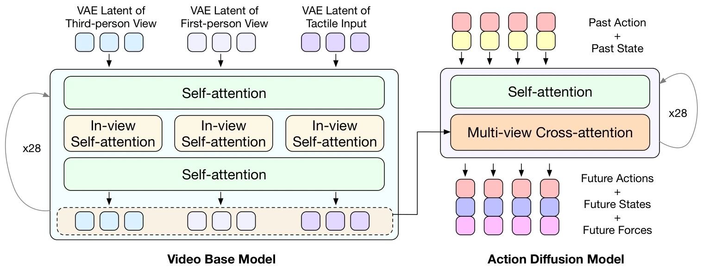

<!-- Generated by scripts/generate.py; edit data/works.json and data/media.json. -->

[← Back to the Awesome index](../../../README.md) · [Interactive website](https://chang-xinhai.github.io/Awesome-RGBDT-Manipulation/?collection=policy&item=vtam#library)

# VTAM

VTAM: Video-Tactile-Action Models for Complex Physical Interaction Beyond VLAs

**2026-03-24 · Preprint · University of Illinois Urbana-Champaign / Stanford University / Shanghai Jiao Tong University**

**[Paper](https://arxiv.org/abs/2603.23481)**

A video-action backbone receives tactile streams with attention regularization for force-sensitive manipulation.

*VTAM: Video-Tactile-Action Models for Complex Physical Interaction Beyond VLAs authors · [Figure source](https://arxiv.org/abs/2603.23481) · Original rights retained.*

| Field | Reported value and source scope |
| :-- | :-- |
| Record type | policy |
| Policy family | World-action model [1](https://arxiv.org/abs/2603.23481)  |
| Base model and architecture | Genie Envisioner GE-base / LTX-Video transformer with 28 layers and parallel action expert. [1](https://arxiv.org/abs/2603.23481)  |
| Model size and component | Not reported [1](https://arxiv.org/abs/2603.23481)  |
| Deployment inputs | Multi-view RGB, GelSight Mini tactile images, language/task conditioning and robot state. [1](https://arxiv.org/abs/2603.23481)  |
| Action outputs and horizon | 54-step continuous action chunks coupled to predicted video/tactile dynamics. [1](https://arxiv.org/abs/2603.23481)  |
| Training method | 50 k video-backbone fine-tuning steps followed by 20 k action-head steps; tactile regularization balances visual/tactile attention. [1](https://arxiv.org/abs/2603.23481)  |
| Training data | 266 real demonstrations: 100 chip pick-and-place, 105 whiteboard wiping, 61 cucumber peeling. [1](https://arxiv.org/abs/2603.23481)  |
| Training duration | 50k video-backbone +20k action-head updates; appendix reports~3.4s per optimization step. Total wall-clock time Not reported. [1](https://arxiv.org/abs/2603.23481)  |
| Training hardware | 4 NVIDIA A100 GPUs, 40 GB each; Deep Speed ZeRO-2 / bf 16. [1](https://arxiv.org/abs/2603.23481)  |
| Inference and control rates | 30 Hz collection and execution. [1](https://arxiv.org/abs/2603.23481)  |
| Evaluation scope | xArm 6 / parallel gripper; fragile chip transport, cucumber peeling and whiteboard wiping. [1](https://arxiv.org/abs/2603.23481)  |
| Observations / modalities | RGB · Tactile · Proprioception |
| Evaluation domain | Real world |
| Embodiment | Parallel-jaw gripper |
| Release: code | Not verified |
| Release: weights | Not verified |
| Release: data | Not verified |
| Release: license | Not verified |
| Release: notes | Original paper reviewed; claimed future releases are not treated as currently available. |

**Scope and qualifications**

- RealSense D455 cameras supply RGB streams; no runtime measured-depth input is established.

**Primary evidence**

1. [Original paper and supplementary implementation details](https://arxiv.org/abs/2603.23481) — Primary full text reviewed; dataset, deployment modalities and training-only privileges are scoped separately.
