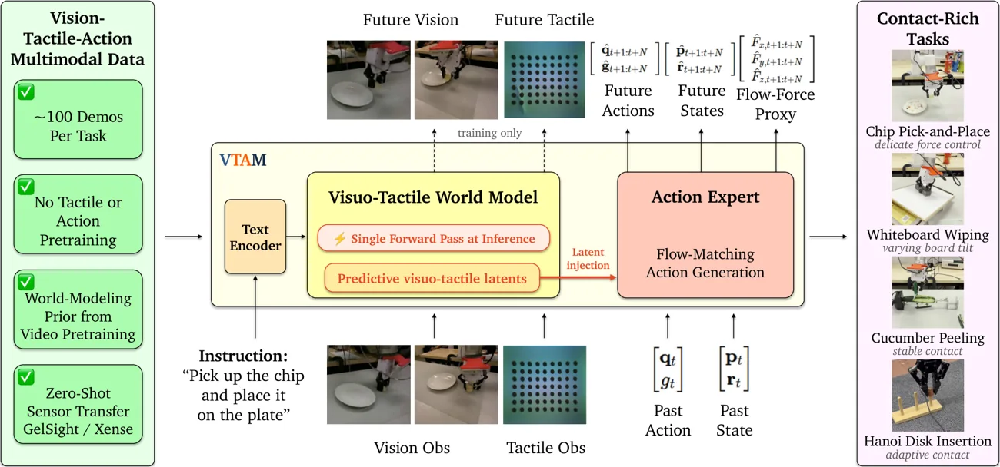

<!-- Generated by scripts/generate.py; edit data/works.json and data/media.json. -->

[← Back to the Awesome index](../../../README.md) · [Interactive website](https://chang-xinhai.github.io/Awesome-RGBDT-Manipulation/?collection=policy&item=vtam#library)

# VTAM

VTAM: Efficient Visuo-Tactile World-Action Models for Contact-Rich Manipulation without Tactile Pretraining

**2026-03-24 · Preprint · University of Illinois Urbana-Champaign / Stanford University / Shanghai Jiao Tong University**

**[Paper](https://arxiv.org/abs/2603.23481)** · [Project](https://plan-lab.github.io/projects/vtam/) · [Code](https://github.com/PLAN-Lab/VTAM) · [Data](https://huggingface.co/datasets/JensenYuan/VTAM_xArm_GelSight)

A video-pretrained world-action model learns tactile dynamics from task demonstrations without separate tactile pretraining.

*VTAM authors · [Figure source](https://arxiv.org/html/2603.23481v2) · Original rights retained.*

| Field | Reported value and source scope |
| :-- | :-- |
| Record type | policy |
| Policy family | World-action model [1](https://arxiv.org/abs/2603.23481) [2](https://arxiv.org/html/2603.23481v2)  |
| Base model and architecture | Genie Envisioner GE-base / LTX-Video transformer with 28 layers and parallel action expert. [1](https://arxiv.org/abs/2603.23481) [2](https://arxiv.org/html/2603.23481v2)  |
| Model size and component | Not reported [1](https://arxiv.org/abs/2603.23481) [2](https://arxiv.org/html/2603.23481v2)  |
| Deployment inputs | RGB, GelSight Mini or Xense Photon tactile imagery, task conditioning and robot state. [1](https://arxiv.org/abs/2603.23481) [2](https://arxiv.org/html/2603.23481v2)  |
| Action outputs and horizon | 54-step actions, robot states and predicted tactile optical-flow force proxy. [1](https://arxiv.org/abs/2603.23481) [2](https://arxiv.org/html/2603.23481v2)  |
| Training method | Shared frozen video VAE and pretrained video transformer, then two-stage tactile/visual latent adaptation and end-to-end action learning. [1](https://arxiv.org/abs/2603.23481) [2](https://arxiv.org/html/2603.23481v2)  |
| Training data | Approximately 100 demonstrations per real task; eight UniVTAC simulation tasks in v2. [1](https://arxiv.org/abs/2603.23481) [2](https://arxiv.org/html/2603.23481v2)  |
| Training duration | 50k visual/tactile latent updates followed by 20k joint action updates; wall time not reported. [1](https://arxiv.org/abs/2603.23481) [2](https://arxiv.org/html/2603.23481v2)  |
| Training hardware | Four NVIDIA A100 GPUs. [1](https://arxiv.org/abs/2603.23481) [2](https://arxiv.org/html/2603.23481v2)  |
| Inference and control rates | 1 Hz policy inference and tactile feedback; 30 Hz data collection and low-level action execution. [1](https://arxiv.org/abs/2603.23481) [2](https://arxiv.org/html/2603.23481v2)  |
| Evaluation scope | v2: four real tasks on xArm6/GelSight Mini and Flexiv Rizon 4/Xense Photon; eight UniVTAC simulation tasks. [1](https://arxiv.org/abs/2603.23481) [2](https://arxiv.org/html/2603.23481v2)  |
| Observations / modalities | RGB · Tactile · Proprioception |
| Evaluation domain | Simulation · Real world |
| Embodiment | Parallel-jaw gripper |
| Release: code | Available — training and inference; UniVTAC configuration pending [3](https://github.com/PLAN-Lab/VTAM) [4](https://github.com/PLAN-Lab/VTAM/blob/main/NOTICE) [5](https://huggingface.co/datasets/JensenYuan/VTAM_xArm_GelSight)  |
| Release: weights | Forthcoming — VTAM task checkpoints; upstream pretrained backbones have separate access [3](https://github.com/PLAN-Lab/VTAM) [4](https://github.com/PLAN-Lab/VTAM/blob/main/NOTICE) [5](https://huggingface.co/datasets/JensenYuan/VTAM_xArm_GelSight)  |
| Release: data | Available — xArm / GelSight demonstrations, chip archive verified HTTP 206 [3](https://github.com/PLAN-Lab/VTAM) [4](https://github.com/PLAN-Lab/VTAM/blob/main/NOTICE) [5](https://huggingface.co/datasets/JensenYuan/VTAM_xArm_GelSight)  |
| Release: license | Mixed licenses: Apache-2.0 and CC BY-NC-SA 4.0 by source file; check NOTICE and upstream terms. [3](https://github.com/PLAN-Lab/VTAM) [4](https://github.com/PLAN-Lab/VTAM/blob/main/NOTICE) [5](https://huggingface.co/datasets/JensenYuan/VTAM_xArm_GelSight)  |
| Release: notes | Official source contains real-world training and inference; task checkpoints and UniVTAC simulation configurations are marked pending. Upstream GE and LTX pretrained weights have their own terms. [3](https://github.com/PLAN-Lab/VTAM) [4](https://github.com/PLAN-Lab/VTAM/blob/main/NOTICE) [5](https://huggingface.co/datasets/JensenYuan/VTAM_xArm_GelSight)  |

**Scope and qualifications**

- The light flow-force proxy derives from optical tactile flow and is not a direct external force measurement.
- RealSense cameras supply RGB; scene depth is not established as a deployed policy input.
- Paper v2 substantially revises the title, task coverage and interpretation; date remains first submission.

**Primary evidence**

1. [Original paper and supplementary implementation details](https://arxiv.org/abs/2603.23481) — Primary full text reviewed; dataset, deployment modalities and training-only privileges are scoped separately.
2. [Revised paper v2: methods, control rates and evaluation](https://arxiv.org/html/2603.23481v2) — Revised version dated 5 November 2026; first submission date retained.
3. [Official source and scope](https://github.com/PLAN-Lab/VTAM) — Training / inference public; UniVTAC configs and trained checkpoints pending.
4. [Per-file license notice](https://github.com/PLAN-Lab/VTAM/blob/main/NOTICE) — Original implementation and upstream components have mixed Apache-2.0 and CC BY-NC-SA terms.
5. [Official xArm data release](https://huggingface.co/datasets/JensenYuan/VTAM_xArm_GelSight) — Three task archives listed and chip archive returned HTTP 206 for a byte-range request.
