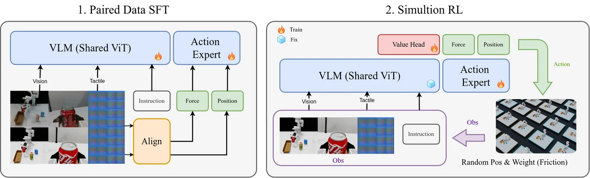

<!-- Generated by scripts/generate.py; edit data/works.json and data/media.json. -->

[← Back to the Awesome index](../../../README.md) · [Interactive website](https://chang-xinhai.github.io/Awesome-RGBDT-Manipulation/?collection=policy&item=vtla-rl#library)

# VTLA-RL

VTLA-RL: Learning Visuotactile Policies for Load-Adaptive Grasping

**2026-11-21 · Preprint · HKUST (Guangzhou); NVIDIA**

**[Paper](https://arxiv.org/abs/2611.28752)**

Post-trains an RGB–touch VLA in randomized simulation so it can adjust bilateral force during physical grasping under varying loads.

*Qiwei Wu and coauthors · [Figure source](https://arxiv.org/html/2611.28752v1) · Original rights retained.*

| Field | Reported value and source scope |
| :-- | :-- |
| Record type | policy |
| Policy family | VTLA-RL [1](https://arxiv.org/html/2611.28752v1)  |
| Base model and architecture | Not reported [1](https://arxiv.org/html/2611.28752v1)  |
| Model size and component | Not reported [1](https://arxiv.org/html/2611.28752v1)  |
| Deployment inputs | Scene and wrist RGB, temporally stacked tactile images, robot state and instruction. Gripper-side tactile force provides between-query servo feedback. [1](https://arxiv.org/html/2611.28752v1)  |
| Action outputs and horizon | Joint motion and bilateral force action chunks, applied by a hybrid force-position gripper. [1](https://arxiv.org/html/2611.28752v1)  |
| Training method | Paired real/simulated demonstration SFT followed by two-stage multitask simulation RL using task success; no additional real demonstration updates during RL. [1](https://arxiv.org/html/2611.28752v1)  |
| Training data | Mixed real and mirrored simulated demonstration pairs; simulation object pose, mass and friction are randomized for RL. [1](https://arxiv.org/html/2611.28752v1)  |
| Training duration | Two RL stages at 200 epochs each per paper experiment. [1](https://arxiv.org/html/2611.28752v1)  |
| Training hardware | Not reported [1](https://arxiv.org/html/2611.28752v1)  |
| Inference and control rates | 20 Hz tactile feedback and executed command cadence; action queries are asynchronous. [1](https://arxiv.org/html/2611.28752v1)  |
| Evaluation scope | Simulated varied-load grasping plus real xArm tests on mass variation and placement perturbation; baseline and full method evaluated separately. [1](https://arxiv.org/html/2611.28752v1)  |
| Observations / modalities | RGB · Tactile · Proprioception · Language |
| Evaluation domain | Simulation · Real world |
| Embodiment | Parallel-jaw gripper |
| Release: code | Not verified |
| Release: weights | Not verified |
| Release: data | Not verified |
| Release: license | Not verified |
| Release: notes | Public paper verified. Code, task weights and data are tracked separately. |

**Scope and qualifications**

- Tactile histories are direct policy inputs. Simulated changes in mass/friction and the physical load perturbations are independently evaluated.

**Primary evidence**

1. [Original author paper with methods, evaluation and scope](https://arxiv.org/html/2611.28752v1)
