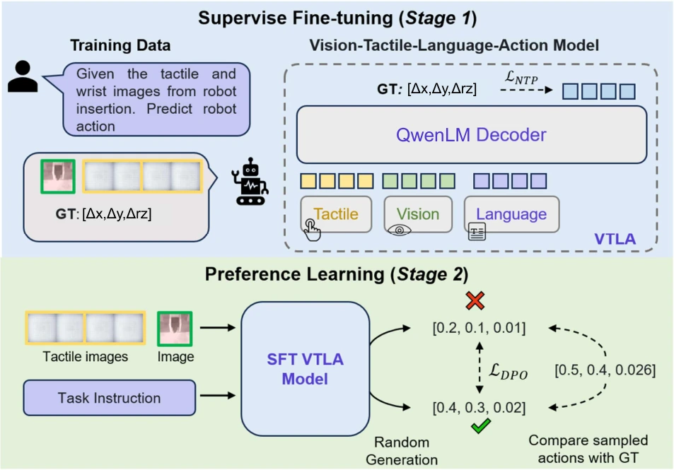

<!-- Generated by scripts/generate.py; edit data/works.json and data/media.json. -->

[← Back to the Awesome index](../../../README.md) · [Interactive website](https://chang-xinhai.github.io/Awesome-RGBDT-Manipulation/?collection=policy&item=vtla#library)

# VTLA

VTLA: Vision-Tactile-Language-Action Model with Preference Learning for Insertion Manipulation

**2025-05-14 · Preprint · Institute of Automation, Chinese Academy of Sciences / Samsung R&D Institute China–Beijing / Beijing Academy of Artificial Intelligence**

**[Paper](https://arxiv.org/abs/2505.09577)** · [Project](https://sites.google.com/view/vtla)

Vision-guided tactile tokens and direct preference optimization adapt a language-action model for simulated and real insertion.

*VTLA: Vision-Tactile-Language-Action Model with Preference Learning for Insertion Manipulation authors · [Figure source](https://arxiv.org/abs/2505.09577) · Original rights retained.*

| Field | Reported value and source scope |
| :-- | :-- |
| Record type | policy |
| Policy family | VLA [1](https://arxiv.org/abs/2505.09577)  |
| Base model and architecture | Qwen2-VL-7B; visual encoder and modality adapter frozen during language-model tuning. [1](https://arxiv.org/abs/2505.09577)  |
| Model size and component | 7B base model; total trainable parameters Not reported. [1](https://arxiv.org/abs/2505.09577)  |
| Deployment inputs | Wrist RGB, bilateral GelStereo 2.0 tactile image sequences and a language instruction; RealSense D405 is used for images, not a reported depth-policy stream. [1](https://arxiv.org/abs/2505.09577)  |
| Action outputs and horizon | Numeric-text corrective Δx, Δy and yaw actions for iterative insertion. [1](https://arxiv.org/abs/2505.09577)  |
| Training method | Stage 1 next-token instruction tuning with vision-guided temporally enhanced tokens; Stage 2 DPO ranks sampled actions by distance to ground truth. [1](https://arxiv.org/abs/2505.09577)  |
| Training data | 28,000 simulated assembly samples over five peg shapes and 0.6–2.0 mm clearances; evaluation includes 6k ID / 4k OOD samples. DPO variants use 1,000 or 2,400 preference pairs. Counts are not demonstration episodes. [1](https://arxiv.org/abs/2505.09577)  |
| Training duration | 10 SFT epochs and 3 DPO epochs; wall-clock time Not reported. [1](https://arxiv.org/abs/2505.09577)  |
| Training hardware | Not reported. [1](https://arxiv.org/abs/2505.09577)  |
| Inference and control rates | Attempt-based insertion; physical policy Hz Not reported. Appendix records tactile acquisition at 20 fps, which is not the VLM control rate. [1](https://arxiv.org/abs/2505.09577)  |
| Evaluation scope | Isaac Gym with custom tactile rendering, version Not reported; UR3 / Robotiq 2F-85 with two GelStereo sensors. Fifty trials per simulated setting and 20 per real setting; shape, clearance and dim-light transfer. [1](https://arxiv.org/abs/2505.09577)  |
| Observations / modalities | RGB · Tactile · Language |
| Evaluation domain | Simulation · Real world |
| Embodiment | Parallel-jaw gripper |
| Release: code | Not verified [2](https://sites.google.com/view/vtla)  |
| Release: weights | Not verified [2](https://sites.google.com/view/vtla)  |
| Release: data | Not verified [2](https://sites.google.com/view/vtla)  |
| Release: license | Not verified [2](https://sites.google.com/view/vtla)  |
| Release: notes | No retrievable official policy code/checkpoint/data release was verified. [2](https://sites.google.com/view/vtla)  |

**Scope and qualifications**

- All policy training uses simulation; real experiments evaluate zero-shot sim-to-real transfer.
- Fine insertion begins with a grasped peg and bounded initial misalignment; at most 15 attempts.
- The project presents videos; public code, checkpoints and dataset artifacts were not verified.

**Primary evidence**

1. [Original paper and reviewed full text](https://arxiv.org/abs/2505.09577) — Full primary text, including available supplementary implementation details; first public date retained separately from reviewed revision.
2. [Official author project](https://sites.google.com/view/vtla) — Current project links and release claims checked independently of paper prose.
