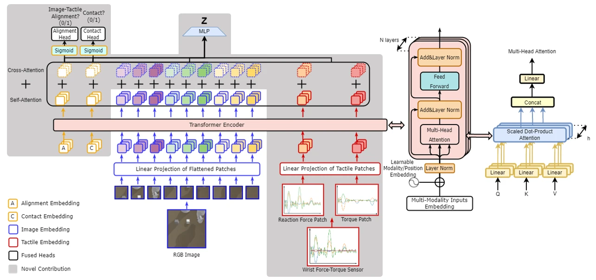

<!-- Generated by scripts/generate.py; edit data/works.json and data/media.json. -->

[← Back to the Awesome index](../../../README.md) · [Interactive website](https://chang-xinhai.github.io/Awesome-RGBDT-Manipulation/?collection=policy&item=vtt#library)

# Visuo-Tactile Transformers

Visuo-Tactile Transformers for Manipulation

**2022-09-30 · Preprint · University of Michigan**

**[Paper](https://arxiv.org/abs/2210.00121)** · [Project](https://www.mmintlab.com/vtt)

Cross-modal transformer representations support latent model-based RL and manipulation planning.

*Visuo-Tactile Transformers for Manipulation authors · [Figure source](https://arxiv.org/abs/2210.00121) · Original rights retained.*

| Field | Reported value and source scope |
| :-- | :-- |
| Record type | policy |
| Policy family | Hybrid [1](https://arxiv.org/abs/2210.00121)  |
| Base model and architecture | VTT self/cross attention with SLAC-style latent dynamics and policy learning. [1](https://arxiv.org/abs/2210.00121)  |
| Model size and component | Not reported [1](https://arxiv.org/abs/2210.00121)  |
| Deployment inputs | Visual and tactile observations. [1](https://arxiv.org/abs/2210.00121)  |
| Action outputs and horizon | Latent dynamics/robot actions for planning and control. [1](https://arxiv.org/abs/2210.00121)  |
| Training method | Joint modality representation/objective learning within model-based RL. [1](https://arxiv.org/abs/2210.00121)  |
| Training data | Four simulated manipulation tasks and real pushing interaction; exact corpus count Not reported. [1](https://arxiv.org/abs/2210.00121)  |
| Training duration | Not reported [1](https://arxiv.org/abs/2210.00121)  |
| Training hardware | Not reported [1](https://arxiv.org/abs/2210.00121)  |
| Inference and control rates | Not reported [1](https://arxiv.org/abs/2210.00121)  |
| Evaluation scope | Four simulation tasks andone real-world pushing task. [1](https://arxiv.org/abs/2210.00121)  |
| Observations / modalities | RGB · Tactile · Proprioception |
| Evaluation domain | Simulation · Real world |
| Embodiment | Parallel-jaw gripper |
| Release: code | Not verified [2](https://www.mmintlab.com/vtt)  |
| Release: weights | Not verified [2](https://www.mmintlab.com/vtt)  |
| Release: data | Not verified [2](https://www.mmintlab.com/vtt)  |
| Release: license | Not verified [2](https://www.mmintlab.com/vtt)  |
| Release: notes | Original paper reviewed; claimed future releases are not treated as currently available. [2](https://www.mmintlab.com/vtt)  |

**Scope and qualifications**

- Parameter-matched baseline comparisons are an architecture ablation, not cross-task generalist policy training.

**Primary evidence**

1. [Original paper and supplementary implementation details](https://arxiv.org/abs/2210.00121) — Primary full text reviewed; dataset, deployment modalities and training-only privileges are scoped separately.
2. [Official author project](https://www.mmintlab.com/vtt) — Live artifact status reviewed separately from paper claims.
