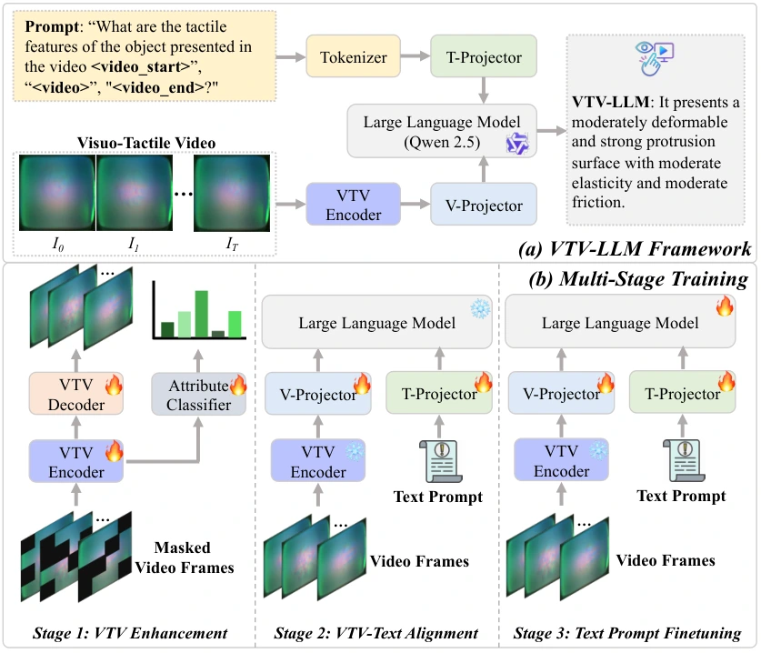

<!-- Generated by scripts/generate.py; edit data/works.json and data/media.json. -->

[← Back to the Awesome index](../../../README.md) · [Interactive website](https://chang-xinhai.github.io/Awesome-RGBDT-Manipulation/?collection=policy&item=vtv-llm#library)

# VTV-LLM / VTV150K

Universal Visuo-Tactile Video Understanding for Embodied Interaction

**2025-05-28 · NeurIPS 2025 (official repository) · Tsinghua University; Sun Yat-sen University; Guangdong Laboratory of Artificial Intelligence and Digital Economy (SZ)**

**[Paper](https://arxiv.org/abs/2505.22566)** · [Code](https://github.com/IvanXie416/VTV-LLM) · [Data](https://huggingface.co/datasets/Ivan416/VBTS_video) · [Weights](https://huggingface.co/Ivan416/VBTS_video_encoder)

Connects tactile video to language through a sensor-diverse video encoder and staged instruction adaptation.

*vtv-llm authors; original paper figure · [Figure source](https://arxiv.org/html/2505.22566#S3.F2) · Original rights retained.*

| Field | Reported value and source scope |
| :-- | :-- |
| Record type | model |
| Model role and downstream interface | Reusable representation or perception model; downstream controllers are separate systems [1](https://arxiv.org/abs/2505.22566)  |
| Model family | Tactile-language model [1](https://arxiv.org/abs/2505.22566)  |
| Model architecture | VideoMAE-derived ViT-Base tactile video encoder with a Qwen2.5 language backbone [1](https://arxiv.org/abs/2505.22566)  |
| Model size and component | Qwen2.5 language variants: 3B, 7B and 14B; tactile video encoder is additional [1](https://arxiv.org/abs/2505.22566)  |
| Model inputs | Optical tactile video or rendered Tac3 Dforce-field video plus text prompt [1](https://arxiv.org/abs/2505.22566)  |
| Model outputs | Tactile-property assessment, comparisons and scenario answers in text [1](https://arxiv.org/abs/2505.22566)  |
| Training method | Tactile-video enhancement, VTV–text alignment and text-prompt fine-tuning [1](https://arxiv.org/abs/2505.22566)  |
| Training data and scale | VTV150K: 150,000 frames from 100 objects and three sensors (GelSight Mini, DIGIT and Tac3D), labeled for hardness, protrusion, elasticity and friction. [1](https://arxiv.org/abs/2505.22566)  |
| Training duration | Not reported [1](https://arxiv.org/abs/2505.22566)  |
| Training hardware | 4 NVIDIA RTX 6000 Ada GPUs [1](https://arxiv.org/abs/2505.22566)  |
| Inference setting and runtime | Not reported [1](https://arxiv.org/abs/2505.22566)  |
| Downstream evaluation and scope | Video tactile understanding and language reasoning across source sensors; no closed-loop robot action evaluation. [1](https://arxiv.org/abs/2505.22566)  |
| Observations / modalities | Tactile · Language |
| Evaluation domain | Real world |
| Embodiment |  |
| Release: code | Available [2](https://github.com/IvanXie416/VTV-LLM)  |
| Release: weights | Partial — tactile video encoder released; complete LLM weights not independently confirmed [2](https://github.com/IvanXie416/VTV-LLM)  |
| Release: data | Available — official resource link [2](https://github.com/IvanXie416/VTV-LLM)  |
| Release: license | No standalone repository LICENSE identified; base-model, dataset and checkpoint terms apply separately. [2](https://github.com/IvanXie416/VTV-LLM)  |
| Release: notes | Code, pretrained encoders and downstream task data are separate artifacts; no policy checkpoint is implied by an encoder release. [2](https://github.com/IvanXie416/VTV-LLM)  |

**Scope and qualifications**

- “Visuo-tactile video” includes images produced by touch sensors; it is not evidence of a measured scene-depth input.
- 150K counts video frames, rather than demonstrations or video clips.

**Primary evidence**

1. [Original model paper and first submission](https://arxiv.org/abs/2505.22566) — Method, experiments and implementation sections; specifications retain component and evaluation scope.
2. [Official implementation and current release instructions](https://github.com/IvanXie416/VTV-LLM) — README and repository files inspected on 2026-10-17.
