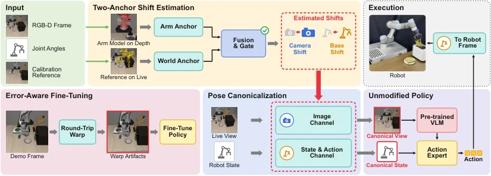

<!-- Generated by scripts/generate.py; edit data/works.json and data/media.json. -->

[← Back to the Awesome index](../../../README.md) · [Interactive website](https://chang-xinhai.github.io/Awesome-RGBDT-Manipulation/?collection=policy&item=waco#library)

# WACO

Towards Pose-Robust Few-Shot Vision-Language-Action Models

**2026-11-18 · Preprint · Shandong University and Shenzhen Loop Area Institute**

**[Paper](https://arxiv.org/abs/2611.24360)** · [Project](https://peacelwh.github.io/WACO/) · [Code](https://github.com/peacelwh/WACO) · [Data](https://huggingface.co/datasets/Bluexxx/LIBERO-PoseShift) · [Weights](https://huggingface.co/Bluexxx/WACO-pi05-LIBERO)

Canonicalizes camera/base shifts before passing observations to the manipulation VLA. LIBERO-PoseShift applies controlled shifts to test robustness.

*Wenhao Li and coauthors · [Figure source](https://arxiv.org/html/2611.24360v1) · Original rights retained.*

| Field | Reported value and source scope |
| :-- | :-- |
| Record type | policy |
| Policy family | RGB-D pose canonicalization around a VLA [1](https://arxiv.org/html/2611.24360v1)  |
| Base model and architecture | π0.5 in LeRobot plus world-anchored geometry front-end. [1](https://arxiv.org/html/2611.24360v1)  |
| Model size and component | Not reported [1](https://arxiv.org/html/2611.24360v1)  |
| Deployment inputs | RGB-D and robot state at setup/deployment, nominal RGB-D static scene, robot mesh and instruction. [1](https://arxiv.org/html/2611.24360v1)  |
| Action outputs and horizon | Canonicalized RGB/state passed to the VLA; predicted action is mapped back to the current robot base frame. [1](https://arxiv.org/html/2611.24360v1)  |
| Training method | Training-free two-anchor pose estimation and separately evaluated error-aware VLA fine-tuning. [1](https://arxiv.org/html/2611.24360v1)  |
| Training data | Few-shot LIBERO demonstrations with nominal camera/base and scripted perturbations. Simulated training assets include separately predicted and scale-aligned DA-V2 depth. [1](https://arxiv.org/html/2611.24360v1)  |
| Training duration | Not reported [1](https://arxiv.org/html/2611.24360v1)  |
| Training hardware | Not reported [1](https://arxiv.org/html/2611.24360v1)  |
| Inference and control rates | Not reported [1](https://arxiv.org/html/2611.24360v1)  |
| Evaluation scope | Simulated camera, base and combined perturbation tracks and physical UR5e tests under pose shifts. [1](https://arxiv.org/html/2611.24360v1)  |
| Observations / modalities | RGB · Depth · Proprioception · Language |
| Evaluation domain | Simulation · Real world |
| Embodiment | UR5e |
| Release: code | Available — LeRobot plugin, runtime canonicalizer and simulator perturbations. [2](https://peacelwh.github.io/WACO/) [3](https://github.com/peacelwh/WACO)  |
| Release: weights | Available — one author checkpoint for LIBERO-Plus camera track. [2](https://peacelwh.github.io/WACO/) [5](https://huggingface.co/Bluexxx/WACO-pi05-LIBERO)  |
| Release: data | Available — LIBERO-PoseShift calibration and training assets. [2](https://peacelwh.github.io/WACO/) [4](https://huggingface.co/datasets/Bluexxx/LIBERO-PoseShift)  |
| Release: license | Apache-2.0 source and asset card; checkpoint follows Gemma/base-model terms. Derived data preserve upstream licenses. [2](https://peacelwh.github.io/WACO/) [4](https://huggingface.co/datasets/Bluexxx/LIBERO-PoseShift) [5](https://huggingface.co/Bluexxx/WACO-pi05-LIBERO)  |
| Release: notes | Use the runtime calibration bundle with the released checkpoint; the released settings are narrower than the full paper evaluation. [2](https://peacelwh.github.io/WACO/)  |

**Scope and qualifications**

- Provided depth targets for one training configuration come from DA-V2 and must not be described as sensor measurements.
- LIBERO-Plus camera-track results are narrower than BASE/MIXED protocols.

**Primary evidence**

1. [Original author paper or dataset description](https://arxiv.org/html/2611.24360v1)
2. [Author source and artifact entry points](https://peacelwh.github.io/WACO/)
3. [Official runtime and licensed implementation](https://github.com/peacelwh/WACO)
4. [Published dataset guide and depth provenance](https://huggingface.co/datasets/Bluexxx/LIBERO-PoseShift)
5. [Public checkpoint and scoped license](https://huggingface.co/Bluexxx/WACO-pi05-LIBERO)
